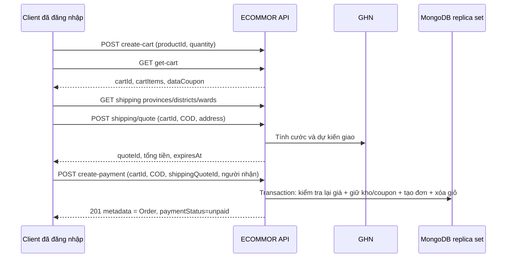
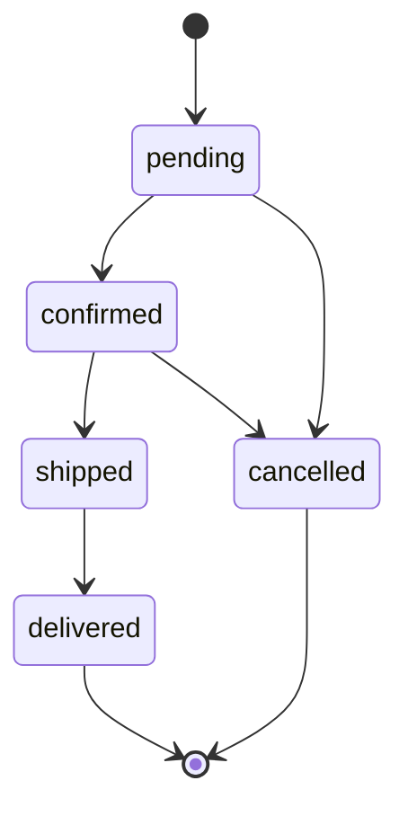

# Luồng sử dụng API

Các bước sau là hướng dẫn cho môi trường thử, không phải chuỗi request đã chạy trên DB cửa hàng. Tất cả ID lấy từ phản hồi trước đó; cookie jar phải giữ cùng host. Với Postman, gọi từng request tương ứng trong collection rồi cập nhật biến environment.

## 1. Đăng ký và đăng nhập

1. `POST /api/register`: gửi `fullName`, `email`, `password`, `phone`, `address`. Server lưu đăng ký chờ OTP, chưa tạo user chính thức.
2. Lấy OTP từ hộp thư thử; `POST /api/verify-email` với `email`, `otp` string 6 chữ số. OTP có hạn 10 phút, giới hạn số lần thử; dùng lại mã đã tiêu thụ không hợp lệ.
3. `POST /api/login` với `email`, `password`. Giữ cookie `token`/`refreshToken`/`logged`. Login không yêu cầu field `emailVerified` cho tài khoản legacy.
4. `GET /api/auth` để đọc `metadata.auth`; kiểm tra `isAdmin` khi cần vào nhóm quản trị. Đổi quyền ở UI không thay được quyền server.
5. Access cookie hết hạn: `GET /api/refresh-token` bằng refresh cookie, sau đó thử lại request một lần nếu refresh thành công. Không lặp refresh vô hạn; refresh không hợp lệ cần đăng nhập lại.
6. `GET /api/logout` clear cookie và thu hồi khóa phiên hiện tại nếu xác minh được token.

Đăng nhập Google dùng `POST /api/login-google` với `credential` là **ID token** do Google SDK cấp cho đúng client ID, không phải email tự khai hay access token tùy ý. Server verify token rồi phát phiên giống login thường.

Nguồn: `server/src/controllers/users.controller.js:92`, `:139`, `:184`, `:203`, `:500`; `server/src/services/otp.service.js:4`.

## 2. Quên mật khẩu

1. `POST /api/forgot-password` với email. HTTP 202 là thông báo chung, không xác nhận email có tồn tại hay thư đã được chuyển phát.
2. `POST /api/verify-reset-password` với email và OTP hợp lệ. Server đặt `tokenResetPassword` sống 5 phút; phải giữ cookie.
3. `POST /api/reset-password` với `password`, `confirmPassword` giống nhau. Không truyền userId/email để chọn tài khoản; server lấy chủ từ cookie proof.
4. Sau thành công, cookie proof bị clear. Đăng nhập bằng mật khẩu mới. Trong Postman cập nhật biến `password` trước khi gọi reset/login mới.

Không có endpoint trả OTP ra response. Tài liệu/collection không tạo mã thật hoặc tự đọc hộp thư.

## 3. Chuẩn bị catalog cho bài thử mua hàng

1. Dùng tài khoản admin đã được chuẩn bị trong môi trường thử; không có API tự đăng ký admin.
2. Đọc danh mục bằng `GET /api/get-all-category`, thương hiệu bằng `GET /api/brands`; upload ảnh fixture qua `POST /api/upload-image` (`images`, multipart).
3. Tạo sản phẩm bằng `POST /api/create-product` với toàn bộ field bắt buộc trong `ProductCreate`. Ví dụ mặc định là preview/demo, stock=0, không thể mua.
4. Chỉ với fixture riêng phục vụ kiểm thử, admin cập nhật các dữ liệu đã kiểm tra: `publicationStatus=published`, `verificationStatus=verified`, `verificationNote` có căn cứ công khai và `stock>0`. Không dùng thao tác này để tự xác minh hàng loạt dữ liệu cửa hàng.
5. Ghi `shippingPackage` thực tế nếu có: weight gram, length/width/height cm, đều số nguyên. Nếu thiếu, server dùng ước lượng đóng gói theo sản phẩm; đây không phải trọng lượng nhà sản xuất.

Xem tham khảo không đồng nghĩa được mua. Catalog có thể trả preview/legacy; frontend vẫn cần đọc các cờ. Server là nơi quyết định quyền bán khi thêm giỏ và checkout.

## 4. Mua COD



Các path trong sơ đồ có prefix `/api/`. Thực hiện theo thứ tự:

1. `POST /api/create-cart`: `productId`, `quantity`. Nếu đã có dòng sẽ **cộng** quantity; muốn thay số lượng dùng `/api/update-product-cart`.
2. `GET /api/get-cart`: lưu `metadata.cartId`. Nếu không có cartId, giỏ đang trống. Chọn tối đa một coupon từ `metadata.dataCoupon`; lấy `_id` làm `nameCoupon`, không dùng chuỗi tên mã.
3. `GET /api/shipping/provinces`, rồi `/districts?provinceId=...`, `/wards?districtId=...`; `wardCode` là string.
4. `POST /api/shipping/quote`:

```json
{
  "cartId": "507f1f77bcf86cd799439013",
  "method": "COD",
  "address": {
    "provinceId": 1,
    "districtId": 1,
    "wardCode": "<MA_PHUONG_THU>",
    "street": "Địa chỉ thử nghiệm"
  }
}
```

ID/mã địa phương trên chỉ minh họa; thay bằng dữ liệu API trả về. Nếu dùng coupon, thêm `nameCoupon` cùng ID sẽ gửi khi checkout. Quote sống **10 phút** và có `subtotal`, `couponDiscount`, `grossFee`, `support`, `customerFee`, `totalPrice`, `expiresAt`, `quoteId`.

5. Cho người mua xem tổng tiền rồi `POST /api/create-payment`:

```json
{
  "cartId": "507f1f77bcf86cd799439013",
  "typePayment": "COD",
  "shippingQuoteId": "507f1f77bcf86cd799439014",
  "fullName": "Nguyễn Văn An",
  "phone": "0900000000",
  "address": "Địa chỉ thử nghiệm",
  "note": "Đơn fixture"
}
```

`address` là phần số nhà/tên đường, phải khớp `street` trong quote; server ghép địa phương thành địa chỉ snapshot. Có coupon thì gửi cùng ID; bỏ coupon ở checkout làm fingerprint khác và cần quote mới. Không gửi giá/tổng tiền từ client làm nguồn tính.

6. Thành công HTTP 201, `metadata` là Order; lấy `_id` làm `orderId`. COD ban đầu `paymentStatus=unpaid`, `status=pending`. `GET /api/get-order-user` đọc lịch sử; `/api/get-payment-success?idPayment=...` đọc chi tiết bất kể tên route có chữ success.

Nếu giá/số lượng/coupon/địa chỉ/kiện thay đổi hoặc quote hết hạn, lấy quote mới và xác nhận lại. Gửi lại checkout cùng cartId đã commit trả đơn cũ trong trường hợp hợp lệ, không giữ kho lần hai. Các POST khác không tự có tính chất này.

Nguồn: `server/src/services/shipping.service.js:75`, `:87`; `server/src/services/vnpay.service.js:172`; `server/test/checkout-request.test.cjs:22`, `:72`.

## 5. VNPay sandbox

Giống COD nhưng quote dùng `method=VNPAY`, checkout dùng `typePayment=VNPAY`; quote COD không dùng cho VNPay. Hỗ trợ phí hiện tại là `ceil(grossFee/2)` cho VNPay, không phải tùy ý truyền từ client.

1. Checkout trả 201, `metadata` là URL string. Client điều hướng trình duyệt đến URL này. Tiền VNPay gửi/nhận dùng VND×100.
2. Nhà cung cấp gọi **IPN** `/api/vnpay-ipn` với tham số và chữ ký hợp lệ. Server kiểm tra signature, mã đơn/attempt, tiền và cả hai status trước khi ghi paid.
3. **Return URL** `/api/vnpay-return` chỉ kiểm tra rồi redirect về trang đơn. Frontend đọc trạng thái đơn từ server, không đánh dấu thành công chỉ vì query Return có mã 00.
4. Nếu chưa rõ kết quả, chủ đơn gọi `POST /api/reconcile-payment-vnpay` với `idOrder`. Đọc `paymentStatus`, `nextCheckAt`; server có lease 5 phút chống query dồn.
5. Chỉ khi đủ điều kiện, `POST /api/retry-payment-vnpay` lấy URL cũ còn hạn hoặc tạo attempt mới sau failed/expired. Không đổi giá snapshot của đơn cũ bằng giá sản phẩm hiện tại.

| paymentStatus | Ý nghĩa xử lý |
| --- | --- |
| pending | Chờ xác minh; chưa giao hàng như đơn đã paid |
| paid | Đã được nguồn server xác minh ghi nhận |
| failed | Lần thanh toán thất bại, đã giải phóng nguồn lực theo nhánh xử lý |
| expired | Đã hết hạn, hoàn giữ kho/coupon một lần; có thể đủ điều kiện thử lại |
| refund_required | Có khoản trả về muộn/xung đột cần đối soát hoàn; không mở lại đơn, không phải đã hoàn tiền |

Giao dịch pending hết hạn dự kiến sau **15 phút**, worker backend kiểm tra mỗi 30 giây khi DB sẵn sàng; đây không phải cam kết cron chạy ở mọi môi trường. Late success được lưu để xử lý khoản tiền, không tự trừ kho/mở lại đơn đã hủy.

Không có endpoint “set paid” cho frontend, không có API hoàn tiền hoàn tất trong source hiện tại. Không dùng callback MoMo legacy trong workflow này.

Nguồn: `server/src/services/vnpay.service.js:17`, `:211`, `:233`, `:271`, `:305`, `:323`; `server/src/server.js:26`.

## 6. Admin xác nhận, tạo vận đơn và giao hàng

1. `GET /api/get-order-admin` xem đơn và paymentAttempts. Với VNPay, phải paid trước xác nhận/giao.
2. `POST /api/update-order-status` body `{ "idOrder": "...", "status": "confirmed" }`.
3. `POST /api/shipping/admin/orders/{id}/preview`, body `{}` hoặc `{ "parcel": { "weight": 750, "length": 20, "width": 16, "height": 12 } }`. Đọc `grossFee` hiện tại.
4. Sau xác nhận phí, `POST .../{id}/create` với `expectedFee` đúng giá preview và cùng `parcel` nếu vừa đổi kiện. Đây là bước **tạo vận đơn thật tại môi trường GHN đang cấu hình**; preview chưa tạo vận đơn.
5. Nếu kết quả creating/unknown hoặc lỗi sau GHN thành công, dùng `POST .../{id}/sync` trước khi thử tạo lại. Server có thể tìm theo `client_order_code` để khôi phục.
6. Dùng mã vận đơn và cập nhật `shipped`, sau đó `delivered` theo nghiệp vụ. Sync cập nhật `shipment`; không tự đồng nhất mọi status GHN với status đơn. COD delivered được đánh dấu paid theo hành vi code hiện tại.

Chuyển trạng thái hợp lệ:



Khách chỉ yêu cầu hủy từ pending, thêm điều kiện thanh toán/vận đơn. Admin không tự vượt các quy tắc này. Đơn có vận đơn hoạt động/chưa rõ phải hủy tại GHN và đồng bộ kết quả trước khi hủy đơn/hoàn tồn. **Chưa có HTTP API hủy vận đơn GHN trong project.** Không trừ tồn lần nữa khi shipped/delivered vì tồn đã được trừ khi giữ lúc checkout.

## 7. Sổ địa chỉ, yêu thích và bộ lọc

1. `GET /api/preferences` lấy ba mảng hiện tại.
2. `PATCH /api/preferences` chỉ gửi mảng cần đổi. Ví dụ `{ "wishlist": ["..."] }` **thay toàn bộ wishlist**, không tự append; đọc/ghép ở client trước khi gửi.
3. Sổ địa chỉ có tối đa 8 mục, đủ label/fullName/phone/address/provinceId/districtId/wardCode. Backend lấy chủ từ session, bỏ qua cơ chế chọn chủ bằng ID client.
4. Saved search tối đa 10 đường dẫn nội bộ `/category/...`; không nhận external URL. Wishlist tối đa 100 ID.
5. Tra cứu shelf dùng `GET /api/catalog-browse?ids=id1,id2,...`, tối đa 20 ID mỗi lần. Danh sách gần đây và so sánh đang lưu localStorage ở frontend, **không có API đồng bộ riêng**.

## 8. Đặt hàng theo yêu cầu

1. Admin chỉ bật `published`, `allowPreorder=true`, `stock<=0` cho sản phẩm được nhận yêu cầu; không suy ra preorder chỉ từ hết hàng.
2. Khách đăng nhập, `POST /api/preorders` với productId, quantity 1–10, fullName, phone Việt Nam, `consent=true`; email/address/note tùy chọn. Server chụp giá DB.
3. Khách `GET /api/preorders/mine`; admin `GET /api/preorders` với page/limit/status.
4. Admin `PATCH /api/preorders/{id}/status` với contacted/confirmed/cancelled và note. Ghi chú hiển thị cho khách; không nhập ghi chú nội bộ vào đây.

`pending→contacted/confirmed/cancelled`, `contacted→confirmed/cancelled`; các trạng thái cuối không mở lại. Chưa thu tiền, giữ kho hoặc tạo đơn bán. **Preorder không phải hậu mãi/đổi trả.**

## 9. Đánh giá từ đơn đã mua

1. Khách có đơn của mình `status=delivered`, `paymentStatus=paid` và có sản phẩm muốn đánh giá.
2. `POST /api/create-preview-product` với productId/content/rating 1–5. Field chủ và bằng chứng đơn lấy server; review mới pending, trùng có thể 409.
3. Admin `GET /api/reviews/moderation`, rồi `PATCH /api/reviews/{id}/status` với approved/rejected.
4. Public `GET /api/reviews?productId=...&page=1`. Lọc sản phẩm trước limit 10; chỉ có nhãn verifiedPurchase khi có orderId làm bằng chứng. Review legacy thiếu moderationStatus vẫn có thể hiển thị theo code hiện tại.

## 10. Đọc chatbot và tin nhắn nhân viên

Gemini: đăng nhập rồi `POST /api/chatbot` với question, history tùy chọn. Response metadata là text, không HTML hay stream. Các giới hạn/lỗi AI tách khỏi checkout; không dùng câu trả lời AI làm bằng chứng giá/tồn hoặc paid.

Hỗ trợ nhân viên: gửi qua `/api/message/create` hoặc `/create-admin`, đọc qua các GET tương ứng; nhận thông báo bằng Socket.IO. Xem [hợp đồng realtime](realtime.md). Không có endpoint tạo ticket hậu mãi gắn dòng hàng.
