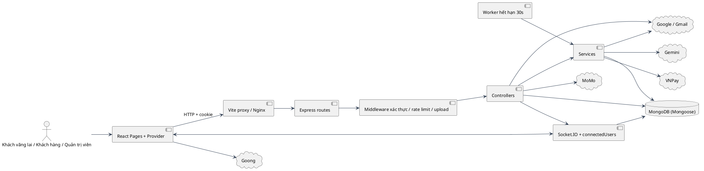

# 00 — Tổng quan hệ thống ECOMMOR (as-is)

## Phạm vi và phương pháp

Snapshot working tree ngày 21/10/2026, gồm file untracked có trước nhiệm vụ. Các commit tài liệu không chứa code ứng dụng làm nguồn; muốn tái dựng snapshot phải giữ cả thay đổi có trước. Chỉ đọc tĩnh: đọc hiểu → đặt giả thuyết → lần theo route/controller/service/model/client → ghi nhận. Không chạy backend, mail, thanh toán hoặc DB. Các tên collection bên dưới là suy ra từ tên đăng ký Mongoose; collection vật lý cần xác minh từ DB, không truy cập trong nhiệm vụ.

## Cây file thực tế

Danh sách đầy đủ file dưới server/client, bỏ node_modules, dist, .git và nội dung .env. Upload và assets chỉ kiểm kê tên file; không suy diễn dữ liệu từ ảnh.

```text
server/.DS_Store
server/.env
server/.gitignore
server/Dockerfile
server/package-lock.json
server/package.json
server/scripts/check-vnpay-connectivity.cjs
server/scripts/check-vnpay-status.cjs
server/scripts/import-luxurytime-catalog.cjs
server/scripts/luxurytime-mapping.cjs
server/scripts/mail-check.js
server/scripts/verify-checkout-live.cjs
server/src/auth/checkAuth.js
server/src/config/connectDB.js
server/src/config/cors.js
server/src/config/vnpay.js
server/src/controllers/blog.controller.js
server/src/controllers/cartUser.controller.js
server/src/controllers/category.controller.js
server/src/controllers/coupon.controller.js
server/src/controllers/message.controller.js
server/src/controllers/payments.controller.js
server/src/controllers/previewProduct.controller.js
server/src/controllers/products.controller.js
server/src/controllers/users.controller.js
server/src/core/error.response.js
server/src/core/reasonPhrases.js
server/src/core/statusCodes.js
server/src/core/success.response.js
server/src/models/apiKey.model.js
server/src/models/blog.model.js
server/src/models/brand.model.js
server/src/models/cartUser.model.js
server/src/models/category.model.js
server/src/models/coupon.model.js
server/src/models/message.model.js
server/src/models/otp.model.js
server/src/models/paymentAttempt.model.js
server/src/models/payments.model.js
server/src/models/previewProduct.model.js
server/src/models/products.model.js
server/src/models/users.model.js
server/src/routes/blog.routes.js
server/src/routes/brand.routes.js
server/src/routes/cartUser.routes.js
server/src/routes/category.routes.js
server/src/routes/coupon.routes.js
server/src/routes/index.js
server/src/routes/message.routes.js
server/src/routes/payments.route.js
server/src/routes/previewProduct.routes.js
server/src/routes/products.routes.js
server/src/routes/users.routes.js
server/src/server.js
server/src/services/brand.service.js
server/src/services/catalog-browse.service.js
server/src/services/mail.service.js
server/src/services/otp.service.js
server/src/services/product-catalog.service.js
server/src/services/tokenSevices.js
server/src/services/vnpay-query.service.js
server/src/services/vnpay.service.js
server/src/socket.js
server/src/uploads/.DS_Store
server/src/uploads/blogs/1754111675412.png
server/src/uploads/blogs/1754642369658.png
server/src/uploads/blogs/1754643785955.avif
server/src/uploads/blogs/1790977126141.png
server/src/uploads/products/.DS_Store
server/src/uploads/products/1754109346045.avif
server/src/uploads/products/1754109346046.avif
server/src/uploads/products/1754109504582.avif
server/src/uploads/products/1754109570792.avif
server/src/uploads/products/1754109570793.avif
server/src/uploads/products/1754109649535.avif
server/src/uploads/products/1754109649536.avif
server/src/uploads/products/1754109747490.avif
server/src/uploads/products/1754109747491.avif
server/src/uploads/products/1754109953996.avif
server/src/uploads/products/1754109953997.avif
server/src/uploads/products/1754110038786.avif
server/src/uploads/products/1754110111007.avif
server/src/uploads/products/1754110111008.avif
server/src/uploads/products/1754111606688.png
server/src/utils/chatbot.js
server/src/utils/SendMail/sendMailForgotPassword.js
server/test/brand-management.test.cjs
server/test/cartUser.test.js
server/test/catalog-browse.test.cjs
server/test/checkout-request.test.cjs
server/test/dev-return.test.cjs
server/test/legacy-login.test.js
server/test/logout-cookie.test.cjs
server/test/luxurytime-mapping.test.cjs
server/test/mongo-options.test.cjs
server/test/origins.test.cjs
server/test/otp.controller.test.js
server/test/otp.service.test.js
server/test/product-catalog.test.cjs
server/test/socket-auth.test.cjs
server/test/vnpay-connectivity.test.cjs
server/test/vnpay-reconcile.test.cjs
server/test/vnpay-status-check.test.cjs
server/test/vnpay.test.js
client/.DS_Store
client/.env
client/.gitignore
client/Dockerfile
client/eslint.config.js
client/index.html
client/package-lock.json
client/package.json
client/public/favicon.webp
client/public/icons/exchange.svg
client/public/icons/shipping.svg
client/public/icons/warranty.svg
client/README.md
client/src/App.css
client/src/App.jsx
client/src/assets/images/img1.jpg
client/src/assets/images/logo.webp
client/src/Components/CardBody/CardBody.jsx
client/src/Components/CardBody/CardBody.module.scss
client/src/Components/Footer/Footer.jsx
client/src/Components/Footer/Footer.module.scss
client/src/Components/Header/Header.jsx
client/src/Components/Header/Header.module.scss
client/src/Components/HomePage/Blog/Blog.jsx
client/src/Components/HomePage/HomePage.jsx
client/src/Components/HomePage/HomePage.module.scss
client/src/Components/HomePage/ProductByCategory/ProductByCategory.jsx
client/src/Components/HomePage/ProductNew/CatalogSection.jsx
client/src/Components/HomePage/ProductNew/ProductNew.jsx
client/src/Components/HomePage/ProductNew/ProductNew.module.scss
client/src/Components/HomePage/Slide/Slide.jsx
client/src/Components/HomePage/Slide/Slide.module.scss
client/src/Components/Loading/Loading.jsx
client/src/Components/Loading/Loading.module.scss
client/src/Components/Messger/Messger.jsx
client/src/config/apiBaseUrl.js
client/src/config/axiosClient.jsx
client/src/config/contactInfo.js
client/src/config/request.jsx
client/src/config/runtimeUrls.js
client/src/hooks/useDebounce.jsx
client/src/hooks/useFetch.jsx
client/src/hooks/useProductCatalog.js
client/src/hooks/userStore.jsx
client/src/main.jsx
client/src/Pages/Admin/Components/ManagerBlog/BlogAdmin.jsx
client/src/Pages/Admin/Components/ManagerCategory/ManagerCategory.jsx
client/src/Pages/Admin/Components/ManagerCategory/ManagerCategory.module.scss
client/src/Pages/Admin/Components/ManagerCoupon/CouponManagement.jsx
client/src/Pages/Admin/Components/ManagerCoupon/CouponManagement.module.scss
client/src/Pages/Admin/Components/ManagerOrder/ManagerOrder.jsx
client/src/Pages/Admin/Components/ManagerOrder/ManagerOrder.module.scss
client/src/Pages/Admin/Components/ManagerProduct/ManagerProduct.jsx
client/src/Pages/Admin/Components/ManagerProduct/ManagerProduct.module.scss
client/src/Pages/Admin/Components/ManagerStatistical/ManagerStatistical.jsx
client/src/Pages/Admin/Components/ManagerStatistical/ManagerStatistical.module.scss
client/src/Pages/Admin/Components/ManagerUser/ManagerUser.jsx
client/src/Pages/Admin/Components/ManagerUser/ManagerUser.module.scss
client/src/Pages/Admin/Components/Messager/components/ChatWindow.jsx
client/src/Pages/Admin/Components/Messager/components/UserSidebar.jsx
client/src/Pages/Admin/Components/Messager/Messager.jsx
client/src/Pages/Admin/index.jsx
client/src/Pages/Admin/index.module.scss
client/src/Pages/Blogs/Blogs.jsx
client/src/Pages/Cart/CartUser.jsx
client/src/Pages/Cart/CartUser.module.scss
client/src/Pages/Category/Category.jsx
client/src/Pages/Category/Category.module.scss
client/src/Pages/CheckOut/CheckOut.jsx
client/src/Pages/CheckOut/CheckOut.module.scss
client/src/Pages/Contact/Contact.jsx
client/src/Pages/Contact/Contact.module.scss
client/src/Pages/DetailBlog/DetailBlog.jsx
client/src/Pages/DetailProduct/DetailProduct.jsx
client/src/Pages/DetailProduct/DetailProduct.module.scss
client/src/Pages/ForgotPassword/ForgotPassword.jsx
client/src/Pages/ForgotPassword/ForgotPassword.module.scss
client/src/Pages/InfoUser/InfoUser.jsx
client/src/Pages/InfoUser/InfoUser.module.scss
client/src/Pages/InfoUser/OrderUser/OrderUser.jsx
client/src/Pages/InfoUser/OrderUser/OrderUser.module.scss
client/src/Pages/LoginUser/LoginUser.jsx
client/src/Pages/LoginUser/LoginUser.module.scss
client/src/Pages/PaymentSuccess/PaymentSuccess.jsx
client/src/Pages/PaymentSuccess/PaymentSuccess.module.scss
client/src/Pages/Register/Register.jsx
client/src/Pages/Register/Register.module.scss
client/src/Routes/index.jsx
client/src/Routes/routes.jsx
client/src/store/Context.jsx
client/src/store/Provider.jsx
client/src/utils/Chatbot/Chatbot.jsx
client/test/apiBaseUrl.test.mjs
client/test/dev-proxy.test.mjs
client/test/tunnel-origin.test.mjs
client/test/vite-cors.test.mjs
client/vite.config.js
```

## Công nghệ và scripts

| Tầng | Scripts thực tế | Dependencies khai báo (range, không phải bản đã resolve) | Nguồn |
| --- | --- | --- | --- |
| server | dev: `nodemon src/server.js`, test: `node --test test`, mail:check: `node scripts/mail-check.js` | @google/generative-ai ^0.24.1, axios ^1.8.3, bcrypt ^5.1.1, bcryptjs ^3.0.3, body-parser ^1.20.3, cloudinary ^2.6.0, config ^3.3.12, cookie-parser ^1.4.7, cors ^2.8.5, crypto-js ^4.2.0, dateformat ^5.0.3, dayjs ^1.11.13, dotenv ^16.4.7, express ^4.21.2, express-rate-limit ^7.5.0, googleapis ^146.0.0, jsonwebtoken ^9.0.2, jwt-decode ^4.0.0, moment ^2.30.1, mongoose ^8.12.1, multer ^1.4.5-lts.1, nodemailer ^6.10.0, nodemon ^3.1.9, otp-generator ^4.0.1, querystring ^0.2.1, socket.io ^4.8.1, vnpay ^2.2.0 | `server/package.json:1` |
| client | dev: `vite`, build: `vite build`, lint: `eslint .`, preview: `vite preview` | @ant-design/compatible ^5.1.4, @ant-design/plots ^2.3.3, @fortawesome/fontawesome-svg-core ^6.5.2, @fortawesome/free-brands-svg-icons ^6.0.0, @fortawesome/free-regular-svg-icons ^6.5.2, @fortawesome/free-solid-svg-icons ^6.0.0, @fortawesome/react-fontawesome ^0.2.1, @react-oauth/google ^0.12.1, @tailwindcss/vite ^4.1.11, @tinymce/tinymce-react ^6.1.0, antd ^5.24.7, axios ^1.8.4, classnames ^2.5.1, crypto-js ^4.2.0, dayjs ^1.11.13, js-cookie ^3.0.5, lucide-react ^0.536.0, react 18.3.1, react-dom 18.3.1, react-router-dom ^7.5.1, react-slick ^0.30.3, sass ^1.86.3, slick-carousel ^1.8.1, socket.io-client ^4.8.1, tailwindcss ^4.1.11 | `client/package.json:1` |

Backend CommonJS: Express 4, Mongoose 8, RSA JWT, bcrypt, Socket.IO. Frontend ES modules: React 18, React Router, Vite, Ant Design, SCSS/Tailwind, TinyMCE. Không suy ra tất cả dependency được dùng chỉ từ package.json.

## Hạ tầng

Compose có mongodb replica set `rs0` với healthcheck khởi tạo; backend nạp env_file, ghi đè CONNECT_DB/TRUST_PROXY, bind cổng host loopback; nginx phục vụ `client/dist`, proxy `/api/` và `/uploads/`; ollama là profile tùy chọn, không thấy backend gọi nó. Volume MongoDB external phải có sẵn. Backend image và compose chạy npm dev; compose còn npm install lúc khởi động. Dockerfile client chạy build trước COPY source. Nginx chưa có location `/socket.io/`. Nguồn: `docker-compose.yaml:1`, `server/Dockerfile:1`, `client/Dockerfile:1`, `nginx/default.conf:1`. Các bất thường được phân loại riêng trong 05.

Vite dev bind loopback, port cố định, whitelist tunnel hostname và proxy `/api`, `/uploads`, `/socket.io` (ws). runtimeUrls chọn same-origin khi dev proxy, configured URL cho mode còn lại; uploadUrl tránh lặp `/uploads`. Nguồn: `client/vite.config.js:1`, `client/src/config/apiBaseUrl.js:1`, `client/src/config/runtimeUrls.js:1`. CORS server và socket dùng cùng getCorsOptions: whitelist DOMAIN_URL, CLIENT_URL, CLIENT_ORIGINS, dev bổ sung origin callback hợp lệ; credentials=true. Nguồn: `server/src/config/cors.js:getAllowedOrigins`, `server/src/socket.js:initSocket`.

## Danh sách đầy đủ endpoint backend

Đếm theo method + effective path, gộp đăng ký GET /api/users bị lặp trong routes/index.js. Các router root dùng app.METHOD(path, router) rồi router.METHOD cùng path: Express giữ nguyên URL cho route middleware; không nối lặp `/api`. Blog/message/brands dùng app.use(prefix). Static middleware chạy trước routes và phục vụ toàn bộ server/src (xem Phát hiện 05). Mọi API đều qua bodyParser, CORS, static và cookieParser; error middleware cuối pipeline. Nguồn: `server/src/routes/index.js:routes`, `server/src/server.js:1`.

| Method | Effective path | Middleware theo thứ tự | Handler | Models trực tiếp / liên quan module | Nguồn |
| --- | --- | --- | --- | --- | --- |
| POST | /api/blog/upload-image | upload.single(image) | inline | Xem service/luồng | `server/src/routes/blog.routes.js:22`; `server/src/routes/blog.routes.js` |
| POST | /api/blog/create | authAdmin | controllerBlog.createBlog | blog.model | `server/src/routes/blog.routes.js:23`; `server/src/controllers/blog.controller.js` |
| GET | /api/blog/get-all | Không middleware riêng | controllerBlog.getAllBlog | blog.model | `server/src/routes/blog.routes.js:24`; `server/src/controllers/blog.controller.js` |
| POST | /api/blog/update | authAdmin | controllerBlog.updateBlog | blog.model | `server/src/routes/blog.routes.js:25`; `server/src/controllers/blog.controller.js` |
| POST | /api/blog/delete | authAdmin | controllerBlog.deleteBlog | blog.model | `server/src/routes/blog.routes.js:26`; `server/src/controllers/blog.controller.js` |
| GET | /api/blog/get-by-id | Không middleware riêng | controllerBlog.getBlogById | blog.model | `server/src/routes/blog.routes.js:27`; `server/src/controllers/blog.controller.js` |
| GET | /api/brands | authAdmin, asyncHandler | service.list | brand.model, products.model | `server/src/routes/brand.routes.js:8`; `server/src/services/brand.service.js` |
| POST | /api/create-cart | authUser, asyncHandler | controllerCartUser.addToCart | cartUser.model, products.model, coupon.model | `server/src/routes/cartUser.routes.js:8`; `server/src/controllers/cartUser.controller.js` |
| GET | /api/get-cart | authUser, asyncHandler | controllerCartUser.getCart | cartUser.model, products.model, coupon.model | `server/src/routes/cartUser.routes.js:9`; `server/src/controllers/cartUser.controller.js` |
| POST | /api/delete-product-cart | authUser, asyncHandler | controllerCartUser.deleteProductCart | cartUser.model, products.model, coupon.model | `server/src/routes/cartUser.routes.js:10`; `server/src/controllers/cartUser.controller.js` |
| POST | /api/update-product-cart | authUser, asyncHandler | controllerCartUser.updateProductCart | cartUser.model, products.model, coupon.model | `server/src/routes/cartUser.routes.js:11`; `server/src/controllers/cartUser.controller.js` |
| POST | /api/update-info-cart | authUser, asyncHandler | controllerCartUser.updateInfoCart | cartUser.model, products.model, coupon.model | `server/src/routes/cartUser.routes.js:12`; `server/src/controllers/cartUser.controller.js` |
| POST | /api/create-category | authAdmin, asyncHandler | controllerCategory.createCategory | category.model, products.model | `server/src/routes/category.routes.js:8`; `server/src/controllers/category.controller.js` |
| GET | /api/get-all-category | asyncHandler | controllerCategory.getAllCategory | category.model, products.model | `server/src/routes/category.routes.js:9`; `server/src/controllers/category.controller.js` |
| POST | /api/update-category | authAdmin, asyncHandler | controllerCategory.updateCategory | category.model, products.model | `server/src/routes/category.routes.js:10`; `server/src/controllers/category.controller.js` |
| DELETE | /api/delete-category | authAdmin, asyncHandler | controllerCategory.deleteCategory | category.model, products.model | `server/src/routes/category.routes.js:11`; `server/src/controllers/category.controller.js` |
| POST | /api/create-coupon | authAdmin, asyncHandler | controllerCoupon.createCoupon | coupon.model, cartUser.model, products.model | `server/src/routes/coupon.routes.js:8`; `server/src/controllers/coupon.controller.js` |
| GET | /api/coupon | asyncHandler | controllerCoupon.getCoupons | coupon.model, cartUser.model, products.model | `server/src/routes/coupon.routes.js:9`; `server/src/controllers/coupon.controller.js` |
| GET | /api/coupons | asyncHandler | controllerCoupon.getAllCoupon | coupon.model, cartUser.model, products.model | `server/src/routes/coupon.routes.js:10`; `server/src/controllers/coupon.controller.js` |
| DELETE | /api/delete-coupon | authAdmin, asyncHandler | controllerCoupon.deleteCoupon | coupon.model, cartUser.model, products.model | `server/src/routes/coupon.routes.js:11`; `server/src/controllers/coupon.controller.js` |
| POST | /api/update-coupon | authAdmin, asyncHandler | controllerCoupon.updateCoupon | coupon.model, cartUser.model, products.model | `server/src/routes/coupon.routes.js:12`; `server/src/controllers/coupon.controller.js` |
| POST | /api/message/create | authUser, asyncHandler | messageController.createMessage | users.model, message.model | `server/src/routes/message.routes.js:8`; `server/src/controllers/message.controller.js` |
| POST | /api/message/create-admin | authAdmin, asyncHandler | messageController.createMessageAdmin | users.model, message.model | `server/src/routes/message.routes.js:9`; `server/src/controllers/message.controller.js` |
| GET | /api/message/all | authAdmin, asyncHandler | messageController.getAllUserMessage | users.model, message.model | `server/src/routes/message.routes.js:11`; `server/src/controllers/message.controller.js` |
| GET | /api/message/get-message | authAdmin, asyncHandler | messageController.getMessage | users.model, message.model | `server/src/routes/message.routes.js:12`; `server/src/controllers/message.controller.js` |
| GET | /api/message/get-message-user | authUser, asyncHandler | messageController.getMessageUser | users.model, message.model | `server/src/routes/message.routes.js:13`; `server/src/controllers/message.controller.js` |
| GET | /api/message/read-message | authUser, asyncHandler | messageController.readMessage | users.model, message.model | `server/src/routes/message.routes.js:14`; `server/src/controllers/message.controller.js` |
| POST | /api/create-payment | authUser, asyncHandler | controllerPayments.createPayment | payments.model, cartUser.model, products.model, coupon.model, paymentAttempt.model, paymentAttempt.model | `server/src/routes/payments.route.js:7`; `server/src/controllers/payments.controller.js` |
| GET | /api/check-payment-vnpay | asyncHandler | controllerPayments.checkPaymentVnpay | payments.model, cartUser.model, products.model, coupon.model, paymentAttempt.model, paymentAttempt.model | `server/src/routes/payments.route.js:8`; `server/src/controllers/payments.controller.js` |
| GET | /api/vnpay-return | asyncHandler | controllerPayments.checkPaymentVnpay | payments.model, cartUser.model, products.model, coupon.model, paymentAttempt.model, paymentAttempt.model | `server/src/routes/payments.route.js:9`; `server/src/controllers/payments.controller.js` |
| GET | /api/vnpay-ipn | Không middleware riêng | controllerPayments.ipnVnpay | payments.model, cartUser.model, products.model, coupon.model, paymentAttempt.model, paymentAttempt.model | `server/src/routes/payments.route.js:10`; `server/src/controllers/payments.controller.js` |
| POST | /api/retry-payment-vnpay | authUser, asyncHandler | controllerPayments.retryVnpay | payments.model, cartUser.model, products.model, coupon.model, paymentAttempt.model, paymentAttempt.model | `server/src/routes/payments.route.js:11`; `server/src/controllers/payments.controller.js` |
| POST | /api/reconcile-payment-vnpay | authUser, asyncHandler | controllerPayments.reconcileVnpay | payments.model, cartUser.model, products.model, coupon.model, paymentAttempt.model, paymentAttempt.model | `server/src/routes/payments.route.js:12`; `server/src/controllers/payments.controller.js` |
| GET | /api/check-payment-momo | asyncHandler | controllerPayments.checkPaymentMomo | payments.model, cartUser.model, products.model, coupon.model, paymentAttempt.model, paymentAttempt.model | `server/src/routes/payments.route.js:13`; `server/src/controllers/payments.controller.js` |
| GET | /api/get-payment-success | authUser, asyncHandler | controllerPayments.getPaymentSuccess | payments.model, cartUser.model, products.model, coupon.model, paymentAttempt.model, paymentAttempt.model | `server/src/routes/payments.route.js:14`; `server/src/controllers/payments.controller.js` |
| GET | /api/get-order-user | authUser, asyncHandler | controllerPayments.getOrderUser | payments.model, cartUser.model, products.model, coupon.model, paymentAttempt.model, paymentAttempt.model | `server/src/routes/payments.route.js:15`; `server/src/controllers/payments.controller.js` |
| POST | /api/cancel-order | authUser, asyncHandler | controllerPayments.cancelOrder | payments.model, cartUser.model, products.model, coupon.model, paymentAttempt.model, paymentAttempt.model | `server/src/routes/payments.route.js:16`; `server/src/controllers/payments.controller.js` |
| GET | /api/get-order-admin | authAdmin, asyncHandler | controllerPayments.getOrderAdmin | payments.model, cartUser.model, products.model, coupon.model, paymentAttempt.model, paymentAttempt.model | `server/src/routes/payments.route.js:17`; `server/src/controllers/payments.controller.js` |
| POST | /api/update-order-status | authAdmin, asyncHandler | controllerPayments.updateOrderStatus | payments.model, cartUser.model, products.model, coupon.model, paymentAttempt.model, paymentAttempt.model | `server/src/routes/payments.route.js:18`; `server/src/controllers/payments.controller.js` |
| POST | /api/create-preview-product | authAdmin, asyncHandler | controllerPreviewProduct.createPreviewProduct | previewProduct.model, products.model, users.model | `server/src/routes/previewProduct.routes.js:8`; `server/src/controllers/previewProduct.controller.js` |
| GET | /api/get-preview-product-home | asyncHandler | controllerPreviewProduct.getPreviewProductHome | previewProduct.model, products.model, users.model | `server/src/routes/previewProduct.routes.js:9`; `server/src/controllers/previewProduct.controller.js` |
| POST | /api/create-product | authAdmin, asyncHandler | controllerProducts.createProduct | products.model, category.model, previewProduct.model, users.model, coupon.model | `server/src/routes/products.routes.js:8`; `server/src/controllers/products.controller.js` |
| GET | /api/get-product-new | asyncHandler | controllerProducts.getProductNew | products.model, category.model, previewProduct.model, users.model, coupon.model | `server/src/routes/products.routes.js:9`; `server/src/controllers/products.controller.js` |
| GET | /api/product-catalog | asyncHandler | controllerProducts.getProductCatalog | products.model, category.model, previewProduct.model, users.model, coupon.model | `server/src/routes/products.routes.js:10`; `server/src/controllers/products.controller.js` |
| GET | /api/catalog-options | asyncHandler | controllerProducts.getCatalogOptions | products.model, category.model, previewProduct.model, users.model, coupon.model | `server/src/routes/products.routes.js:11`; `server/src/controllers/products.controller.js` |
| GET | /api/catalog-browse | asyncHandler | controllerProducts.browseProducts | products.model, category.model, previewProduct.model, users.model, coupon.model | `server/src/routes/products.routes.js:12`; `server/src/controllers/products.controller.js` |
| GET | /api/get-product-by-id | asyncHandler | controllerProducts.getProductById | products.model, category.model, previewProduct.model, users.model, coupon.model | `server/src/routes/products.routes.js:13`; `server/src/controllers/products.controller.js` |
| GET | /api/get-product-by-category | asyncHandler | controllerProducts.getProductByCategory | products.model, category.model, previewProduct.model, users.model, coupon.model | `server/src/routes/products.routes.js:14`; `server/src/controllers/products.controller.js` |
| GET | /api/get-product-manufactured | asyncHandler | controllerProducts.getProductManufactured | products.model, category.model, previewProduct.model, users.model, coupon.model | `server/src/routes/products.routes.js:15`; `server/src/controllers/products.controller.js` |
| GET | /api/search | asyncHandler | controllerProducts.searchProduct | products.model, category.model, previewProduct.model, users.model, coupon.model | `server/src/routes/products.routes.js:16`; `server/src/controllers/products.controller.js` |
| GET | /api/get-all-product | asyncHandler | controllerProducts.getAllProduct | products.model, category.model, previewProduct.model, users.model, coupon.model | `server/src/routes/products.routes.js:18`; `server/src/controllers/products.controller.js` |
| POST | /api/update-product | authAdmin, asyncHandler | controllerProducts.updateProduct | products.model, category.model, previewProduct.model, users.model, coupon.model | `server/src/routes/products.routes.js:19`; `server/src/controllers/products.controller.js` |
| DELETE | /api/delete-product | authAdmin, asyncHandler | controllerProducts.deleteProduct | products.model, category.model, previewProduct.model, users.model, coupon.model | `server/src/routes/products.routes.js:20`; `server/src/controllers/products.controller.js` |
| POST | /api/register | otpSendLimiter, asyncHandler | controllerUser.register | users.model, apiKey.model, products.model, payments.model, previewProduct.model, otp.model | `server/src/routes/users.routes.js:12`; `server/src/controllers/users.controller.js` |
| POST | /api/verify-email | otpVerifyLimiter, asyncHandler | controllerUser.verifyEmail | users.model, apiKey.model, products.model, payments.model, previewProduct.model, otp.model | `server/src/routes/users.routes.js:13`; `server/src/controllers/users.controller.js` |
| POST | /api/resend-verification | otpSendLimiter, asyncHandler | controllerUser.resendVerification | users.model, apiKey.model, products.model, payments.model, previewProduct.model, otp.model | `server/src/routes/users.routes.js:14`; `server/src/controllers/users.controller.js` |
| POST | /api/login | asyncHandler | controllerUser.login | users.model, apiKey.model, products.model, payments.model, previewProduct.model, otp.model | `server/src/routes/users.routes.js:15`; `server/src/controllers/users.controller.js` |
| GET | /api/auth | authUser, asyncHandler | controllerUser.authUser | users.model, apiKey.model, products.model, payments.model, previewProduct.model, otp.model | `server/src/routes/users.routes.js:16`; `server/src/controllers/users.controller.js` |
| GET | /api/refresh-token | asyncHandler | controllerUser.refreshToken | users.model, apiKey.model, products.model, payments.model, previewProduct.model, otp.model | `server/src/routes/users.routes.js:17`; `server/src/controllers/users.controller.js` |
| GET | /api/logout | asyncHandler | controllerUser.logout | users.model, apiKey.model, products.model, payments.model, previewProduct.model, otp.model | `server/src/routes/users.routes.js:18`; `server/src/controllers/users.controller.js` |
| POST | /api/login-google | asyncHandler | controllerUser.loginGoogle | users.model, apiKey.model, products.model, payments.model, previewProduct.model, otp.model | `server/src/routes/users.routes.js:19`; `server/src/controllers/users.controller.js` |
| POST | /api/update-user | authUser, asyncHandler | controllerUser.updateUser | users.model, apiKey.model, products.model, payments.model, previewProduct.model, otp.model | `server/src/routes/users.routes.js:20`; `server/src/controllers/users.controller.js` |
| POST | /api/forgot-password | otpSendLimiter, asyncHandler | controllerUser.forgotPassword | users.model, apiKey.model, products.model, payments.model, previewProduct.model, otp.model | `server/src/routes/users.routes.js:22`; `server/src/controllers/users.controller.js` |
| POST | /api/verify-reset-password | otpVerifyLimiter, asyncHandler | controllerUser.verifyPasswordReset | users.model, apiKey.model, products.model, payments.model, previewProduct.model, otp.model | `server/src/routes/users.routes.js:23`; `server/src/controllers/users.controller.js` |
| POST | /api/reset-password | asyncHandler | controllerUser.resetPassword | users.model, apiKey.model, products.model, payments.model, previewProduct.model, otp.model | `server/src/routes/users.routes.js:24`; `server/src/controllers/users.controller.js` |
| GET | /api/statistical | authAdmin, asyncHandler | controllerUser.getStatistical | users.model, apiKey.model, products.model, payments.model, previewProduct.model, otp.model | `server/src/routes/users.routes.js:26`; `server/src/controllers/users.controller.js` |
| GET | /api/users | authAdmin, asyncHandler | controllerUser.findAllUser | users.model, apiKey.model, products.model, payments.model, previewProduct.model, otp.model | `server/src/routes/users.routes.js:27`; `server/src/controllers/users.controller.js` |
| POST | /api/update-user-admin | authAdmin, asyncHandler | controllerUser.updateUserAdmin | users.model, apiKey.model, products.model, payments.model, previewProduct.model, otp.model | `server/src/routes/users.routes.js:28`; `server/src/controllers/users.controller.js` |
| GET | /api/admin | authUser, authAdmin | inline | Xem service/luồng | `server/src/routes/users.routes.js:30`; `server/src/routes/users.routes.js` |
| POST | /api/chatbot | chatbotRateLimit | askQuestion | Xem service/luồng | `server/src/server.js:64`; `server/src/server.js` |
| POST | /api/upload-image | authAdmin, upload.array(images) | inline upload | Xem service/luồng | `server/src/routes/index.js:103`; `server/src/routes/index.js` |

Tổng: **71 endpoint duy nhất**. Rate limit OTP send 5/giờ/IP và verify 15/15 phút/IP dùng hai instance chung cho các route tương ứng; chatbot 10/phút/IP. `authUser` trả 401, `authAdmin` cũng trả 401 khi không có quyền. Blog không bọc asyncHandler; xem 05. Nguồn: `server/src/routes/users.routes.js:1`, `server/src/auth/checkAuth.js:1`, `server/src/server.js:chatbotRateLimit`.

## Model Mongoose

| Tên model đăng ký | Mục đích từ code | Nguồn |
| --- | --- | --- |
| apikey | Cặp khóa RSA theo user để ký/verify access và refresh token; không phải key dịch vụ bên ngoài | `server/src/models/apiKey.model.js:1` |
| blog | Bài viết HTML và ảnh | `server/src/models/blog.model.js:1` |
| brand | Tên/key thương hiệu; brand.service.list hợp nhất với products.brand | `server/src/models/brand.model.js:1` |
| cartUser | Giỏ và thông tin nhận hàng; danh sách sản phẩm nhúng | `server/src/models/cartUser.model.js:1` |
| category | Danh mục tên; products.category lưu String | `server/src/models/category.model.js:1` |
| coupon | Giảm trực tiếp số tiền, thời gian, số lượng và minPrice | `server/src/models/coupon.model.js:1` |
| Message | Tin nhắn, conversationId và isRead | `server/src/models/message.model.js:1` |
| otp | OTP hash theo email/purpose; registration tạm, attempts, resend window | `server/src/models/otp.model.js:1` |
| paymentAttempts | Mỗi lần thanh toán VNPay; ref, hạn, kết quả IPN/querydr | `server/src/models/paymentAttempt.model.js:1` |
| payments | Đơn hàng và snapshot sản phẩm; trạng thái đơn và thanh toán riêng | `server/src/models/payments.model.js:1` |
| previewProduct | Đánh giá sản phẩm (content/rating), không phải ảnh preview | `server/src/models/previewProduct.model.js:1` |
| products | Thông số đồng hồ, giá, tồn kho và số đã bán | `server/src/models/products.model.js:1` |
| user | Tài khoản; isAdmin, typeLogin, trạng thái online | `server/src/models/users.model.js:1` |

## Routes và cấu trúc client

| Path UI | Nguồn |
| --- | --- |
| / | `client/src/Routes/routes.jsx:18` |
| /login | `client/src/Routes/routes.jsx:19` |
| /register | `client/src/Routes/routes.jsx:20` |
| /admin | `client/src/Routes/routes.jsx:22` |
| /product/:id | `client/src/Routes/routes.jsx:29` |
| /category/:id | `client/src/Routes/routes.jsx:30` |
| /category/brand/:brand | `client/src/Routes/routes.jsx:31` |
| /contact | `client/src/Routes/routes.jsx:32` |
| /cart | `client/src/Routes/routes.jsx:33` |
| /checkout | `client/src/Routes/routes.jsx:34` |
| /payments/:id | `client/src/Routes/routes.jsx:35` |
| /profile | `client/src/Routes/routes.jsx:36` |
| /forgot-password | `client/src/Routes/routes.jsx:37` |
| /orders | `client/src/Routes/routes.jsx:38` |
| /blogs | `client/src/Routes/routes.jsx:39` |
| /blogs/:id | `client/src/Routes/routes.jsx:40` |

`/admin` bọc AdminRoute → requestAdmin → authUser + authAdmin. Các tab quản trị là state selectedKey trong AdminLayout, không có route con `/admin/products`. `/profile` và `/orders` đều render InfoUser với tab mặc định thông tin; server vẫn bảo vệ dữ liệu cá nhân. Contact là trang tĩnh, không có API gửi liên hệ. Nguồn: `client/src/Routes/index.jsx:AdminRoute`, `client/src/Pages/Admin/index.jsx:AdminLayout`, `client/src/Pages/InfoUser/InfoUser.jsx:InfoUser`, `client/src/Pages/Contact/Contact.jsx:Contact`.

Provider giữ dataUser/dataCart/category/authLoading và hai message event, gọi auth rồi cart khi cookie logged='1', mở socket khi có userId, cleanup disconnect. Context được đọc qua useStore. useFetch tạo axios riêng, trả data/loading/error/reFetch, delay 600 ms; useDebounce cleanup timeout; useProductCatalog abort request, retry, khóa kết quả theo requestKey. Nguồn: `client/src/store/Provider.jsx:Provider`, `client/src/store/Context.jsx:1`, `client/src/hooks/userStore.jsx:useStore`, `client/src/hooks/useFetch.jsx:useFetch`, `client/src/hooks/useDebounce.jsx:useDebounce`, `client/src/hooks/useProductCatalog.js:useProductCatalog`.

### Pages/Components/hook và dependencies trực tiếp

| Module | Imports trực tiếp (giữ tên thực tế) | Nguồn |
| --- | --- | --- |
| client/src/App.jsx | react, ./Components/Header/Header, ./Components/HomePage/HomePage, ./Components/Footer/Footer, ./utils/Chatbot/Chatbot, ./Components/Messger/Messger, ./hooks/userStore | `client/src/App.jsx:1` |
| client/src/Components/CardBody/CardBody.jsx | classnames/bind, react-router-dom, ../../config/runtimeUrls | `client/src/Components/CardBody/CardBody.jsx:1` |
| client/src/Components/Footer/Footer.jsx | classnames/bind, react-router-dom, ../../config/contactInfo | `client/src/Components/Footer/Footer.jsx:1` |
| client/src/Components/Header/Header.jsx | classnames/bind, @fortawesome/react-fontawesome, @fortawesome/free-solid-svg-icons, ../../assets/images/logo.webp, react-router-dom, antd, lucide-react, ../../config/request, ../../config/runtimeUrls, @ant-design/icons, ../../hooks/userStore, react, ../../hooks/useDebounce, ../../hooks/useFetch | `client/src/Components/Header/Header.jsx:1` |
| client/src/Components/HomePage/Blog/Blog.jsx | react, antd, @ant-design/icons, ../../../config/request, react-router-dom, ../../../config/runtimeUrls | `client/src/Components/HomePage/Blog/Blog.jsx:1` |
| client/src/Components/HomePage/HomePage.jsx | classnames/bind, ./Slide/Slide, ./ProductNew/ProductNew, ../../assets/images/img1.jpg, ./Blog/Blog | `client/src/Components/HomePage/HomePage.jsx:1` |
| client/src/Components/HomePage/ProductByCategory/ProductByCategory.jsx | react, antd, ../../../hooks/userStore, ../../../hooks/useFetch, ../../CardBody/CardBody | `client/src/Components/HomePage/ProductByCategory/ProductByCategory.jsx:1` |
| client/src/Components/HomePage/ProductNew/CatalogSection.jsx | react, react-router-dom, antd, lucide-react, ../../CardBody/CardBody, ../../../hooks/useProductCatalog, classnames/bind | `client/src/Components/HomePage/ProductNew/CatalogSection.jsx:1` |
| client/src/Components/HomePage/ProductNew/ProductNew.jsx | classnames/bind, ../../CardBody/CardBody, ./CatalogSection, antd, lucide-react, ../../../hooks/useProductCatalog | `client/src/Components/HomePage/ProductNew/ProductNew.jsx:1` |
| client/src/Components/HomePage/Slide/Slide.jsx | react-slick, classnames/bind | `client/src/Components/HomePage/Slide/Slide.jsx:1` |
| client/src/Components/Loading/Loading.jsx | antd, classnames/bind | `client/src/Components/Loading/Loading.jsx:1` |
| client/src/Components/Messger/Messger.jsx | react, antd, @ant-design/icons, ../../config/request, ../../hooks/userStore | `client/src/Components/Messger/Messger.jsx:1` |
| client/src/hooks/useDebounce.jsx | react | `client/src/hooks/useDebounce.jsx:1` |
| client/src/hooks/useFetch.jsx | react, axios, ../config/runtimeUrls | `client/src/hooks/useFetch.jsx:1` |
| client/src/hooks/useProductCatalog.js | react, ../config/axiosClient | `client/src/hooks/useProductCatalog.js:1` |
| client/src/hooks/userStore.jsx | react, ../store/Context | `client/src/hooks/userStore.jsx:1` |
| client/src/main.jsx | react, react-dom/client, react-router-dom, ./Routes/routes.jsx, ./store/Provider, ./Components/Messger/Messger.jsx | `client/src/main.jsx:1` |
| client/src/Pages/Admin/Components/ManagerBlog/BlogAdmin.jsx | react, antd, @ant-design/icons, @tinymce/tinymce-react, ../../../../config/runtimeUrls, react-toastify, ../../../../config/request | `client/src/Pages/Admin/Components/ManagerBlog/BlogAdmin.jsx:1` |
| client/src/Pages/Admin/Components/ManagerCategory/ManagerCategory.jsx | react, antd, @ant-design/icons, classnames/bind, ../../../../config/request | `client/src/Pages/Admin/Components/ManagerCategory/ManagerCategory.jsx:1` |
| client/src/Pages/Admin/Components/ManagerCoupon/CouponManagement.jsx | react, antd, @ant-design/icons, classnames/bind, dayjs, ../../../../config/request | `client/src/Pages/Admin/Components/ManagerCoupon/CouponManagement.jsx:1` |
| client/src/Pages/Admin/Components/ManagerOrder/ManagerOrder.jsx | react, antd, ../../../../config/request, ../../../../config/runtimeUrls | `client/src/Pages/Admin/Components/ManagerOrder/ManagerOrder.jsx:1` |
| client/src/Pages/Admin/Components/ManagerProduct/ManagerProduct.jsx | react, antd, @ant-design/icons, @tinymce/tinymce-react, ../../../../config/request | `client/src/Pages/Admin/Components/ManagerProduct/ManagerProduct.jsx:1` |
| client/src/Pages/Admin/Components/ManagerStatistical/ManagerStatistical.jsx | react, classnames/bind, antd, @ant-design/icons, @ant-design/plots, ../../../../config/request, react-router-dom | `client/src/Pages/Admin/Components/ManagerStatistical/ManagerStatistical.jsx:1` |
| client/src/Pages/Admin/Components/ManagerUser/ManagerUser.jsx | react, classnames/bind, antd, ../../../../config/request | `client/src/Pages/Admin/Components/ManagerUser/ManagerUser.jsx:1` |
| client/src/Pages/Admin/Components/Messager/components/ChatWindow.jsx | react, antd, @ant-design/icons, ../../../../../hooks/userStore, ../../../../../config/request, dayjs, dayjs/plugin/relativeTime, dayjs/locale/vi | `client/src/Pages/Admin/Components/Messager/components/ChatWindow.jsx:1` |
| client/src/Pages/Admin/Components/Messager/components/UserSidebar.jsx | react, antd, @ant-design/icons, dayjs, dayjs/plugin/relativeTime, dayjs/locale/vi | `client/src/Pages/Admin/Components/Messager/components/UserSidebar.jsx:1` |
| client/src/Pages/Admin/Components/Messager/Messager.jsx | react, ./components/ChatWindow, ./components/UserSidebar, ../../../../config/request, ../../../../hooks/userStore | `client/src/Pages/Admin/Components/Messager/Messager.jsx:1` |
| client/src/Pages/Admin/index.jsx | react, antd, @ant-design/icons, react-router-dom, classnames/bind, ./Components/ManagerStatistical/ManagerStatistical, ./Components/ManagerCategory/ManagerCategory, ./Components/ManagerProduct/ManagerProduct, ./Components/ManagerUser/ManagerUser, ./Components/ManagerOrder/ManagerOrder, ./Components/ManagerCoupon/CouponManagement, ./Components/Messager/Messager, react, ./Components/ManagerBlog/BlogAdmin, ../../config/request | `client/src/Pages/Admin/index.jsx:1` |
| client/src/Pages/Blogs/Blogs.jsx | react, antd, @ant-design/icons, ../../Components/Footer/Footer, ../../Components/Header/Header, ../../config/request, react-router-dom, ../../config/runtimeUrls | `client/src/Pages/Blogs/Blogs.jsx:1` |
| client/src/Pages/Cart/CartUser.jsx | classnames/bind, ../../Components/Header/Header, ../../Components/Footer/Footer, react-router-dom, ../../hooks/userStore, ../../config/request, react, ../../config/runtimeUrls | `client/src/Pages/Cart/CartUser.jsx:1` |
| client/src/Pages/Category/Category.jsx | react, react-router-dom, antd, lucide-react, classnames/bind, ../../Components/Header/Header, ../../Components/Footer/Footer, ../../Components/CardBody/CardBody, ../../config/axiosClient, ../../hooks/useFetch | `client/src/Pages/Category/Category.jsx:1` |
| client/src/Pages/CheckOut/CheckOut.jsx | react, antd, @ant-design/icons, ../../Components/Footer/Footer, ../../Components/Header/Header, classnames/bind, ../../hooks/userStore, axios, ../../hooks/useDebounce, ../../config/request, react-router-dom, ../../config/runtimeUrls | `client/src/Pages/CheckOut/CheckOut.jsx:1` |
| client/src/Pages/Contact/Contact.jsx | classnames/bind, @fortawesome/react-fontawesome, @fortawesome/free-brands-svg-icons, lucide-react, ../../Components/Header/Header, ../../Components/Footer/Footer, ../../config/contactInfo | `client/src/Pages/Contact/Contact.jsx:1` |
| client/src/Pages/DetailBlog/DetailBlog.jsx | react, antd, @ant-design/icons, ../../Components/Footer/Footer, ../../Components/Header/Header, ../../config/request, react-router-dom, ../../config/runtimeUrls | `client/src/Pages/DetailBlog/DetailBlog.jsx:1` |
| client/src/Pages/DetailProduct/DetailProduct.jsx | classnames/bind, ../../Components/Header/Header, ../../Components/Footer/Footer, react-router-dom, ../../hooks/useFetch, antd, @ant-design/compatible, @ant-design/icons, react, ../../Components/Loading/Loading, ../../Components/CardBody/CardBody, ../../config/request, ../../hooks/userStore, ../../config/runtimeUrls | `client/src/Pages/DetailProduct/DetailProduct.jsx:1` |
| client/src/Pages/ForgotPassword/ForgotPassword.jsx | react, antd, @ant-design/icons, classnames/bind, ../../Components/Header/Header, ../../config/request, react-router-dom | `client/src/Pages/ForgotPassword/ForgotPassword.jsx:1` |
| client/src/Pages/InfoUser/InfoUser.jsx | react, antd, @ant-design/icons, ../../Components/Footer/Footer, ../../Components/Header/Header, classnames/bind, ../../hooks/userStore, ./OrderUser/OrderUser, ../../config/request | `client/src/Pages/InfoUser/InfoUser.jsx:1` |
| client/src/Pages/InfoUser/OrderUser/OrderUser.jsx | react, antd, classnames/bind, ../../../config/request, @ant-design/icons, react-router-dom, ../../../config/runtimeUrls | `client/src/Pages/InfoUser/OrderUser/OrderUser.jsx:1` |
| client/src/Pages/LoginUser/LoginUser.jsx | classnames/bind, ../../Components/Header/Header, ../../Components/Footer/Footer, @react-oauth/google, @ant-design/icons, react-router-dom, antd, react, ../../config/request, ../../hooks/userStore | `client/src/Pages/LoginUser/LoginUser.jsx:1` |
| client/src/Pages/PaymentSuccess/PaymentSuccess.jsx | classnames/bind, antd, @ant-design/icons, ../../Components/Header/Header, ../../Components/Footer/Footer, react, react-router-dom, ../../config/request, ../../config/runtimeUrls | `client/src/Pages/PaymentSuccess/PaymentSuccess.jsx:1` |
| client/src/Pages/Register/Register.jsx | react, classnames/bind, ../../Components/Header/Header, ../../Components/Footer/Footer, @ant-design/icons, react-router-dom, antd, ../../config/request | `client/src/Pages/Register/Register.jsx:1` |
| client/src/Routes/index.jsx | ../Components/Loading/Loading, ../hooks/userStore, react-router-dom, react, ../config/request | `client/src/Routes/index.jsx:1` |
| client/src/Routes/routes.jsx | ../App, ../Pages/Admin, ../Pages/LoginUser/LoginUser, ../Pages/Register/Register, ../Pages/DetailProduct/DetailProduct, ../Pages/Category/Category, ../Pages/Contact/Contact, ../Pages/Cart/CartUser, ../Pages/CheckOut/CheckOut, ../Pages/PaymentSuccess/PaymentSuccess, ../Pages/InfoUser/InfoUser, ../Pages/ForgotPassword/ForgotPassword, ../Pages/Blogs/Blogs, ../Pages/DetailBlog/DetailBlog, ./index | `client/src/Routes/routes.jsx:1` |
| client/src/store/Context.jsx | react | `client/src/store/Context.jsx:1` |
| client/src/store/Provider.jsx | ./Context, js-cookie, ../config/request, react, socket.io-client, ../config/runtimeUrls | `client/src/store/Provider.jsx:1` |
| client/src/utils/Chatbot/Chatbot.jsx | react, lucide-react, ../../config/request | `client/src/utils/Chatbot/Chatbot.jsx:1` |

## Toàn bộ request.jsx → endpoint và nơi dùng

| Hàm | HTTP / path | Axios instance | Nơi tham chiếu thực tế | Nguồn |
| --- | --- | --- | --- | --- |
| requestGetAllProduct | GET /api/get-all-product | request | client/src/Pages/Admin/Components/ManagerProduct/ManagerProduct.jsx | `client/src/config/request.jsx:12` |
| requestChatbot | POST /api/chatbot | request | client/src/utils/Chatbot/Chatbot.jsx | `client/src/config/request.jsx:17` |
| requestSearch | GET /api/search | request | client/src/Components/Header/Header.jsx | `client/src/config/request.jsx:22` |
| requestUploadImage | POST /api/upload-image | apiClient | client/src/Pages/Admin/Components/ManagerProduct/ManagerProduct.jsx | `client/src/config/request.jsx:27` |
| requestForgotPassword | POST /api/forgot-password | request | client/src/Pages/ForgotPassword/ForgotPassword.jsx | `client/src/config/request.jsx:34` |
| requestVerifyResetPassword | POST /api/verify-reset-password | request | client/src/Pages/ForgotPassword/ForgotPassword.jsx | `client/src/config/request.jsx:39` |
| requestResetPassword | POST /api/reset-password | request | client/src/Pages/ForgotPassword/ForgotPassword.jsx | `client/src/config/request.jsx:44` |
| requestUpdateCategory | POST /api/update-category | apiClient | client/src/Pages/Admin/Components/ManagerCategory/ManagerCategory.jsx | `client/src/config/request.jsx:49` |
| requestDeleteCategory | DELETE /api/delete-category | apiClient | client/src/Pages/Admin/Components/ManagerCategory/ManagerCategory.jsx | `client/src/config/request.jsx:54` |
| requestStatistical | GET /api/statistical | apiClient | client/src/Pages/Admin/Components/ManagerStatistical/ManagerStatistical.jsx | `client/src/config/request.jsx:59` |
| requestAdmin | GET /api/admin | apiClient | client/src/Pages/Admin/Components/ManagerStatistical/ManagerStatistical.jsx; client/src/Routes/index.jsx | `client/src/config/request.jsx:64` |
| requestRegister | POST /api/register | request | client/src/Pages/Register/Register.jsx | `client/src/config/request.jsx:69` |
| requestVerifyEmail | POST /api/verify-email | request | client/src/Pages/Register/Register.jsx | `client/src/config/request.jsx:74` |
| requestResendVerification | POST /api/resend-verification | request | client/src/Pages/Register/Register.jsx | `client/src/config/request.jsx:79` |
| requestLoginGoogle | POST /api/login-google | request | client/src/Pages/LoginUser/LoginUser.jsx | `client/src/config/request.jsx:84` |
| requestLogin | POST /api/login | request | client/src/Pages/LoginUser/LoginUser.jsx | `client/src/config/request.jsx:89` |
| requestAuth | GET /api/auth | apiClient | client/src/Pages/LoginUser/LoginUser.jsx; client/src/store/Provider.jsx | `client/src/config/request.jsx:94` |
| requestLogout | GET /api/logout | apiClient | client/src/Components/Header/Header.jsx; client/src/Pages/Admin/index.jsx | `client/src/config/request.jsx:99` |
| requestRefreshToken | GET /api/refresh-token | apiClient | Không thấy consumer ngoài request.jsx | `client/src/config/request.jsx:104` |
| requestCreateCategory | POST /api/create-category | apiClient | client/src/Pages/Admin/Components/ManagerCategory/ManagerCategory.jsx | `client/src/config/request.jsx:109` |
| requestGetAllCategory | GET /api/get-all-category | request | client/src/Pages/Admin/Components/ManagerCategory/ManagerCategory.jsx; client/src/Pages/Admin/Components/ManagerProduct/ManagerProduct.jsx; client/src/store/Provider.jsx | `client/src/config/request.jsx:114` |
| requestGetBrands | GET /api/brands | apiClient | client/src/Pages/Admin/Components/ManagerProduct/ManagerProduct.jsx | `client/src/config/request.jsx:119` |
| requestCreateCart | POST /api/create-cart | request | client/src/Pages/DetailProduct/DetailProduct.jsx | `client/src/config/request.jsx:121` |
| requestGetCart | GET /api/get-cart | apiClient | client/src/store/Provider.jsx | `client/src/config/request.jsx:126` |
| requestDeleteProductCart | POST /api/delete-product-cart | apiClient | client/src/Pages/Cart/CartUser.jsx | `client/src/config/request.jsx:131` |
| requestUpdateProductCart | POST /api/update-product-cart | apiClient | client/src/Pages/Cart/CartUser.jsx | `client/src/config/request.jsx:136` |
| requestCreatePayment | POST /api/create-payment | apiClient | client/src/Pages/CheckOut/CheckOut.jsx | `client/src/config/request.jsx:141` |
| requestRetryVnpay | POST /api/retry-payment-vnpay | apiClient | client/src/Pages/PaymentSuccess/PaymentSuccess.jsx | `client/src/config/request.jsx:146` |
| requestReconcileVnpay | POST /api/reconcile-payment-vnpay | apiClient | client/src/Pages/PaymentSuccess/PaymentSuccess.jsx | `client/src/config/request.jsx:151` |
| requestUpdateInfoCart | POST /api/update-info-cart | apiClient | client/src/Pages/CheckOut/CheckOut.jsx | `client/src/config/request.jsx:156` |
| requestGetPaymentSuccess | GET /api/get-payment-success | apiClient | client/src/Pages/PaymentSuccess/PaymentSuccess.jsx | `client/src/config/request.jsx:161` |
| requestGetOrderUser | GET /api/get-order-user | apiClient | client/src/Pages/InfoUser/OrderUser/OrderUser.jsx | `client/src/config/request.jsx:168` |
| requestUpdateUser | POST /api/update-user | apiClient | client/src/Pages/InfoUser/InfoUser.jsx | `client/src/config/request.jsx:173` |
| requestCancelOrder | POST /api/cancel-order | apiClient | client/src/Pages/InfoUser/OrderUser/OrderUser.jsx | `client/src/config/request.jsx:178` |
| requestCreateProduct | POST /api/create-product | apiClient | client/src/Pages/Admin/Components/ManagerProduct/ManagerProduct.jsx | `client/src/config/request.jsx:183` |
| requestUpdateProduct | POST /api/update-product | apiClient | client/src/Pages/Admin/Components/ManagerProduct/ManagerProduct.jsx | `client/src/config/request.jsx:188` |
| requestDeleteProduct | DELETE /api/delete-product | apiClient | client/src/Pages/Admin/Components/ManagerProduct/ManagerProduct.jsx | `client/src/config/request.jsx:193` |
| requestGetAllUser | GET /api/users | apiClient | client/src/Pages/Admin/Components/ManagerUser/ManagerUser.jsx | `client/src/config/request.jsx:198` |
| requestUpdateUserAdmin | POST /api/update-user-admin | apiClient | client/src/Pages/Admin/Components/ManagerUser/ManagerUser.jsx | `client/src/config/request.jsx:203` |
| requestGetOrderAdmin | GET /api/get-order-admin | apiClient | client/src/Pages/Admin/Components/ManagerOrder/ManagerOrder.jsx | `client/src/config/request.jsx:208` |
| requestUpdateOrderStatus | POST /api/update-order-status | apiClient | client/src/Pages/Admin/Components/ManagerOrder/ManagerOrder.jsx | `client/src/config/request.jsx:213` |
| requestGetProductManufactured | GET /api/get-product-manufactured | request | Không thấy consumer ngoài request.jsx | `client/src/config/request.jsx:218` |
| requestCreatePreviewProduct | POST /api/create-preview-product | apiClient | client/src/Pages/InfoUser/OrderUser/OrderUser.jsx | `client/src/config/request.jsx:223` |
| requestGetPreviewProductHome | GET /api/get-preview-product-home | apiClient | Không thấy consumer ngoài request.jsx | `client/src/config/request.jsx:228` |
| requestGetAllCoupon | GET /api/coupons | apiClient | client/src/Pages/Admin/Components/ManagerCoupon/CouponManagement.jsx | `client/src/config/request.jsx:234` |
| requestCreateCoupon | POST /api/create-coupon | apiClient | client/src/Pages/Admin/Components/ManagerCoupon/CouponManagement.jsx | `client/src/config/request.jsx:239` |
| requestUpdateCoupon | POST /api/update-coupon | apiClient | client/src/Pages/Admin/Components/ManagerCoupon/CouponManagement.jsx | `client/src/config/request.jsx:244` |
| requestDeleteCoupon | DELETE /api/delete-coupon | apiClient | client/src/Pages/Admin/Components/ManagerCoupon/CouponManagement.jsx | `client/src/config/request.jsx:249` |
| requestCreateMessage | POST /api/message/create | apiClient | client/src/Components/Messger/Messger.jsx | `client/src/config/request.jsx:260` |
| requestCreateMessageAdmin | POST /api/message/create-admin | apiClient | client/src/Pages/Admin/Components/Messager/components/ChatWindow.jsx | `client/src/config/request.jsx:265` |
| requestGetAllMessage | GET /api/message/all | apiClient | client/src/Pages/Admin/Components/Messager/Messager.jsx | `client/src/config/request.jsx:270` |
| requestGetMessage | GET /api/message/get-message | apiClient | client/src/Pages/Admin/Components/Messager/Messager.jsx | `client/src/config/request.jsx:275` |
| requestGetMessageUser | GET /api/message/get-message-user | apiClient | client/src/Components/Messger/Messger.jsx | `client/src/config/request.jsx:285` |
| requestReadMessage | GET /api/message/read-message | apiClient | client/src/Pages/Admin/Components/Messager/Messager.jsx | `client/src/config/request.jsx:294` |
| requestCreateBlog | POST /api/blog/create | apiClient | client/src/Pages/Admin/Components/ManagerBlog/BlogAdmin.jsx | `client/src/config/request.jsx:306` |
| requestUploadImageBlog | POST /api/blog/upload-image | apiClient | client/src/Pages/Admin/Components/ManagerBlog/BlogAdmin.jsx | `client/src/config/request.jsx:311` |
| requestGetAllBlog | GET /api/blog/get-all | apiClient | client/src/Components/HomePage/Blog/Blog.jsx; client/src/Pages/Admin/Components/ManagerBlog/BlogAdmin.jsx; client/src/Pages/Blogs/Blogs.jsx; client/src/Pages/DetailBlog/DetailBlog.jsx | `client/src/config/request.jsx:316` |
| requestUpdateBlog | POST /api/blog/update | apiClient | client/src/Pages/Admin/Components/ManagerBlog/BlogAdmin.jsx | `client/src/config/request.jsx:321` |
| requestDeleteBlog | POST /api/blog/delete | apiClient | client/src/Pages/Admin/Components/ManagerBlog/BlogAdmin.jsx | `client/src/config/request.jsx:326` |
| requestGetBlogById | GET /api/blog/get-by-id | request | client/src/Pages/DetailBlog/DetailBlog.jsx | `client/src/config/request.jsx:331` |

API ngoài request.jsx: useProductCatalog → GET /api/product-catalog; Category → GET /api/catalog-browse và useFetch /api/catalog-options; Header → useFetch /api/catalog-options; DetailProduct → useFetch /api/get-product-by-id; ProductByCategory → URL động get-product-by-category (component không được HomePage import). ApiClient.refreshToken/logout dùng axios trực tiếp. CheckOut gọi Goong Place AutoComplete trực tiếp (không chép key). Nguồn: các module client trong bảng dependencies, `client/src/Pages/CheckOut/CheckOut.jsx:onAddressSearch`.

## Socket.IO

| Event | Bên gửi → bên nhận | Payload / hành vi | Nguồn |
| --- | --- | --- | --- |
| connection | Socket.IO → server | Đọc cookie token, verify RSA; cập nhật user online; Map userId → một socketId | server/src/socket.js:initSocket |
| userConnected | Client có thể gửi → server | userId chỉ được log; không thay map identity; không thấy Provider emit | server/src/socket.js:initSocket |
| newMessage | MessageController → socket admin | Document Message sau POST /api/message/create; Provider lưu newMessageAdmin | server/src/controllers/message.controller.js:createMessage; client/src/store/Provider.jsx:Provider |
| newMessageUser | MessageController → socket khách | Document Message sau POST create-admin; Provider lưu newMessageUser | server/src/controllers/message.controller.js:createMessageAdmin; client/src/store/Provider.jsx:Provider |
| allUserOnline | Không thấy emitter → Provider có listener | Chỉ console.log phía client; không xác định payload thực tế | client/src/store/Provider.jsx:Provider |
| disconnect | Socket.IO → server | Xóa map khi socket hiện tại khớp; cập nhật isOnline=false, lastLoginAt | server/src/socket.js:initSocket |

Tin nhắn được lưu bằng HTTP, socket chỉ chuyển thông báo, không có socket event gửi tin hay xác nhận đã đọc. Mark read là GET API cập nhật isRead, không emit read receipt. Nguồn: `server/src/controllers/message.controller.js:readMessage`.

## Tích hợp ngoài và tác nhân

| Tích hợp | As-is | Nguồn |
| --- | --- | --- |
| VNPay | SDK build URL, HMAC SHA512 verify Return/IPN; Return chỉ redirect; IPN settle; querydr đối soát có DB lease 5 phút và HTTP timeout 10s; worker 30s hết hạn tối đa 100 đơn/lượt | server/src/services/vnpay.service.js:checkout, verify, settle, reconcile, expirePending; server/src/services/vnpay-query.service.js:queryAttempt; server/src/server.js:runPaymentExpiry |
| Google OAuth | Frontend GoogleLogin nhận credential; server verifyIdToken audience GOOGLE_CLIENT và email_verified; liên kết bằng email | client/src/Pages/LoginUser/LoginUser.jsx:handleSuccess; server/src/controllers/users.controller.js:loginGoogle |
| Gmail OAuth2/Nodemailer | Lấy access token từ refresh token rồi gửi email qua Gmail transport (không có lệnh Gmail API messages.send); dùng USER_EMAIL | server/src/services/mail.service.js:createMailService |
| Gemini | Catalog công khai tối đa 10 sản phẩm còn hàng; key server; thiếu key trả 503 INVALID_KEY; không có fallback giả thành công; 30s/lần, tối đa 2 retry | server/src/utils/chatbot.js:askQuestion |
| MoMo | Có UI, tạo request HMAC SHA256 và nhận payUrl; callback GET dựa resultCode/orderInfo, không có IPN handler riêng | server/src/controllers/payments.controller.js:createPayment, checkPaymentMomo; client/src/Pages/CheckOut/CheckOut.jsx:onFinish |
| Goong | Gợi ý địa chỉ trực tiếp từ browser; debounce 500 ms, tối thiểu 3 ký tự, abort cleanup | client/src/Pages/CheckOut/CheckOut.jsx:onAddressSearch |
| Upload | Multer diskStorage; timestamp + đuôi tên gốc; products array(images), blogs single(image); URL /uploads/...; không thấy limits/fileFilter | server/src/routes/index.js:storage; server/src/routes/blog.routes.js:storage |

Khách vãng lai dùng endpoint công khai. Khách hàng đã đăng nhập có JWT cookie token; `authUser` chỉ xác minh token, không dựa thông tin mã hóa frontend. Quản trị viên là user có isAdmin === true kiểm tra từ DB, thừa hưởng khả năng của user đã đăng nhập; typeLogin là phương thức email/google, không phải vai trò. Hệ thống ngoài: Google, Gmail, VNPay, MoMo, Gemini, Goong. Nguồn: `server/src/auth/checkAuth.js:authUser`, `authAdmin`; `server/src/models/users.model.js:1`.

## Kiến trúc tổng thể

React gọi Express qua Vite proxy hoặc Nginx/configured URL; backend đọc MongoDB và tích hợp dịch vụ ngoài. Worker thanh toán cùng process Express; realtime map chỉ trong memory process. Không mô tả microservice hoặc queue không có trong code.

Nguồn sơ đồ: [uml/class-architecture.puml](uml/class-architecture.puml). Chưa kiểm tra cú pháp bằng công cụ.



## Ma trận truy vết sơ bộ

Ma trận đầy đủ theo từng endpoint và UC nằm ở 05; bảng request/API và dependencies ở trên cung cấp liên kết nguồn ban đầu.

| Nhóm | Route / controller | Model | Trang |
| --- | --- | --- | --- |
| Tài khoản | /api/register, login, auth, forgot-password → users.controller | user, apikey, otp | Register, LoginUser, ForgotPassword, InfoUser |
| Catalog | /api/product-catalog, catalog-browse → products.controller | products, category, brand | HomePage/ProductNew, Category, Header |
| Giỏ / đơn | /api/*cart → cartUser.controller; create-payment → payments.controller / vnpay.service | cartUser, products, coupon, payments, paymentAttempts | CartUser, CheckOut, PaymentSuccess, OrderUser |
| Nội dung / chat | /api/blog/*; /api/message/*; /api/chatbot | blog, Message, products | Blogs, DetailBlog, Messger, Chatbot |
| Admin | /api/*product/category/coupon/user/order, statistical | Các model tương ứng; previewProduct cho thống kê | AdminLayout và các Manager* |

## Công cụ vận hành và import (không chạy)

`run-dev.ps1:Test-Port` kiểm cổng, khởi động backend ẩn nếu chưa có process lắng nghe, chờ `/api/catalog-options`, rồi mở Vite ẩn và kiểm ready. Script dùng đường dẫn Node/Npm cố định trên máy tác giả. `run-vnpay-dev.ps1:1` lấy callback origin từ checker, chỉ nhận hostname ngrok-free hợp lệ, đặt tạm VITE_TUNNEL_HOST/VITE_API_MODE rồi khôi phục env; quản lý tunnel riêng. Không chạy hai script này trong nhiệm vụ.

| Script | Vai trò xác minh từ code | Nguồn |
| --- | --- | --- |
| mail-check.js | Gọi shared mailService.sendCheckEmail; có thể gửi mail thật nếu chạy | server/scripts/mail-check.js:1 |
| check-vnpay-connectivity.cjs | Validate callback origin; probe Return/IPN bằng request rỗng và kiểm bị từ chối chữ ký | server/scripts/check-vnpay-connectivity.cjs:checkConnectivity |
| check-vnpay-status.cjs | Đọc order/attempt từ DB rồi querydr; không phải API route | server/scripts/check-vnpay-status.cjs:1 |
| luxurytime-mapping.cjs | Map dữ liệu catalog, chuẩn hóa thông số và escape HTML; stable id, không thêm model Mongoose | server/scripts/luxurytime-mapping.cjs:mapProducts |
| import-luxurytime-catalog.cjs | Mặc định preview nhưng vẫn connect/read DB; --apply bulkWrite category/product và staging collection luxurytime_products | server/scripts/import-luxurytime-catalog.cjs:run |
| verify-checkout-live.cjs | Tạo fixture cart/key/order/attempt và cleanup trong DB; tuyệt đối không chạy trong phạm vi này | server/scripts/verify-checkout-live.cjs:main |

### Kiểm kê test theo file (không coi là đã pass)

| Test file | Mục đích qua tên test | Lưu ý chạy | Nguồn |
| --- | --- | --- | --- |
| server/test/brand-management.test.cjs | brand suggestions preserve saved and product brands; removed management APIs return 404 | Có connect/listen trong source | `server/test/brand-management.test.cjs:1` |
| server/test/cartUser.test.js | getCart removes malformed and deleted product entries before calculating totals | Cần đọc phụ thuộc trước chạy | `server/test/cartUser.test.js:1` |
| server/test/catalog-browse.test.cjs | catalog browse and filters over HTTP; options contain real categories and distinct brands, without creating brand categories; all products have stable pages of at most 20 without duplicates; specific category and brand filters combine with stock state; price filter uses discounted price and search escapes regex syntax; invalid filters return 400; page beyond end clamps | Có connect/listen trong source | `server/test/catalog-browse.test.cjs:1` |
| server/test/checkout-request.test.cjs | real controller and signing service return 201 JSON with a redirect URL; COD returns an order; retry of committed COD returns the existing order even after the cart is deleted; standalone transaction failure reaches checkout as 503 without bypassing transactions | Cần đọc phụ thuộc trước chạy | `server/test/checkout-request.test.cjs:1` |
| server/test/dev-return.test.cjs | verified Return stays on the callback origin in dev; production keeps configured redirect | Cần đọc phụ thuộc trước chạy | `server/test/dev-return.test.cjs:1` |
| server/test/legacy-login.test.js | a legacy email account without an emailVerified field can still sign in | Cần đọc phụ thuộc trước chạy | `server/test/legacy-login.test.js:1` |
| server/test/logout-cookie.test.cjs | logout clears host-only cookies with the same flags used at login in dev and production | Cần đọc phụ thuộc trước chạy | `server/test/logout-cookie.test.cjs:1` |
| server/test/luxurytime-mapping.test.cjs | size parsing distinguishes decimal commas, alternative sizes, case width and thickness; source price wins; missing price uses same-family median and excludes custom pieces; order-only stock is zero despite WooCommerce in-stock flag; demo stock is capped; accessories do not inherit watch movement or dial dimensions; escaped source descriptions cannot inject scripts or event handlers into catalog HTML; stable source IDs preserve distinct variants; raw data is not mutated; inferred material is traceable, while country and warranty remain explicitly unverified; invalid currencies and unsafe image schemes are rejected before any database writes | Cần đọc phụ thuộc trước chạy | `server/test/luxurytime-mapping.test.cjs:1` |
| server/test/mongo-options.test.cjs | only single-host loopback dev connections use direct Docker-primary access | Cần đọc phụ thuộc trước chạy | `server/test/mongo-options.test.cjs:1` |
| server/test/origins.test.cjs | HTTP and Socket.IO origin list supports both dev origins and legacy variables; production does not inherit development origins; dev accepts only the exact explicitly configured public VNPay callback origin | Cần đọc phụ thuộc trước chạy | `server/test/origins.test.cjs:1` |
| server/test/otp.controller.test.js | registration creates a user only after a valid verification code; password reset mail failures keep the client response generic and log only the error category | Cần đọc phụ thuộc trước chạy | `server/test/otp.controller.test.js:1` |
| server/test/otp.service.test.js | OTP is hashed, consumed once, and preserves pending registration data; OTP expires and locks after too many failed attempts; OTP resend has cooldown and preserves the pending registration payload; mail service uses a mock transporter and classifies delivery failures | Cần đọc phụ thuộc trước chạy | `server/test/otp.service.test.js:1` |
| server/test/product-catalog.test.cjs | page input rejects malformed, non-scalar and unsafe values; homepage sections stay ordered and each group has its own page count; empty and exact-multiple groups do not invent extra populated pages; catalog pagination over real MongoDB and registered HTTP routes; latest returns only ten positive-stock items sorted by import date, then stable ID; every group paginates once without missing or repeating items within the group; last male page stays male; female section starts independently at page one; product detail returns at most eight related products from the same category; out-of-range page clamps to last; invalid or duplicate parameters return 400 | Có connect/listen trong source | `server/test/product-catalog.test.cjs:1` |
| server/test/socket-auth.test.cjs | invalid Socket.IO cookie disconnects without an unhandled rejection | Có connect/listen trong source | `server/test/socket-auth.test.cjs:1` |
| server/test/vnpay-connectivity.test.cjs | connectivity probes use empty read-only queries and require signature rejection on both origins; offline ngrok fails the check without exposing response bodies or signed URLs; redirects, browser interstitials, wrong routes and network errors cannot look healthy; callback config rejects credentials, signed queries, non-HTTPS and unknown paths | Cần đọc phụ thuộc trước chạy | `server/test/vnpay-connectivity.test.cjs:1` |
| server/test/vnpay-reconcile.test.cjs | VNPay reconciliation with replica-set transactions; missing IPN: owner reconciliation changes pending to paid and keeps order pending/stock reserved; owner and ID validation occur before contacting provider; concurrent requests query once and persist cooldown across reloads; bad signature, query 94 and network failure never mark paid or release stock; expired paid attempts require reconciliation without reopening or subtracting stock; IPN arriving during provider query wins safely; replay does not change stock; authenticated HTTP endpoint updates DB and payment-details response; unauthenticated and foreign owners cannot reconcile; verified failed payment releases stock once; malformed or pending provider status does not settle | Có connect/listen trong source | `server/test/vnpay-reconcile.test.cjs:1` |
| server/test/vnpay-status-check.test.cjs | status check sends only QUERYDR and accepts a signed, matching paid transaction; missing, malformed and tampered response signatures never confirm payment; even signed mismatched merchant, reference, amount, command or transaction type are rejected; successful query is not equivalent to paid; production calls are refused | Cần đọc phụ thuộc trước chạy | `server/test/vnpay-status-check.test.cjs:1` |
| server/test/vnpay.test.js | GMT+7 dates are independent of process timezone and roll across midnight; integer VND pricing rounds once without floating point multiplication; URL uses integer amount x100, client IP, GMT+7 and a library-verifiable hash; valid callback verifies; missing, modified, malformed and duplicate parameters fail; configuration errors name the variable and never contain credential values; MongoDB replica set integration; concurrent double click produces one order and reserves stock/coupon once; return URL is read-only; simultaneous IPN and replay only confirm once; signed wrong amount and unknown reference return correct IPN codes; failed/cancelled provider result releases resources once; retry has a new reference; expiry releases once; late success is recorded for refund without reopening order; cancel race restores once; paid callback cannot reopen cancelled order; late success for expired attempt cancels newer reservation and records both attempts; retry enforces owner, coupon availability and paid order state; two customers cannot oversell last stock; invalid coupons and quantities roll back all writes; COD delivery is idempotent and snapshots survive price changes and deletion | Có connect/listen trong source | `server/test/vnpay.test.js:1` |
| client/test/apiBaseUrl.test.mjs | tunnel checkout and login use the public origin instead of browser localhost; local dev, intentional remote backends and relative configuration stay intact | Cần đọc phụ thuộc trước chạy | `client/test/apiBaseUrl.test.mjs:1` |
| client/test/dev-proxy.test.mjs | one Vite proxy serves local/public hosts, uploads, callback queries and WebSocket without ngrok or DB | Có connect/listen trong source | `client/test/dev-proxy.test.mjs:1` |
| client/test/tunnel-origin.test.mjs | a configured Vite tunnel uses the current page proxy to avoid cross-site cookies; distinct remote backends and configured subpaths are preserved; uploaded paths resolve without duplicate slashes or uploads prefixes | Cần đọc phụ thuộc trước chạy | `client/test/tunnel-origin.test.mjs:1` |
| client/test/vite-cors.test.mjs | dev preflight allows credentials only for configured origins; localhost still starts when no tunnel hostname is configured | Có connect/listen trong source | `client/test/vite-cors.test.mjs:1` |

## Giả định / Phát hiện

Tên collection vật lý, Google Console, Gmail consent, VNPay merchant/IPN registration, DNS/TLS, dữ liệu legacy và deployment đều **Cần xác minh**. Phát hiện tập trung tại 05 để tránh nhầm hành vi hiện tại với đề xuất sửa.
