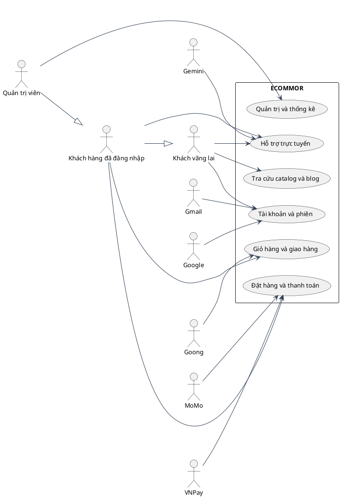
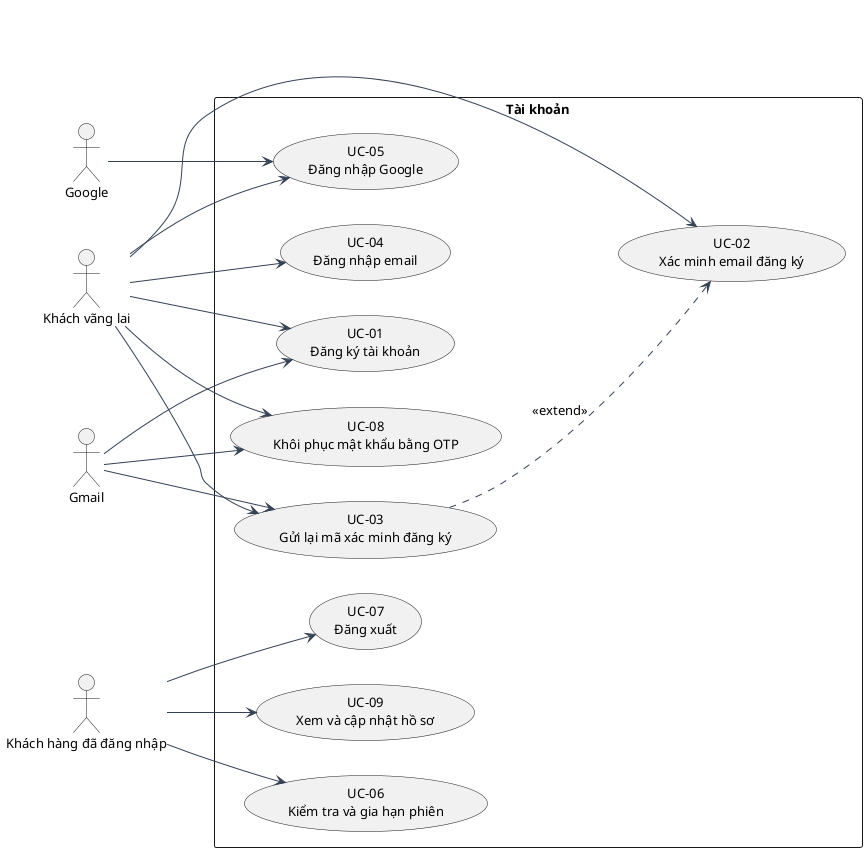
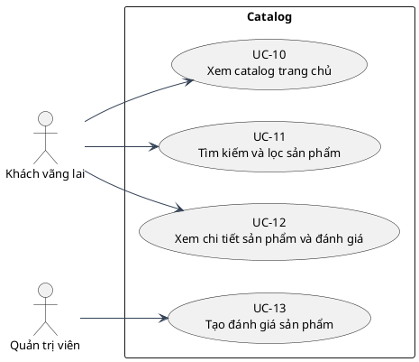
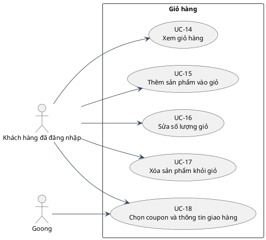
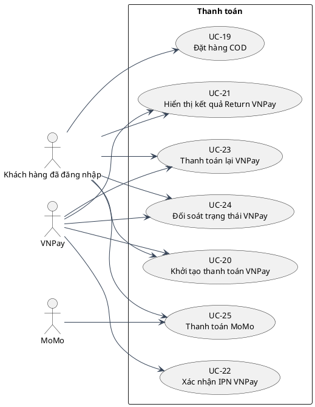
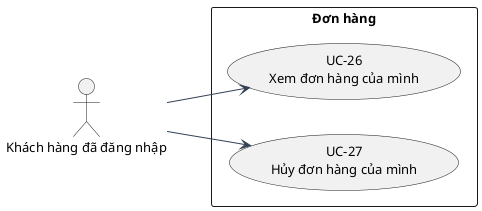
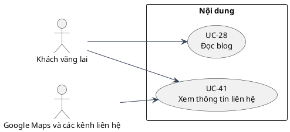
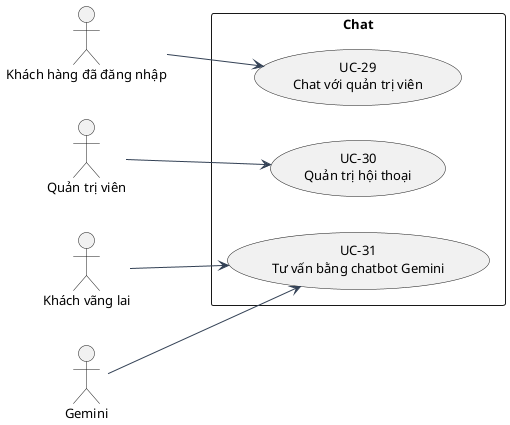
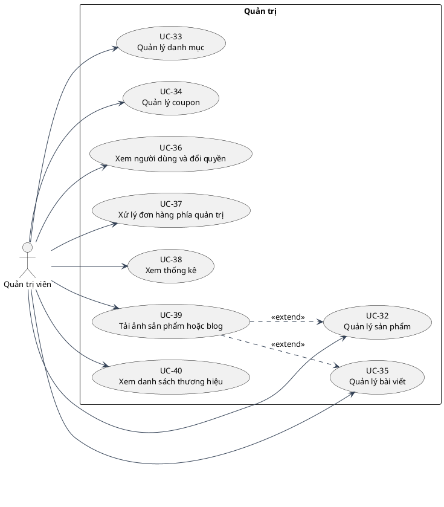

# 01 — Use case as-is

## Tác nhân và quy ước

Khách vãng lai là browser chưa có phiên; Khách hàng đã đăng nhập là user có token xác minh được; Quản trị viên là user có isAdmin=true ở DB. Các public API cũng dùng được khi đăng nhập; kế thừa actor là cách biểu diễn năng lực, không phải một trường role mới. Actor hệ thống ngoài không được coi là user trong DB. Nguồn: `server/src/auth/checkAuth.js:authUser`, `authAdmin`; `server/src/models/users.model.js:1`.

Danh sách UC dưới đây đặc tả cả các nhánh tồn tại nhưng lỗi/không đầy đủ; không khẳng định luồng đó thành công trong vận hành. Các endpoint legacy được gắn rõ vào UC hoặc phần khoảng trống. CRUD được nhóm thành một UC theo đối tượng với các nhánh tạo/sửa/xóa, không suy diễn user CRUD khi chỉ có đổi quyền.

| Mã | Tên | Tác nhân chính | Module |
| --- | --- | --- | --- |
| UC-01 | Đăng ký tài khoản | Khách vãng lai | Tài khoản |
| UC-02 | Xác minh email đăng ký | Khách vãng lai | Tài khoản |
| UC-03 | Gửi lại mã xác minh đăng ký | Khách vãng lai | Tài khoản |
| UC-04 | Đăng nhập email | Khách vãng lai | Tài khoản |
| UC-05 | Đăng nhập Google | Khách vãng lai | Tài khoản |
| UC-06 | Kiểm tra và gia hạn phiên | Khách hàng đã đăng nhập | Tài khoản |
| UC-07 | Đăng xuất | Khách hàng đã đăng nhập | Tài khoản |
| UC-08 | Khôi phục mật khẩu bằng OTP | Khách vãng lai | Tài khoản |
| UC-09 | Xem và cập nhật hồ sơ | Khách hàng đã đăng nhập | Tài khoản |
| UC-10 | Xem catalog trang chủ | Khách vãng lai | Catalog |
| UC-11 | Tìm kiếm và lọc sản phẩm | Khách vãng lai | Catalog |
| UC-12 | Xem chi tiết sản phẩm và đánh giá | Khách vãng lai | Catalog |
| UC-13 | Tạo đánh giá sản phẩm | Quản trị viên | Catalog |
| UC-14 | Xem giỏ hàng | Khách hàng đã đăng nhập | Giỏ hàng |
| UC-15 | Thêm sản phẩm vào giỏ | Khách hàng đã đăng nhập | Giỏ hàng |
| UC-16 | Sửa số lượng giỏ | Khách hàng đã đăng nhập | Giỏ hàng |
| UC-17 | Xóa sản phẩm khỏi giỏ | Khách hàng đã đăng nhập | Giỏ hàng |
| UC-18 | Chọn coupon và thông tin giao hàng | Khách hàng đã đăng nhập | Giỏ hàng |
| UC-19 | Đặt hàng COD | Khách hàng đã đăng nhập | Thanh toán |
| UC-20 | Khởi tạo thanh toán VNPay | Khách hàng đã đăng nhập | Thanh toán |
| UC-21 | Hiển thị kết quả Return VNPay | Khách hàng đã đăng nhập | Thanh toán |
| UC-22 | Xác nhận IPN VNPay | VNPay | Thanh toán |
| UC-23 | Thanh toán lại VNPay | Khách hàng đã đăng nhập | Thanh toán |
| UC-24 | Đối soát trạng thái VNPay | Khách hàng đã đăng nhập | Thanh toán |
| UC-25 | Thanh toán MoMo | Khách hàng đã đăng nhập | Thanh toán |
| UC-26 | Xem đơn hàng của mình | Khách hàng đã đăng nhập | Đơn hàng |
| UC-27 | Hủy đơn hàng của mình | Khách hàng đã đăng nhập | Đơn hàng |
| UC-28 | Đọc blog | Khách vãng lai | Nội dung |
| UC-29 | Chat với quản trị viên | Khách hàng đã đăng nhập | Chat |
| UC-30 | Quản trị hội thoại | Quản trị viên | Chat |
| UC-31 | Tư vấn bằng chatbot Gemini | Khách vãng lai | Chat |
| UC-32 | Quản lý sản phẩm | Quản trị viên | Quản trị |
| UC-33 | Quản lý danh mục | Quản trị viên | Quản trị |
| UC-34 | Quản lý coupon | Quản trị viên | Quản trị |
| UC-35 | Quản lý bài viết | Quản trị viên | Quản trị |
| UC-36 | Xem người dùng và đổi quyền | Quản trị viên | Quản trị |
| UC-37 | Xử lý đơn hàng phía quản trị | Quản trị viên | Quản trị |
| UC-38 | Xem thống kê | Quản trị viên | Quản trị |
| UC-39 | Tải ảnh sản phẩm hoặc blog | Quản trị viên | Quản trị |
| UC-40 | Xem danh sách thương hiệu | Quản trị viên | Quản trị |
| UC-41 | Xem thông tin liên hệ | Khách vãng lai | Nội dung |

## Sơ đồ tổng quát

Các nhóm chức năng là package phân loại, không phải endpoint mới. Google/Gmail/VNPay/MoMo/Gemini/Goong chỉ tham gia nơi code có tích hợp.

Nguồn sơ đồ: [uml/uc-overview.puml](uml/uc-overview.puml). Chưa kiểm tra cú pháp bằng công cụ.

### Module Tài khoản

Sơ đồ liên kết các UC của module; nguồn chi tiết nằm ở từng đặc tả ngay dưới.

Nguồn sơ đồ: [uml/uc-module-01.puml](uml/uc-module-01.puml). Chưa kiểm tra cú pháp bằng công cụ.

### Module Catalog

Sơ đồ liên kết các UC của module; nguồn chi tiết nằm ở từng đặc tả ngay dưới.

Nguồn sơ đồ: [uml/uc-module-02.puml](uml/uc-module-02.puml). Chưa kiểm tra cú pháp bằng công cụ.

### Module Giỏ hàng

Sơ đồ liên kết các UC của module; nguồn chi tiết nằm ở từng đặc tả ngay dưới.

Nguồn sơ đồ: [uml/uc-module-03.puml](uml/uc-module-03.puml). Chưa kiểm tra cú pháp bằng công cụ.

### Module Thanh toán

Sơ đồ liên kết các UC của module; nguồn chi tiết nằm ở từng đặc tả ngay dưới.

Nguồn sơ đồ: [uml/uc-module-04.puml](uml/uc-module-04.puml). Chưa kiểm tra cú pháp bằng công cụ.

### Module Đơn hàng

Sơ đồ liên kết các UC của module; nguồn chi tiết nằm ở từng đặc tả ngay dưới.

Nguồn sơ đồ: [uml/uc-module-05.puml](uml/uc-module-05.puml). Chưa kiểm tra cú pháp bằng công cụ.

### Module Nội dung

Sơ đồ liên kết các UC của module; nguồn chi tiết nằm ở từng đặc tả ngay dưới.

Nguồn sơ đồ: [uml/uc-module-06.puml](uml/uc-module-06.puml). Chưa kiểm tra cú pháp bằng công cụ.

### Module Chat

Sơ đồ liên kết các UC của module; nguồn chi tiết nằm ở từng đặc tả ngay dưới.

Nguồn sơ đồ: [uml/uc-module-07.puml](uml/uc-module-07.puml). Chưa kiểm tra cú pháp bằng công cụ.

### Module Quản trị

Sơ đồ liên kết các UC của module; nguồn chi tiết nằm ở từng đặc tả ngay dưới.

Nguồn sơ đồ: [uml/uc-module-08.puml](uml/uc-module-08.puml). Chưa kiểm tra cú pháp bằng công cụ.

Quan hệ include không được thêm chỉ vì hai UC gọi chung service hoặc middleware. Ví dụ COD và VNPay dùng chung checkout nhưng là hai lựa chọn phương thức; không có UC xác thực độc lập bắt buộc phải gọi mỗi request ngoài JWT middleware. Upload ảnh là mở rộng tùy chọn của quản lý sản phẩm/blog khi có ảnh mới (không include bắt buộc). Xác minh email và reset OTP là bước tuần tự trong hành trình, không tự động suy ra extend giữa hai mục tiêu độc lập. Nguồn: `client/src/Pages/Admin/Components/ManagerProduct/ManagerProduct.jsx:handleSubmit`, `server/src/services/vnpay.service.js:checkout`.

## Đặc tả chi tiết

Mọi HTTP status không chỉ định trong throw BadRequestError mặc định là **403**, không tự chuyển thành 400 theo ý nghĩa tên class. BadUserRequestError mặc định **401**. Lỗi chưa xử lý có thể thành 500 ở error middleware; riêng async blog trên Express 4 có thể không tới middleware. Nguồn: `server/src/core/error.response.js:BadRequestError`, `server/src/core/success.response.js:SuccessResponse`, `server/src/server.js:1`.

### UC-01 — Đăng ký tài khoản

- **Tên / Mã:** Đăng ký tài khoản / UC-01.
- **Tác nhân chính:** Khách vãng lai.
- **Tác nhân phụ:** Gmail.
- **Mô tả:** Đăng ký tài khoản theo hành vi hiện có trong handler và UI được dẫn nguồn.
- **Điều kiện kích hoạt:** Khách nhập họ tên, email, phone, address và password rồi submit.
- **Tiền điều kiện:** Ứng dụng được cấu hình và có thể truy cập API.
- **Hậu điều kiện thành công:** OTP pending được tạo/thay thế; user chỉ được tạo ở UC-02. Thất bại gửi mail có thể vẫn còn record OTP.
- **Hậu điều kiện thất bại:** Không đạt mục tiêu UC; trạng thái có thể đã thay đổi ở bước ghi trước lỗi nếu không có transaction. Các trường hợp cụ thể được ghi trong luồng và 05.

**Luồng sự kiện chính**

1. Khách nhập họ tên, email, phone, address và password rồi submit.
2. Frontend gọi requestRegister và chuyển sang bước nhập OTP khi request thành công.
3. Backend normalize email, kiểm tra dữ liệu và email đã tồn tại.
4. Backend bcrypt password, ghi pending registration vào otp rồi gửi email.

- **Luồng thay thế:** Email đã tồn tại trả 202 thông báo chung; email đủ điều kiện trả 201. Chưa tạo user trước verify.
- **Luồng ngoại lệ:** 400 Registration information is invalid; 429 COOLDOWN/RATE_LIMIT; 503 Email delivery is unavailable.
- **Quy tắc nghiệp vụ và ràng buộc:** Server kiểm tra truthy các trường và regex email; bcrypt cost 10. UI password tối thiểu 6 và confirm khớp nhưng server chưa kiểm tra độ dài/confirm. Limiter gửi chung 5/giờ/IP, cooldown email/type 60s.
- **Quan hệ include/extend:** Không xác lập include/extend từ việc chỉ dùng chung middleware.
- **API:** POST /api/register.
- **Nguồn code:** `server/src/controllers/users.controller.js:60`; `client/src/Pages/Register/Register.jsx:1`; `server/src/routes/users.routes.js:12`; `server/src/services/otp.service.js:20`; `server/src/services/mail.service.js:21`.

### UC-02 — Xác minh email đăng ký

- **Tên / Mã:** Xác minh email đăng ký / UC-02.
- **Tác nhân chính:** Khách vãng lai.
- **Tác nhân phụ:** Không.
- **Mô tả:** Xác minh email đăng ký theo hành vi hiện có trong handler và UI được dẫn nguồn.
- **Điều kiện kích hoạt:** Khách nhập mã 6 chữ số.
- **Tiền điều kiện:** Có registration pending chưa hết hạn.
- **Hậu điều kiện thành công:** 200 và user được tạo; lỗi sau consume có thể đã mất OTP.
- **Hậu điều kiện thất bại:** Không đạt mục tiêu UC; trạng thái có thể đã thay đổi ở bước ghi trước lỗi nếu không có transaction. Các trường hợp cụ thể được ghi trong luồng và 05.

**Luồng sự kiện chính**

1. Khách nhập mã 6 chữ số.
2. UI gửi email và otp.
3. Backend consume OTP verifyAccount, xóa atomically khi khớp.
4. Backend lấy registration, kiểm tra email chưa có rồi tạo user email.
5. UI báo hoàn tất và chuyển /login.

- **Luồng thay thế:** Không có nhánh thay thế riêng.
- **Luồng ngoại lệ:** 400 Email or verification code is invalid; 400 Verification code is invalid or expired (có biến thể dấu chấm từ service).
- **Quy tắc nghiệp vụ và ràng buộc:** TTL 10 phút được kiểm tra bằng code và TTL index; tối đa 5 lần sai; limiter verify chung 15/15 phút/IP. Không tự đăng nhập.
- **Quan hệ include/extend:** UC-03 extend quá trình xác minh khi cần gửi lại.
- **API:** POST /api/verify-email.
- **Nguồn code:** `server/src/controllers/users.controller.js:522`; `client/src/Pages/Register/Register.jsx:1`; `server/src/routes/users.routes.js:13`; `server/src/services/otp.service.js:20`; `server/src/services/mail.service.js:21`.

### UC-03 — Gửi lại mã xác minh đăng ký

- **Tên / Mã:** Gửi lại mã xác minh đăng ký / UC-03.
- **Tác nhân chính:** Khách vãng lai.
- **Tác nhân phụ:** Gmail.
- **Mô tả:** Gửi lại mã xác minh đăng ký theo hành vi hiện có trong handler và UI được dẫn nguồn.
- **Điều kiện kích hoạt:** Khách chọn gửi lại sau countdown.
- **Tiền điều kiện:** Ứng dụng được cấu hình và có thể truy cập API.
- **Hậu điều kiện thành công:** Response thành công theo handler; client cập nhật state hoặc chuyển trang.
- **Hậu điều kiện thất bại:** Không đạt mục tiêu UC; trạng thái có thể đã thay đổi ở bước ghi trước lỗi nếu không có transaction. Các trường hợp cụ thể được ghi trong luồng và 05.

**Luồng sự kiện chính**

1. Khách chọn gửi lại sau countdown.
2. UI gửi email.
3. Backend kiểm tra pending registration, issue lại mã và giữ registration.
4. Gmail nhận yêu cầu gửi; UI đặt lại 60s.

- **Luồng thay thế:** Không có pending cũng trả 202 thông báo chung.
- **Luồng ngoại lệ:** 429 Please wait before requesting a new code.; 503 Email delivery is unavailable.
- **Quy tắc nghiệp vụ và ràng buộc:** 5/giờ/IP chung với register/forgot; issue kiểm tra 60s và 5 lần/email/type trong cửa sổ lưu ở record.
- **Quan hệ include/extend:** extend UC-02 tại bước chờ mã.
- **API:** POST /api/resend-verification.
- **Nguồn code:** `server/src/controllers/users.controller.js:539`; `client/src/Pages/Register/Register.jsx:1`; `server/src/routes/users.routes.js:14`; `server/src/services/otp.service.js:20`; `server/src/services/mail.service.js:21`.

### UC-04 — Đăng nhập email

- **Tên / Mã:** Đăng nhập email / UC-04.
- **Tác nhân chính:** Khách vãng lai.
- **Tác nhân phụ:** Không.
- **Mô tả:** Đăng nhập email theo hành vi hiện có trong handler và UI được dẫn nguồn.
- **Điều kiện kích hoạt:** Khách nhập email/password.
- **Tiền điều kiện:** Ứng dụng được cấu hình và có thể truy cập API.
- **Hậu điều kiện thành công:** Cookie phiên và dữ liệu auth/cart; đăng nhập mới thay cặp key cũ.
- **Hậu điều kiện thất bại:** Không đạt mục tiêu UC; trạng thái có thể đã thay đổi ở bước ghi trước lỗi nếu không có transaction. Các trường hợp cụ thể được ghi trong luồng và 05.

**Luồng sự kiện chính**

1. Khách nhập email/password.
2. Backend tìm user theo email, chặn typeLogin google, bcrypt compare.
3. Backend rotate cặp RSA theo user, ký token 15m và refresh 7d.
4. Response 200 đặt cookie; UI gọi auth, tải cart rồi điều hướng admin hoặc trang chủ.

- **Luồng thay thế:** Không có nhánh thay thế riêng.
- **Luồng ngoại lệ:** 403 Tài khoản hoặc mật khẩu không chính xác !!!; 403 Vui lòng đăng nhập bằng Google. Lỗi bcrypt/cast không chuẩn hóa có thể thành 500.
- **Quy tắc nghiệp vụ và ràng buộc:** Cookie token/refreshToken httpOnly; logged có thể đọc từ JS; production secure + Strict, dev Lax. Login không có rate limiter riêng.
- **Quan hệ include/extend:** Không xác lập include/extend từ việc chỉ dùng chung middleware.
- **API:** POST /api/login.
- **Nguồn code:** `server/src/controllers/users.controller.js:92`; `client/src/Pages/LoginUser/LoginUser.jsx:1`; `server/src/routes/users.routes.js:15`.

### UC-05 — Đăng nhập Google

- **Tên / Mã:** Đăng nhập Google / UC-05.
- **Tác nhân chính:** Khách vãng lai.
- **Tác nhân phụ:** Google.
- **Mô tả:** Đăng nhập Google theo hành vi hiện có trong handler và UI được dẫn nguồn.
- **Điều kiện kích hoạt:** Khách chọn GoogleLogin popup.
- **Tiền điều kiện:** Ứng dụng được cấu hình và có thể truy cập API.
- **Hậu điều kiện thành công:** Response thành công theo handler; client cập nhật state hoặc chuyển trang.
- **Hậu điều kiện thất bại:** Không đạt mục tiêu UC; trạng thái có thể đã thay đổi ở bước ghi trước lỗi nếu không có transaction. Các trường hợp cụ thể được ghi trong luồng và 05.

**Luồng sự kiện chính**

1. Khách chọn GoogleLogin popup.
2. Frontend gửi credential.
3. Server verifyIdToken với audience GOOGLE_CLIENT và email_verified.
4. Server tìm theo email, dùng user sẵn có hoặc tạo user google.
5. Server rotate RSA, đặt cookie giống email login; UI xác định trang theo isAdmin.

- **Luồng thay thế:** Email đã có: không tạo user mới; email mới: lưu name/email/typeLogin google.
- **Luồng ngoại lệ:** 403 Không thể xác thực Google; Google credential không hợp lệ; Email Google chưa được xác minh.
- **Quy tắc nghiệp vụ và ràng buộc:** Không tin name/email do client tự gửi; cần credential và GOOGLE_CLIENT. Account cùng email được liên kết trực tiếp.
- **Quan hệ include/extend:** Không xác lập include/extend từ việc chỉ dùng chung middleware.
- **API:** POST /api/login-google.
- **Nguồn code:** `server/src/controllers/users.controller.js:92`; `client/src/Pages/LoginUser/LoginUser.jsx:1`; `server/src/routes/users.routes.js:19`.

### UC-06 — Kiểm tra và gia hạn phiên

- **Tên / Mã:** Kiểm tra và gia hạn phiên / UC-06.
- **Tác nhân chính:** Khách hàng đã đăng nhập.
- **Tác nhân phụ:** Không.
- **Mô tả:** Kiểm tra và gia hạn phiên theo hành vi hiện có trong handler và UI được dẫn nguồn.
- **Điều kiện kích hoạt:** Provider thấy cookie logged và yêu cầu auth; AdminRoute còn yêu cầu admin.
- **Tiền điều kiện:** Ứng dụng được cấu hình và có thể truy cập API. Có cookie token hợp lệ; authAdmin kiểm tra DB khi route ghi yêu cầu admin.
- **Hậu điều kiện thành công:** Response thành công theo handler; client cập nhật state hoặc chuyển trang.
- **Hậu điều kiện thất bại:** Không đạt mục tiêu UC; trạng thái có thể đã thay đổi ở bước ghi trước lỗi nếu không có transaction. Các trường hợp cụ thể được ghi trong luồng và 05.

**Luồng sự kiện chính**

1. Provider thấy cookie logged và yêu cầu auth; AdminRoute còn yêu cầu admin.
2. authUser middleware verify JWT RSA qua key theo id; authAdmin kiểm tra isAdmin từ DB.
3. Handler auth chỉ trả các trường hồ sơ được chọn.
4. Nếu API trả 401, ApiClient dùng refresh cookie để lấy access cookie mới rồi retry; lỗi refresh thì logout và chuyển /login.

- **Luồng thay thế:** request.jsx có interceptor khác ApiClient; nhánh queue đầu tiên có bất thường ghi ở 05, không coi retry luôn thành công.
- **Luồng ngoại lệ:** 401 Vui lòng đăng nhập / Vui lòng đăng nhập lại / Bạn không có quyền truy cập; 403 Tài khoản không tồn tại từ refresh nếu user bị xóa.
- **Quy tắc nghiệp vụ và ràng buộc:** Access 15m/refresh 7d dùng cùng cặp RSA và verifyToken. /api/admin chạy authUser rồi authAdmin. logged chỉ là dấu hiệu để UI thử request.
- **Quan hệ include/extend:** Không xác lập include/extend từ việc chỉ dùng chung middleware.
- **API:** GET /api/auth, GET /api/refresh-token, GET /api/admin.
- **Nguồn code:** `server/src/controllers/users.controller.js:166`; `client/src/store/Provider.jsx:1`; `server/src/routes/users.routes.js:16`; `server/src/routes/users.routes.js:17`; `server/src/routes/users.routes.js:30`.

### UC-07 — Đăng xuất

- **Tên / Mã:** Đăng xuất / UC-07.
- **Tác nhân chính:** Khách hàng đã đăng nhập.
- **Tác nhân phụ:** Không.
- **Mô tả:** Đăng xuất theo hành vi hiện có trong handler và UI được dẫn nguồn.
- **Điều kiện kích hoạt:** Khách/admin chọn đăng xuất.
- **Tiền điều kiện:** Ứng dụng được cấu hình và có thể truy cập API. Có cookie token hợp lệ; authAdmin kiểm tra DB khi route ghi yêu cầu admin.
- **Hậu điều kiện thành công:** Cookie phía browser được clear; key chỉ bị thu hồi ở nhánh verify thành công.
- **Hậu điều kiện thất bại:** Không đạt mục tiêu UC; trạng thái có thể đã thay đổi ở bước ghi trước lỗi nếu không có transaction. Các trường hợp cụ thể được ghi trong luồng và 05.

**Luồng sự kiện chính**

1. Khách/admin chọn đăng xuất.
2. Client gọi GET logout.
3. Nếu access token verify được, backend xóa key theo userId.
4. Backend clear token/refreshToken/logged với cùng flags.
5. Header clearAuth hoặc admin chuyển /login.

- **Luồng thay thế:** Không có nhánh thay thế riêng.
- **Luồng ngoại lệ:** 200 Đăng xuất thành công; lỗi DB xóa key bị catch trong khối verify/xóa.
- **Quy tắc nghiệp vụ và ràng buộc:** Không có auth middleware nên vẫn clear cookie khi access hết hạn; chỉ xóa key nếu access verify được.
- **Quan hệ include/extend:** Không xác lập include/extend từ việc chỉ dùng chung middleware.
- **API:** GET /api/logout.
- **Nguồn code:** `server/src/controllers/users.controller.js:203`; `client/src/Components/Header/Header.jsx:1`; `server/src/routes/users.routes.js:18`.

### UC-08 — Khôi phục mật khẩu bằng OTP

- **Tên / Mã:** Khôi phục mật khẩu bằng OTP / UC-08.
- **Tác nhân chính:** Khách vãng lai.
- **Tác nhân phụ:** Gmail.
- **Mô tả:** Khôi phục mật khẩu bằng OTP theo hành vi hiện có trong handler và UI được dẫn nguồn.
- **Điều kiện kích hoạt:** Khách gửi email, UI chờ mã.
- **Tiền điều kiện:** Ứng dụng được cấu hình và có thể truy cập API.
- **Hậu điều kiện thành công:** Mật khẩu thay đổi; key phiên đang có không bị xóa; proof chỉ clear cookie, chưa có record consume proof.
- **Hậu điều kiện thất bại:** Không đạt mục tiêu UC; trạng thái có thể đã thay đổi ở bước ghi trước lỗi nếu không có transaction. Các trường hợp cụ thể được ghi trong luồng và 05.

**Luồng sự kiện chính**

1. Khách gửi email, UI chờ mã.
2. Server tìm tài khoản email hợp lệ, issue OTP rồi gửi Gmail; trả thông báo chung 202.
3. Khách gửi email/otp, backend consume đúng purpose rồi đặt cookie proof 5m.
4. Khách nhập password/confirmPassword, server verify proof purpose=passwordReset và user email.
5. Backend bcrypt password, save user, clear proof; UI chuyển /login.

- **Luồng thay thế:** Email không tồn tại/google/không hợp lệ đều 202; lỗi mail reset được log và vẫn 202 (trừ cooldown).
- **Luồng ngoại lệ:** 429 cooldown; 400 mã không hợp lệ; 401 Password reset session has expired. Verify the code again.; 400 Password reset request is invalid.
- **Quy tắc nghiệp vụ và ràng buộc:** OTP TTL 10m, 5 lần sai, resend 60s; rate send 5/giờ/IP và verify 15/15m/IP. Reset yêu cầu password truthy, confirm khớp; min 6 chỉ UI.
- **Quan hệ include/extend:** Không xác lập include/extend từ việc chỉ dùng chung middleware.
- **API:** POST /api/forgot-password, POST /api/verify-reset-password, POST /api/reset-password.
- **Nguồn code:** `server/src/controllers/users.controller.js:414`; `client/src/Pages/ForgotPassword/ForgotPassword.jsx:1`; `server/src/routes/users.routes.js:22`; `server/src/routes/users.routes.js:23`; `server/src/routes/users.routes.js:24`; `server/src/services/otp.service.js:20`; `server/src/services/mail.service.js:21`.

### UC-09 — Xem và cập nhật hồ sơ

- **Tên / Mã:** Xem và cập nhật hồ sơ / UC-09.
- **Tác nhân chính:** Khách hàng đã đăng nhập.
- **Tác nhân phụ:** Không.
- **Mô tả:** Xem và cập nhật hồ sơ theo hành vi hiện có trong handler và UI được dẫn nguồn.
- **Điều kiện kích hoạt:** Khách mở profile và chọn chỉnh sửa.
- **Tiền điều kiện:** Ứng dụng được cấu hình và có thể truy cập API. Có cookie token hợp lệ; authAdmin kiểm tra DB khi route ghi yêu cầu admin.
- **Hậu điều kiện thành công:** 200 Cập nhật thông tin thành công; response hiện trả nguyên user document (xem 05).
- **Hậu điều kiện thất bại:** Không đạt mục tiêu UC; trạng thái có thể đã thay đổi ở bước ghi trước lỗi nếu không có transaction. Các trường hợp cụ thể được ghi trong luồng và 05.

**Luồng sự kiện chính**

1. Khách mở profile và chọn chỉnh sửa.
2. UI nạp dữ liệu từ Provider, validate form.
3. Backend lấy id từ JWT, chỉ cập nhật fullName/address/phone.
4. UI gọi auth để nạp lại hồ sơ.

- **Luồng thay thế:** Không có nhánh thay thế riêng.
- **Luồng ngoại lệ:** 401 nếu không có phiên; lỗi cast/DB chuyển error middleware.
- **Quy tắc nghiệp vụ và ràng buộc:** authUser; không nhận id hoặc isAdmin từ body để sửa chính mình; không có runValidators ở query update.
- **Quan hệ include/extend:** Không xác lập include/extend từ việc chỉ dùng chung middleware.
- **API:** POST /api/update-user.
- **Nguồn code:** `server/src/controllers/users.controller.js:218`; `client/src/Pages/InfoUser/InfoUser.jsx:1`; `server/src/routes/users.routes.js:20`.

### UC-10 — Xem catalog trang chủ

- **Tên / Mã:** Xem catalog trang chủ / UC-10.
- **Tác nhân chính:** Khách vãng lai.
- **Tác nhân phụ:** Không.
- **Mô tả:** Xem catalog trang chủ theo hành vi hiện có trong handler và UI được dẫn nguồn.
- **Điều kiện kích hoạt:** Khách mở trang chủ.
- **Tiền điều kiện:** Ứng dụng được cấu hình và có thể truy cập API.
- **Hậu điều kiện thành công:** Response thành công theo handler; client cập nhật state hoặc chuyển trang.
- **Hậu điều kiện thất bại:** Không đạt mục tiêu UC; trạng thái có thể đã thay đổi ở bước ghi trước lỗi nếu không có transaction. Các trường hợp cụ thể được ghi trong luồng và 05.

**Luồng sự kiện chính**

1. Khách mở trang chủ.
2. useProductCatalog lấy section mới và danh sách section gender/brand.
3. Service chọn tối đa 10 sản phẩm mới còn hàng, đếm section đồng hồ theo category tên chuẩn hóa.
4. CatalogSection tải khi thấy trong viewport và phân trang theo section.
5. UI hiển thị card hoặc loading/error/retry.

- **Luồng thay thế:** Legacy API get-product-new/manufactured/by-category vẫn có dù không phải đường gọi chính mới.
- **Luồng ngoại lệ:** 400 Invalid page/section type/section value/gender/brand.
- **Quy tắc nghiệp vụ và ràng buộc:** PAGE_SIZE 10; sort createdAt/_id giảm; page nguyên dương và clamp về totalPages; new chỉ 1 trang. Legacy manufactured lọc discount >=10; by-category còn bộ lọc cũ.
- **Quan hệ include/extend:** Không xác lập include/extend từ việc chỉ dùng chung middleware.
- **API:** GET /api/get-product-new, GET /api/product-catalog, GET /api/get-product-by-category, GET /api/get-product-manufactured.
- **Nguồn code:** `server/src/services/product-catalog.service.js:37`; `client/src/Components/HomePage/ProductNew/ProductNew.jsx:1`; `server/src/routes/products.routes.js:9`; `server/src/routes/products.routes.js:10`; `server/src/routes/products.routes.js:14`; `server/src/routes/products.routes.js:15`.

### UC-11 — Tìm kiếm và lọc sản phẩm

- **Tên / Mã:** Tìm kiếm và lọc sản phẩm / UC-11.
- **Tác nhân chính:** Khách vãng lai.
- **Tác nhân phụ:** Không.
- **Mô tả:** Tìm kiếm và lọc sản phẩm theo hành vi hiện có trong handler và UI được dẫn nguồn.
- **Điều kiện kích hoạt:** Khách nhập tìm kiếm Header hoặc chọn category/brand/giá/tồn kho.
- **Tiền điều kiện:** Ứng dụng được cấu hình và có thể truy cập API.
- **Hậu điều kiện thành công:** Response thành công theo handler; client cập nhật state hoặc chuyển trang.
- **Hậu điều kiện thất bại:** Không đạt mục tiêu UC; trạng thái có thể đã thay đổi ở bước ghi trước lỗi nếu không có transaction. Các trường hợp cụ thể được ghi trong luồng và 05.

**Luồng sự kiện chính**

1. Khách nhập tìm kiếm Header hoặc chọn category/brand/giá/tồn kho.
2. Header debounce gọi search; Category giữ filter/page trong query string và abort request cũ.
3. Backend browse validate, escape regex search, tính giá sau discount trong query.
4. Backend đếm, clamp page và trả 20 item/trang.
5. UI hiển thị tổng/trang và chọn lại filter.

- **Luồng thay thế:** Không có nhánh thay thế riêng.
- **Luồng ngoại lệ:** 400 Choose category or brand / Invalid stock / Invalid price range / Invalid search; lỗi regex legacy có thể 500.
- **Quy tắc nghiệp vụ và ràng buộc:** Không chọn đồng thời category và brand; stock all/in/order; min/max là số nguyên không âm, min<=max; search tối đa 100. Legacy /api/search dùng regex trực tiếp chưa escape.
- **Quan hệ include/extend:** Không xác lập include/extend từ việc chỉ dùng chung middleware.
- **API:** GET /api/catalog-options, GET /api/catalog-browse, GET /api/search.
- **Nguồn code:** `server/src/services/catalog-browse.service.js:37`; `client/src/Pages/Category/Category.jsx:1`; `server/src/routes/products.routes.js:11`; `server/src/routes/products.routes.js:12`; `server/src/routes/products.routes.js:16`.

### UC-12 — Xem chi tiết sản phẩm và đánh giá

- **Tên / Mã:** Xem chi tiết sản phẩm và đánh giá / UC-12.
- **Tác nhân chính:** Khách vãng lai.
- **Tác nhân phụ:** Không.
- **Mô tả:** Xem chi tiết sản phẩm và đánh giá theo hành vi hiện có trong handler và UI được dẫn nguồn.
- **Điều kiện kích hoạt:** Khách mở /product/:id.
- **Tiền điều kiện:** Ứng dụng được cấu hình và có thể truy cập API.
- **Hậu điều kiện thành công:** Response thành công theo handler; client cập nhật state hoặc chuyển trang.
- **Hậu điều kiện thất bại:** Không đạt mục tiêu UC; trạng thái có thể đã thay đổi ở bước ghi trước lỗi nếu không có transaction. Các trường hợp cụ thể được ghi trong luồng và 05.

**Luồng sự kiện chính**

1. Khách mở /product/:id.
2. useFetch yêu cầu sản phẩm theo id.
3. Controller đọc product, tìm tối đa 8 sản phẩm cùng category và các previewProduct.
4. Controller tra tên user cho từng đánh giá.
5. UI hiển thị thông số, ảnh, giá và rating.

- **Luồng thay thế:** DetailProduct còn gọi get-preview-product-home qua useFetch rồi lọc theo productId; API chỉ trả tối đa 10 review toàn hệ thống. Wrapper requestGetPreviewProductHome không có consumer ngoài request.jsx.
- **Luồng ngoại lệ:** ID không hợp lệ hoặc product/user đã xóa có thể thành 500 do truy cập null; không có nhánh 404 chuẩn trong handler.
- **Quy tắc nghiệp vụ và ràng buộc:** Public read. get-preview-product-home lấy 10 record không sort; tra user/product từng record.
- **Quan hệ include/extend:** Không xác lập include/extend từ việc chỉ dùng chung middleware.
- **API:** GET /api/get-preview-product-home, GET /api/get-product-by-id.
- **Nguồn code:** `server/src/controllers/products.controller.js:118`; `client/src/Pages/DetailProduct/DetailProduct.jsx:1`; `server/src/routes/previewProduct.routes.js:9`; `server/src/routes/products.routes.js:13`.

### UC-13 — Tạo đánh giá sản phẩm

- **Tên / Mã:** Tạo đánh giá sản phẩm / UC-13.
- **Tác nhân chính:** Quản trị viên.
- **Tác nhân phụ:** Không.
- **Mô tả:** Tạo đánh giá sản phẩm theo hành vi hiện có trong handler và UI được dẫn nguồn.
- **Điều kiện kích hoạt:** UI OrderUser cho phép nhập rating/comment cho sản phẩm trong đơn.
- **Tiền điều kiện:** Ứng dụng được cấu hình và có thể truy cập API. Có cookie token hợp lệ; authAdmin kiểm tra DB khi route ghi yêu cầu admin.
- **Hậu điều kiện thành công:** Admin có thể tạo đánh giá; luồng khách hàng dở dang được ghi tại 05.
- **Hậu điều kiện thất bại:** Không đạt mục tiêu UC; trạng thái có thể đã thay đổi ở bước ghi trước lỗi nếu không có transaction. Các trường hợp cụ thể được ghi trong luồng và 05.

**Luồng sự kiện chính**

1. UI OrderUser cho phép nhập rating/comment cho sản phẩm trong đơn.
2. Client gửi productId/content/rating.
3. Route yêu cầu authAdmin.
4. Controller lấy userId từ JWT và tạo previewProduct, trả 201.

- **Luồng thay thế:** Không có nhánh thay thế riêng.
- **Luồng ngoại lệ:** 401 Bạn không có quyền truy cập với khách thường; lỗi schema/DB có thể 500.
- **Quy tắc nghiệp vụ và ràng buộc:** As-is chỉ admin gọi được API; không kiểm tra đã mua/giao hàng, không giới hạn rating ở schema. UI khách hàng tồn tại nhưng bị server từ chối.
- **Quan hệ include/extend:** Không xác lập include/extend từ việc chỉ dùng chung middleware.
- **API:** POST /api/create-preview-product.
- **Nguồn code:** `server/src/controllers/previewProduct.controller.js:6`; `client/src/Pages/InfoUser/OrderUser/OrderUser.jsx:1`; `server/src/routes/previewProduct.routes.js:8`.

### UC-14 — Xem giỏ hàng

- **Tên / Mã:** Xem giỏ hàng / UC-14.
- **Tác nhân chính:** Khách hàng đã đăng nhập.
- **Tác nhân phụ:** Không.
- **Mô tả:** Xem giỏ hàng theo hành vi hiện có trong handler và UI được dẫn nguồn.
- **Điều kiện kích hoạt:** Provider/khách yêu cầu giỏ.
- **Tiền điều kiện:** Ứng dụng được cấu hình và có thể truy cập API. Có cookie token hợp lệ; authAdmin kiểm tra DB khi route ghi yêu cầu admin.
- **Hậu điều kiện thành công:** Giỏ được phản ánh giá hiện tại; không reserve kho ở bước này.
- **Hậu điều kiện thất bại:** Không đạt mục tiêu UC; trạng thái có thể đã thay đổi ở bước ghi trước lỗi nếu không có transaction. Các trường hợp cụ thể được ghi trong luồng và 05.

**Luồng sự kiện chính**

1. Provider/khách yêu cầu giỏ.
2. Server tìm cart theo id JWT.
3. Nếu có giỏ, server bỏ item có productId không hợp lệ/sản phẩm đã xóa, tính lại tổng từ giá hiện tại.
4. Server lưu giỏ đã sửa nếu cần và tìm coupon theo tổng, date, quantity.
5. UI nhận cartId, cartItems, totalPrice, dataCoupon.

- **Luồng thay thế:** Không có nhánh thay thế riêng.
- **Luồng ngoại lệ:** 401 phiên; lỗi DB/cast thành 500.
- **Quy tắc nghiệp vụ và ràng buộc:** authUser; GET có thể ghi sửa giỏ; không có cart trả 200 mảng rỗng và total=0.
- **Quan hệ include/extend:** Không xác lập include/extend từ việc chỉ dùng chung middleware.
- **API:** GET /api/get-cart.
- **Nguồn code:** `server/src/controllers/cartUser.controller.js:114`; `client/src/Pages/Cart/CartUser.jsx:1`; `server/src/routes/cartUser.routes.js:9`.

### UC-15 — Thêm sản phẩm vào giỏ

- **Tên / Mã:** Thêm sản phẩm vào giỏ / UC-15.
- **Tác nhân chính:** Khách hàng đã đăng nhập.
- **Tác nhân phụ:** Không.
- **Mô tả:** Thêm sản phẩm vào giỏ theo hành vi hiện có trong handler và UI được dẫn nguồn.
- **Điều kiện kích hoạt:** Khách bấm thêm ở card/chi tiết.
- **Tiền điều kiện:** Ứng dụng được cấu hình và có thể truy cập API. Có cookie token hợp lệ; authAdmin kiểm tra DB khi route ghi yêu cầu admin.
- **Hậu điều kiện thành công:** Giỏ mới 201 hoặc giỏ cũ 200.
- **Hậu điều kiện thất bại:** Không đạt mục tiêu UC; trạng thái có thể đã thay đổi ở bước ghi trước lỗi nếu không có transaction. Các trường hợp cụ thể được ghi trong luồng và 05.

**Luồng sự kiện chính**

1. Khách bấm thêm ở card/chi tiết.
2. Client gửi productId/quantity.
3. Server kiểm tra sản phẩm và số nguyên dương <= stock, kể cả tổng quantity cũ+mới.
4. Server tạo giỏ hoặc push/tăng item, tính tổng từ DB rồi save.
5. UI gọi getCart.

- **Luồng thay thế:** Không có nhánh thay thế riêng.
- **Luồng ngoại lệ:** 403 Số lượng sản phẩm không hợp lệ / Sản phẩm không tồn tại / Số lượng sản phẩm không đủ / Missing required fields.
- **Quy tắc nghiệp vụ và ràng buộc:** authUser; chưa reserve stock; thao tác read/save giỏ không transaction; quantityProduct không dùng giá client.
- **Quan hệ include/extend:** Không xác lập include/extend từ việc chỉ dùng chung middleware.
- **API:** POST /api/create-cart.
- **Nguồn code:** `server/src/controllers/cartUser.controller.js:31`; `client/src/Components/CardBody/CardBody.jsx:1`; `server/src/routes/cartUser.routes.js:8`.

### UC-16 — Sửa số lượng giỏ

- **Tên / Mã:** Sửa số lượng giỏ / UC-16.
- **Tác nhân chính:** Khách hàng đã đăng nhập.
- **Tác nhân phụ:** Không.
- **Mô tả:** Sửa số lượng giỏ theo hành vi hiện có trong handler và UI được dẫn nguồn.
- **Điều kiện kích hoạt:** Khách tăng/giảm số lượng.
- **Tiền điều kiện:** Ứng dụng được cấu hình và có thể truy cập API. Có cookie token hợp lệ; authAdmin kiểm tra DB khi route ghi yêu cầu admin.
- **Hậu điều kiện thành công:** Response thành công theo handler; client cập nhật state hoặc chuyển trang.
- **Hậu điều kiện thất bại:** Không đạt mục tiêu UC; trạng thái có thể đã thay đổi ở bước ghi trước lỗi nếu không có transaction. Các trường hợp cụ thể được ghi trong luồng và 05.

**Luồng sự kiện chính**

1. Khách tăng/giảm số lượng.
2. Backend validate quantityProduct.
3. Server tìm cart của JWT và item, lấy giá hiện tại.
4. Trừ thành tiền cũ, cộng thành tiền mới rồi save.
5. UI nạp lại giỏ.

- **Luồng thay thế:** Không có nhánh thay thế riêng.
- **Luồng ngoại lệ:** 403 Giỏ hàng không tồn tại / Sản phẩm không tồn tại trong giỏ hàng / Số lượng sản phẩm không đủ.
- **Quy tắc nghiệp vụ và ràng buộc:** Số nguyên dương không vượt stock; quantity=0 không phải thao tác xóa.
- **Quan hệ include/extend:** Không xác lập include/extend từ việc chỉ dùng chung middleware.
- **API:** POST /api/update-product-cart.
- **Nguồn code:** `server/src/controllers/cartUser.controller.js:196`; `client/src/Pages/Cart/CartUser.jsx:1`; `server/src/routes/cartUser.routes.js:11`.

### UC-17 — Xóa sản phẩm khỏi giỏ

- **Tên / Mã:** Xóa sản phẩm khỏi giỏ / UC-17.
- **Tác nhân chính:** Khách hàng đã đăng nhập.
- **Tác nhân phụ:** Không.
- **Mô tả:** Xóa sản phẩm khỏi giỏ theo hành vi hiện có trong handler và UI được dẫn nguồn.
- **Điều kiện kích hoạt:** Khách chọn xóa item.
- **Tiền điều kiện:** Ứng dụng được cấu hình và có thể truy cập API. Có cookie token hợp lệ; authAdmin kiểm tra DB khi route ghi yêu cầu admin.
- **Hậu điều kiện thành công:** Response thành công theo handler; client cập nhật state hoặc chuyển trang.
- **Hậu điều kiện thất bại:** Không đạt mục tiêu UC; trạng thái có thể đã thay đổi ở bước ghi trước lỗi nếu không có transaction. Các trường hợp cụ thể được ghi trong luồng và 05.

**Luồng sự kiện chính**

1. Khách chọn xóa item.
2. Server tìm giỏ theo JWT và item theo productId.
3. Server đọc product hiện tại để tính tiền trừ.
4. Server filter item, save cart, trả 200.
5. UI tải lại giỏ.

- **Luồng thay thế:** Không có nhánh thay thế riêng.
- **Luồng ngoại lệ:** 403 Giỏ hàng không tồn tại / Sản phẩm không tồn tại trong giỏ hàng / Không tìm thấy thông tin sản phẩm.
- **Quy tắc nghiệp vụ và ràng buộc:** authUser; nếu product đã xóa, deleteProductCart từ chối; getCart mới có cơ chế dọn item mất.
- **Quan hệ include/extend:** Không xác lập include/extend từ việc chỉ dùng chung middleware.
- **API:** POST /api/delete-product-cart.
- **Nguồn code:** `server/src/controllers/cartUser.controller.js:160`; `client/src/Pages/Cart/CartUser.jsx:1`; `server/src/routes/cartUser.routes.js:10`.

### UC-18 — Chọn coupon và thông tin giao hàng

- **Tên / Mã:** Chọn coupon và thông tin giao hàng / UC-18.
- **Tác nhân chính:** Khách hàng đã đăng nhập.
- **Tác nhân phụ:** Goong (gợi ý địa chỉ tùy chọn).
- **Mô tả:** Chọn coupon và thông tin giao hàng theo hành vi hiện có trong handler và UI được dẫn nguồn.
- **Điều kiện kích hoạt:** Khách nhập fullName/phone/address/note và chọn coupon từ dataCoupon trong getCart.
- **Tiền điều kiện:** Ứng dụng được cấu hình và có thể truy cập API. Có cookie token hợp lệ; authAdmin kiểm tra DB khi route ghi yêu cầu admin.
- **Hậu điều kiện thành công:** Response thành công theo handler; client cập nhật state hoặc chuyển trang.
- **Hậu điều kiện thất bại:** Không đạt mục tiêu UC; trạng thái có thể đã thay đổi ở bước ghi trước lỗi nếu không có transaction. Các trường hợp cụ thể được ghi trong luồng và 05.

**Luồng sự kiện chính**

1. Khách nhập fullName/phone/address/note và chọn coupon từ dataCoupon trong getCart.
2. UI giữ nameCoupon là id coupon và hiển thị tổng dự kiến.
3. COD/VNPay gửi thông tin trực tiếp create-payment; MoMo gọi update-info-cart trước.
4. updateInfoCart gán thông tin vào cart, trả 200; checkout COD/VNPay kiểm lại coupon ở server.

- **Luồng thay thế:** Gợi ý địa chỉ sau 3 ký tự và debounce 500ms; lỗi Goong xóa gợi ý, vẫn nhập tay được.
- **Luồng ngoại lệ:** 403 Giỏ hàng không tồn tại; checkout 400 Coupon is invalid, expired or unavailable; /api/coupon thường 500.
- **Quy tắc nghiệp vụ và ràng buộc:** UI phone 10 chữ số; checkout server kiểm shipping string dài <=500, coupon quantity/date/minPrice. /api/coupon là endpoint legacy lỗi req.user vì route thiếu auth, không phải nguồn coupon của UI hiện tại.
- **Quan hệ include/extend:** Không xác lập include/extend từ việc chỉ dùng chung middleware.
- **API:** POST /api/update-info-cart, GET /api/coupon.
- **Nguồn code:** `server/src/controllers/cartUser.controller.js:235`; `client/src/Pages/CheckOut/CheckOut.jsx:1`; `server/src/routes/cartUser.routes.js:12`; `server/src/routes/coupon.routes.js:9`.

### UC-19 — Đặt hàng COD

- **Tên / Mã:** Đặt hàng COD / UC-19.
- **Tác nhân chính:** Khách hàng đã đăng nhập.
- **Tác nhân phụ:** Không.
- **Mô tả:** Đặt hàng COD theo hành vi hiện có trong handler và UI được dẫn nguồn.
- **Điều kiện kích hoạt:** Khách chọn COD và submit; UI chặn submit lặp bằng ref.
- **Tiền điều kiện:** Ứng dụng được cấu hình và có thể truy cập API. Có cookie token hợp lệ; authAdmin kiểm tra DB khi route ghi yêu cầu admin.
- **Hậu điều kiện thành công:** Đơn pending/unpaid, inventory/coupon reserved và cart xóa atomically; lỗi rollback transaction.
- **Hậu điều kiện thất bại:** Không đạt mục tiêu UC; trạng thái có thể đã thay đổi ở bước ghi trước lỗi nếu không có transaction. Các trường hợp cụ thể được ghi trong luồng và 05.

**Luồng sự kiện chính**

1. Khách chọn COD và submit; UI chặn submit lặp bằng ref.
2. Server validate cartId và quyền sở hữu; tìm đơn theo checkoutKey để tái sử dụng.
3. Trong transaction server snapshot giá/ảnh/tên, tính subtotal-discount, shipping=0.
4. Server trừ stock có điều kiện và reserve coupon, save order pending/unpaid rồi xóa cart.
5. Response 201 document đơn; UI tới /payments/:id và nạp lại giỏ.

- **Luồng thay thế:** Không có nhánh thay thế riêng.
- **Luồng ngoại lệ:** 400 Cart is empty / Invalid cartId / Insufficient stock; 409 Cart already checked out; 503 Checkout requires MongoDB replica set transactions.
- **Quy tắc nghiệp vụ và ràng buộc:** Replica set transaction bắt buộc. checkoutKey unique sparse; không tin totalPrice từ client. unitPrice làm tròn VND bằng BigInt. Giá giảm hợp lệ 0..100%, số tiền safe integer.
- **Quan hệ include/extend:** Không xác lập include/extend từ việc chỉ dùng chung middleware.
- **API:** POST /api/create-payment.
- **Nguồn code:** `server/src/services/vnpay.service.js:132`; `client/src/Pages/CheckOut/CheckOut.jsx:1`; `server/src/routes/payments.route.js:7`.

### UC-20 — Khởi tạo thanh toán VNPay

- **Tên / Mã:** Khởi tạo thanh toán VNPay / UC-20.
- **Tác nhân chính:** Khách hàng đã đăng nhập.
- **Tác nhân phụ:** VNPay.
- **Mô tả:** Khởi tạo thanh toán VNPay theo hành vi hiện có trong handler và UI được dẫn nguồn.
- **Điều kiện kích hoạt:** Khách chọn VNPAY và submit.
- **Tiền điều kiện:** Ứng dụng được cấu hình và có thể truy cập API. Có cookie token hợp lệ; authAdmin kiểm tra DB khi route ghi yêu cầu admin.
- **Hậu điều kiện thành công:** Cart xóa, đơn và attempt pending được lưu trước chuyển hướng; chưa phải đã thanh toán.
- **Hậu điều kiện thất bại:** Không đạt mục tiêu UC; trạng thái có thể đã thay đổi ở bước ghi trước lỗi nếu không có transaction. Các trường hợp cụ thể được ghi trong luồng và 05.

**Luồng sự kiện chính**

1. Khách chọn VNPAY và submit.
2. Checkout tính snapshot và reserve trong transaction như COD.
3. Server validate cấu hình gateway/Return/client URL và IP, tạo ref ngẫu nhiên.
4. SDK build URL có hạn 15m, lưu paymentAttempt và order pending.
5. Trả 201 metadata URL; browser chuyển sang VNPay.

- **Luồng thay thế:** Không có nhánh thay thế riêng.
- **Luồng ngoại lệ:** 400 Invalid VNPay amount / Invalid client IP; 503 thiếu/cấu hình sai biến; 409 Use the order page to check payment status or retry.
- **Quy tắc nghiệp vụ và ràng buộc:** Gateway allowlist; production callback/client bắt buộc HTTPS công khai; không tạo URL khi tổng bằng 0. SDK nhận VND; callback amount đối chiếu *100. Retry checkout cùng cartId trả URL attempt pending còn hạn.
- **Quan hệ include/extend:** Không xác lập include/extend từ việc chỉ dùng chung middleware.
- **API:** POST /api/create-payment.
- **Nguồn code:** `server/src/services/vnpay.service.js:156`; `client/src/Pages/CheckOut/CheckOut.jsx:1`; `server/src/routes/payments.route.js:7`.

### UC-21 — Hiển thị kết quả Return VNPay

- **Tên / Mã:** Hiển thị kết quả Return VNPay / UC-21.
- **Tác nhân chính:** Khách hàng đã đăng nhập.
- **Tác nhân phụ:** VNPay.
- **Mô tả:** Hiển thị kết quả Return VNPay theo hành vi hiện có trong handler và UI được dẫn nguồn.
- **Điều kiện kích hoạt:** VNPay đưa browser về Return URL.
- **Tiền điều kiện:** Ứng dụng được cấu hình và có thể truy cập API. Có cookie token hợp lệ; authAdmin kiểm tra DB khi route ghi yêu cầu admin.
- **Hậu điều kiện thành công:** Response thành công theo handler; client cập nhật state hoặc chuyển trang.
- **Hậu điều kiện thất bại:** Không đạt mục tiêu UC; trạng thái có thể đã thay đổi ở bước ghi trước lỗi nếu không có transaction. Các trường hợp cụ thể được ghi trong luồng và 05.

**Luồng sự kiện chính**

1. VNPay đưa browser về Return URL.
2. Server verify HMAC/params, tìm attempt theo TxnRef và so amount.
3. Server redirect 302 /payments/:orderId (absolute client URL ở production, relative khi dev).
4. Trang kết quả đọc đơn có auth/ownership và có thể đối soát.

- **Luồng thay thế:** Không có nhánh thay thế riêng.
- **Luồng ngoại lệ:** 400 Dữ liệu hoặc chữ ký VNPay không hợp lệ / Số tiền thanh toán không khớp; 404 Không tìm thấy giao dịch.
- **Quy tắc nghiệp vụ và ràng buộc:** Return endpoint công khai nhưng không cập nhật paid. Không phụ thuộc cookie trên request callback; trang kết quả cần phiên của chủ đơn.
- **Quan hệ include/extend:** Không xác lập include/extend từ việc chỉ dùng chung middleware.
- **API:** GET /api/check-payment-vnpay, GET /api/vnpay-return.
- **Nguồn code:** `server/src/controllers/payments.controller.js:148`; `client/src/Pages/PaymentSuccess/PaymentSuccess.jsx:1`; `server/src/routes/payments.route.js:8`; `server/src/routes/payments.route.js:9`.

### UC-22 — Xác nhận IPN VNPay

- **Tên / Mã:** Xác nhận IPN VNPay / UC-22.
- **Tác nhân chính:** VNPay.
- **Tác nhân phụ:** Không.
- **Mô tả:** Xác nhận IPN VNPay theo hành vi hiện có trong handler và UI được dẫn nguồn.
- **Điều kiện kích hoạt:** VNPay gửi GET IPN.
- **Tiền điều kiện:** Ứng dụng được cấu hình và có thể truy cập API.
- **Hậu điều kiện thành công:** paid/failed/refund_required hoặc không đổi nếu reject/replay; không có API hoàn tiền thực tế.
- **Hậu điều kiện thất bại:** Không đạt mục tiêu UC; trạng thái có thể đã thay đổi ở bước ghi trước lỗi nếu không có transaction. Các trường hợp cụ thể được ghi trong luồng và 05.

**Luồng sự kiện chính**

1. VNPay gửi GET IPN.
2. Service verify chữ ký và trường bắt buộc.
3. Trong transaction tìm attempt/order, kiểm method, amount và orderInfo.
4. Callback đã nhận/đối soát trả 02; success hiện tại cập nhật paid.
5. Thất bại release kho/coupon; success đến muộn/attempt cũ ghi refund_required.
6. Trả HTTP 200 với RspCode nghiệp vụ.

- **Luồng thay thế:** Không có nhánh thay thế riêng.
- **Luồng ngoại lệ:** RspCode 97 chữ ký/params; 01 không khớp đơn; 04 amount; 02 đã xác nhận; 99 unknown error; 00 confirm success.
- **Quy tắc nghiệp vụ và ràng buộc:** Thành công cần responseCode=00 và transactionStatus=00; idempotency qua receivedAt/reconciledAt trong transaction. Callback trễ không tự bán lại hàng hoặc tự hoàn tiền.
- **Quan hệ include/extend:** Không xác lập include/extend từ việc chỉ dùng chung middleware.
- **API:** GET /api/vnpay-ipn.
- **Nguồn code:** `server/src/services/vnpay.service.js:218`; `server/src/controllers/payments.controller.js:1`; `server/src/routes/payments.route.js:10`.

### UC-23 — Thanh toán lại VNPay

- **Tên / Mã:** Thanh toán lại VNPay / UC-23.
- **Tác nhân chính:** Khách hàng đã đăng nhập.
- **Tác nhân phụ:** VNPay.
- **Mô tả:** Thanh toán lại VNPay theo hành vi hiện có trong handler và UI được dẫn nguồn.
- **Điều kiện kích hoạt:** Khách chọn thanh toán lại ở đơn pending.
- **Tiền điều kiện:** Ứng dụng được cấu hình và có thể truy cập API. Có cookie token hợp lệ; authAdmin kiểm tra DB khi route ghi yêu cầu admin.
- **Hậu điều kiện thành công:** Response thành công theo handler; client cập nhật state hoặc chuyển trang.
- **Hậu điều kiện thất bại:** Không đạt mục tiêu UC; trạng thái có thể đã thay đổi ở bước ghi trước lỗi nếu không có transaction. Các trường hợp cụ thể được ghi trong luồng và 05.

**Luồng sự kiện chính**

1. Khách chọn thanh toán lại ở đơn pending.
2. Server kiểm ownership, method VNPAY và paymentStatus pending/failed/expired.
3. Pending còn hạn tái dùng URL; pending đã quá hạn yêu cầu chờ worker.
4. Failed/expired reserve lại stock/coupon và tạo attempt mới trong transaction.
5. UI chuyển URL mới.

- **Luồng thay thế:** Không có nhánh thay thế riêng.
- **Luồng ngoại lệ:** 409 Order cannot be paid / Payment is awaiting expiry processing; retry shortly; 400 Insufficient stock/coupon; 401 phiên.
- **Quy tắc nghiệp vụ và ràng buộc:** Đơn status phải pending; không được retry paid/refund_required/cancelled; snapshot giá đơn được giữ.
- **Quan hệ include/extend:** Không xác lập include/extend từ việc chỉ dùng chung middleware.
- **API:** POST /api/retry-payment-vnpay.
- **Nguồn code:** `server/src/services/vnpay.service.js:179`; `client/src/Pages/PaymentSuccess/PaymentSuccess.jsx:1`; `server/src/routes/payments.route.js:11`.

### UC-24 — Đối soát trạng thái VNPay

- **Tên / Mã:** Đối soát trạng thái VNPay / UC-24.
- **Tác nhân chính:** Khách hàng đã đăng nhập.
- **Tác nhân phụ:** VNPay.
- **Mô tả:** Đối soát trạng thái VNPay theo hành vi hiện có trong handler và UI được dẫn nguồn.
- **Điều kiện kích hoạt:** Trang kết quả đọc đơn và gọi reconcile cho pending/expired/failed khi đến lịch.
- **Tiền điều kiện:** Ứng dụng được cấu hình và có thể truy cập API. Có cookie token hợp lệ; authAdmin kiểm tra DB khi route ghi yêu cầu admin.
- **Hậu điều kiện thành công:** Response thành công theo handler; client cập nhật state hoặc chuyển trang.
- **Hậu điều kiện thất bại:** Không đạt mục tiêu UC; trạng thái có thể đã thay đổi ở bước ghi trước lỗi nếu không có transaction. Các trường hợp cụ thể được ghi trong luồng và 05.

**Luồng sự kiện chính**

1. Trang kết quả đọc đơn và gọi reconcile cho pending/expired/failed khi đến lịch.
2. Server kiểm ownership, method và lấy DB lease nextQueryAt 5 phút.
3. Server ký querydr gửi VNPay ngoài transaction, timeout 10s.
4. Service verify response; chỉ code=00, status=00/02 mới settle vào transaction.
5. UI cập nhật paymentStatus/nextCheckAt; polling đọc đơn mỗi 3s khi pending, tối đa 200 lần hẹn.

- **Luồng thay thế:** paid/refund_required/unpaid trả summary ngay; đang lease trả nextQueryAt hiện tại.
- **Luồng ngoại lệ:** 400 Invalid order ID; 404 Order not found; provider lỗi trả summary cũ (không throw về UI).
- **Quy tắc nghiệp vụ và ràng buộc:** Lease hạn chế nhiều tab/worker; lỗi mạng giữ trạng thái cũ và lịch query; không tin query string browser để paid.
- **Quan hệ include/extend:** Không xác lập include/extend từ việc chỉ dùng chung middleware.
- **API:** POST /api/reconcile-payment-vnpay.
- **Nguồn code:** `server/src/services/vnpay.service.js:232`; `client/src/Pages/PaymentSuccess/PaymentSuccess.jsx:1`; `server/src/routes/payments.route.js:12`.

### UC-25 — Thanh toán MoMo

- **Tên / Mã:** Thanh toán MoMo / UC-25.
- **Tác nhân chính:** Khách hàng đã đăng nhập.
- **Tác nhân phụ:** MoMo.
- **Mô tả:** Thanh toán MoMo theo hành vi hiện có trong handler và UI được dẫn nguồn.
- **Điều kiện kích hoạt:** Khách chọn MOMO, UI lưu shipping vào cart rồi gọi create-payment.
- **Tiền điều kiện:** Ứng dụng được cấu hình và có thể truy cập API. Có cookie token hợp lệ; authAdmin kiểm tra DB khi route ghi yêu cầu admin.
- **Hậu điều kiện thành công:** Có nhánh tạo đơn MOMO status pending, paymentStatus default unpaid; tính an toàn bị hạn chế, xem Phát hiện 05.
- **Hậu điều kiện thất bại:** Không đạt mục tiêu UC; trạng thái có thể đã thay đổi ở bước ghi trước lỗi nếu không có transaction. Các trường hợp cụ thể được ghi trong luồng và 05.

**Luồng sự kiện chính**

1. Khách chọn MOMO, UI lưu shipping vào cart rồi gọi create-payment.
2. Server lấy cart, tính amount từ totalPrice và coupon, ký HMAC SHA256 gửi endpoint cấu hình để nhận payUrl.
3. Browser chuyển MoMo rồi callback GET về server.
4. Với resultCode=0 server lấy cartId từ orderInfo, reserveInventory, tạo đơn và trừ coupon/xóa cart.
5. Redirect DOMAIN_URL/payments/:id.

- **Luồng thay thế:** Không có nhánh thay thế riêng.
- **Luồng ngoại lệ:** Thiếu cấu hình throw Error →500; callback resultCode khác 0 không kết thúc response; reserve lỗi 403.
- **Quy tắc nghiệp vụ và ràng buộc:** Đường xử lý legacy riêng, không dùng snapshot/transaction/attempt như VNPay. Chỉ kiểm transactionRef unique để chống lặp; chưa verify callback chữ ký.
- **Quan hệ include/extend:** Không xác lập include/extend từ việc chỉ dùng chung middleware.
- **API:** POST /api/create-payment, GET /api/check-payment-momo.
- **Nguồn code:** `server/src/controllers/payments.controller.js:180`; `client/src/Pages/CheckOut/CheckOut.jsx:1`; `server/src/routes/payments.route.js:7`; `server/src/routes/payments.route.js:13`.

### UC-26 — Xem đơn hàng của mình

- **Tên / Mã:** Xem đơn hàng của mình / UC-26.
- **Tác nhân chính:** Khách hàng đã đăng nhập.
- **Tác nhân phụ:** Không.
- **Mô tả:** Xem đơn hàng của mình theo hành vi hiện có trong handler và UI được dẫn nguồn.
- **Điều kiện kích hoạt:** Khách mở lịch sử hoặc /payments/:id.
- **Tiền điều kiện:** Ứng dụng được cấu hình và có thể truy cập API. Có cookie token hợp lệ; authAdmin kiểm tra DB khi route ghi yêu cầu admin.
- **Hậu điều kiện thành công:** Response thành công theo handler; client cập nhật state hoặc chuyển trang.
- **Hậu điều kiện thất bại:** Không đạt mục tiêu UC; trạng thái có thể đã thay đổi ở bước ghi trước lỗi nếu không có transaction. Các trường hợp cụ thể được ghi trong luồng và 05.

**Luồng sự kiện chính**

1. Khách mở lịch sử hoặc /payments/:id.
2. Server lọc userId từ JWT và idPayment nếu xem chi tiết.
3. Server dựng sản phẩm từ snapshot; fallback product hiện tại cho đơn legacy.
4. UI hiển thị trạng thái đơn, phương thức và paymentStatus.

- **Luồng thay thế:** Không có nhánh thay thế riêng.
- **Luồng ngoại lệ:** 403 Không tìm thấy đơn hàng / Có lỗi xảy ra khi lấy đơn hàng; 401 phiên.
- **Quy tắc nghiệp vụ và ràng buộc:** Ownership phía server; order mới độc lập giá hiện tại; ảnh/tên legacy có fallback sản phẩm đã xóa.
- **Quan hệ include/extend:** Không xác lập include/extend từ việc chỉ dùng chung middleware.
- **API:** GET /api/get-payment-success, GET /api/get-order-user.
- **Nguồn code:** `server/src/controllers/payments.controller.js:269`; `client/src/Pages/InfoUser/OrderUser/OrderUser.jsx:1`; `server/src/routes/payments.route.js:14`; `server/src/routes/payments.route.js:15`.

### UC-27 — Hủy đơn hàng của mình

- **Tên / Mã:** Hủy đơn hàng của mình / UC-27.
- **Tác nhân chính:** Khách hàng đã đăng nhập.
- **Tác nhân phụ:** Không.
- **Mô tả:** Hủy đơn hàng của mình theo hành vi hiện có trong handler và UI được dẫn nguồn.
- **Điều kiện kích hoạt:** Khách chọn hủy đơn pending.
- **Tiền điều kiện:** Ứng dụng được cấu hình và có thể truy cập API. Có cookie token hợp lệ; authAdmin kiểm tra DB khi route ghi yêu cầu admin.
- **Hậu điều kiện thành công:** Response thành công theo handler; client cập nhật state hoặc chuyển trang.
- **Hậu điều kiện thất bại:** Không đạt mục tiêu UC; trạng thái có thể đã thay đổi ở bước ghi trước lỗi nếu không có transaction. Các trường hợp cụ thể được ghi trong luồng và 05.

**Luồng sự kiện chính**

1. Khách chọn hủy đơn pending.
2. Server kiểm ownership và transition.
3. Đơn online đã paid/unpaid legacy hoặc refund_required bị chặn theo rule.
4. Trong transaction release inventory/coupon, cancel attempt pending, đổi order status cancelled; VNPay paymentStatus failed.
5. UI nạp lại danh sách.

- **Luồng thay thế:** Không có nhánh thay thế riêng.
- **Luồng ngoại lệ:** 400 Invalid order status or ID; 404 Order not found; 409 Invalid order status transition / Paid online orders require a refund workflow.
- **Quy tắc nghiệp vụ và ràng buộc:** User chỉ được hủy pending; cùng status trả ngay không cộng kho lần nữa. COD có thể hủy trước confirmed đối với user.
- **Quan hệ include/extend:** Không xác lập include/extend từ việc chỉ dùng chung middleware.
- **API:** POST /api/cancel-order.
- **Nguồn code:** `server/src/services/vnpay.service.js:327`; `client/src/Pages/InfoUser/OrderUser/OrderUser.jsx:1`; `server/src/routes/payments.route.js:16`.

### UC-28 — Đọc blog

- **Tên / Mã:** Đọc blog / UC-28.
- **Tác nhân chính:** Khách vãng lai.
- **Tác nhân phụ:** Không.
- **Mô tả:** Đọc blog theo hành vi hiện có trong handler và UI được dẫn nguồn.
- **Điều kiện kích hoạt:** Khách mở danh sách hoặc chọn bài.
- **Tiền điều kiện:** Ứng dụng được cấu hình và có thể truy cập API.
- **Hậu điều kiện thành công:** Response thành công theo handler; client cập nhật state hoặc chuyển trang.
- **Hậu điều kiện thất bại:** Không đạt mục tiêu UC; trạng thái có thể đã thay đổi ở bước ghi trước lỗi nếu không có transaction. Các trường hợp cụ thể được ghi trong luồng và 05.

**Luồng sự kiện chính**

1. Khách mở danh sách hoặc chọn bài.
2. UI lấy get-all/get-by-id và bài liên quan từ get-all.
3. Backend find/findById, trả metadata.
4. UI render title/image/content HTML.

- **Luồng thay thế:** Không có nhánh thay thế riêng.
- **Luồng ngoại lệ:** Không có nhánh not found rõ ở get-by-id; lỗi query trong async handler không có wrapper (xem 05).
- **Quy tắc nghiệp vụ và ràng buộc:** Public read, không pagination; HTML render bằng dangerouslySetInnerHTML.
- **Quan hệ include/extend:** Không xác lập include/extend từ việc chỉ dùng chung middleware.
- **API:** GET /api/blog/get-all, GET /api/blog/get-by-id.
- **Nguồn code:** `server/src/controllers/blog.controller.js:58`; `client/src/Pages/DetailBlog/DetailBlog.jsx:1`; `server/src/routes/blog.routes.js:24`; `server/src/routes/blog.routes.js:27`.

### UC-29 — Chat với quản trị viên

- **Tên / Mã:** Chat với quản trị viên / UC-29.
- **Tác nhân chính:** Khách hàng đã đăng nhập.
- **Tác nhân phụ:** Không.
- **Mô tả:** Chat với quản trị viên theo hành vi hiện có trong handler và UI được dẫn nguồn.
- **Điều kiện kích hoạt:** Khách mở khung chat ở trang chủ và tải lịch sử.
- **Tiền điều kiện:** Ứng dụng được cấu hình và có thể truy cập API. Có cookie token hợp lệ; authAdmin kiểm tra DB khi route ghi yêu cầu admin.
- **Hậu điều kiện thành công:** Response thành công theo handler; client cập nhật state hoặc chuyển trang.
- **Hậu điều kiện thất bại:** Không đạt mục tiêu UC; trạng thái có thể đã thay đổi ở bước ghi trước lỗi nếu không có transaction. Các trường hợp cụ thể được ghi trong luồng và 05.

**Luồng sự kiện chính**

1. Khách mở khung chat ở trang chủ và tải lịch sử.
2. UI gửi text bằng HTTP; backend chọn user admin đầu tiên, tạo conversationId từ hai id đã sort.
3. Backend lưu Message và emit newMessage tới socket admin nếu online.
4. Provider nhận newMessageUser cho trả lời, UI nối message.
5. GET read-message có thể đặt isRead=true cho cả conversation.

- **Luồng thay thế:** Không có nhánh thay thế riêng.
- **Luồng ngoại lệ:** Không có admin hoặc khách chưa từng gửi tin khiến truy cập null ở controller →500; lỗi socket có thể sau khi DB đã ghi.
- **Quy tắc nghiệp vụ và ràng buộc:** authUser; sender lấy từ JWT; socket identity từ token đã verify. Không queue giao nhận realtime, lịch sử trong DB.
- **Quan hệ include/extend:** Không xác lập include/extend từ việc chỉ dùng chung middleware.
- **API:** POST /api/message/create, GET /api/message/get-message-user, GET /api/message/read-message.
- **Nguồn code:** `server/src/controllers/message.controller.js:15`; `client/src/Components/Messger/Messger.jsx:1`; `server/src/routes/message.routes.js:8`; `server/src/routes/message.routes.js:13`; `server/src/routes/message.routes.js:14`.

### UC-30 — Quản trị hội thoại

- **Tên / Mã:** Quản trị hội thoại / UC-30.
- **Tác nhân chính:** Quản trị viên.
- **Tác nhân phụ:** Không.
- **Mô tả:** Quản trị hội thoại theo hành vi hiện có trong handler và UI được dẫn nguồn.
- **Điều kiện kích hoạt:** Admin mở tab tin nhắn, GET all aggregate sidebar/unread.
- **Tiền điều kiện:** Ứng dụng được cấu hình và có thể truy cập API. Có cookie token hợp lệ; authAdmin kiểm tra DB khi route ghi yêu cầu admin.
- **Hậu điều kiện thành công:** Response thành công theo handler; client cập nhật state hoặc chuyển trang.
- **Hậu điều kiện thất bại:** Không đạt mục tiêu UC; trạng thái có thể đã thay đổi ở bước ghi trước lỗi nếu không có transaction. Các trường hợp cụ thể được ghi trong luồng và 05.

**Luồng sự kiện chính**

1. Admin mở tab tin nhắn, GET all aggregate sidebar/unread.
2. Admin chọn khách, GET read-message và get-message.
3. Admin gửi receiverId/text qua create-admin.
4. Backend lưu Message rồi emit newMessageUser nếu socket khách online.
5. ChatWindow cập nhật state; sidebar tải lại khi newMessage.

- **Luồng thay thế:** Không có nhánh thay thế riêng.
- **Luồng ngoại lệ:** 401 quyền; cast/DB lỗi có thể 500; receiver offline chỉ bỏ push, vẫn lưu DB.
- **Quy tắc nghiệp vụ và ràng buộc:** authAdmin cho all/get-message/create-admin; read-message dùng authUser. get-message lấy sender/receiver từ query, không ràng buộc admin hiện tại.
- **Quan hệ include/extend:** Không xác lập include/extend từ việc chỉ dùng chung middleware.
- **API:** POST /api/message/create-admin, GET /api/message/all, GET /api/message/get-message.
- **Nguồn code:** `server/src/controllers/message.controller.js:42`; `client/src/Pages/Admin/Components/Messager/Messager.jsx:1`; `server/src/routes/message.routes.js:9`; `server/src/routes/message.routes.js:11`; `server/src/routes/message.routes.js:12`.

### UC-31 — Tư vấn bằng chatbot Gemini

- **Tên / Mã:** Tư vấn bằng chatbot Gemini / UC-31.
- **Tác nhân chính:** Khách vãng lai.
- **Tác nhân phụ:** Gemini.
- **Mô tả:** Tư vấn bằng chatbot Gemini theo hành vi hiện có trong handler và UI được dẫn nguồn.
- **Điều kiện kích hoạt:** Khách nhập câu hỏi tối đa 1000 ký tự.
- **Tiền điều kiện:** Ứng dụng được cấu hình và có thể truy cập API.
- **Hậu điều kiện thành công:** Response thành công theo handler; client cập nhật state hoặc chuyển trang.
- **Hậu điều kiện thất bại:** Không đạt mục tiêu UC; trạng thái có thể đã thay đổi ở bước ghi trước lỗi nếu không có transaction. Các trường hợp cụ thể được ghi trong luồng và 05.

**Luồng sự kiện chính**

1. Khách nhập câu hỏi tối đa 1000 ký tự.
2. Server rate-limit, validate question/history, tạo requestId.
3. Service kiểm key, đọc tối đa 10 sản phẩm còn hàng và dựng systemInstruction.
4. Gemini generateContent, retry tối đa 2 lần cho quota/network/503.
5. Backend kiểm safety/finishReason/text và trả string metadata.
6. UI sanitize control chars, cắt 4000 ký tự, render text và cho thử lại khi lỗi.

- **Luồng thay thế:** Không có nhánh thay thế riêng.
- **Luồng ngoại lệ:** 400 INVALID_INPUT; 429 RATE_LIMIT/QUOTA_429; 503 INVALID_KEY/NETWORK/UNAVAILABLE_5xx; 504 TIMEOUT; 502 MODEL_NOT_FOUND/EMPTY_RESPONSE/UNKNOWN; 422 BLOCKED_BY_SAFETY.
- **Quy tắc nghiệp vụ và ràng buộc:** 10/phút/IP; history tối đa 10 message role user/model, mỗi text<=1000; UI hiện chỉ gửi question, không history; timeout SDK 30s mỗi lần.
- **Quan hệ include/extend:** Không xác lập include/extend từ việc chỉ dùng chung middleware.
- **API:** POST /api/chatbot.
- **Nguồn code:** `server/src/utils/chatbot.js:156`; `client/src/utils/Chatbot/Chatbot.jsx:1`; `server/src/server.js:64`.

### UC-32 — Quản lý sản phẩm

- **Tên / Mã:** Quản lý sản phẩm / UC-32.
- **Tác nhân chính:** Quản trị viên.
- **Tác nhân phụ:** Không.
- **Mô tả:** Quản lý sản phẩm theo hành vi hiện có trong handler và UI được dẫn nguồn.
- **Điều kiện kích hoạt:** Admin mở tab, tải toàn bộ sản phẩm, danh mục và thương hiệu.
- **Tiền điều kiện:** Ứng dụng được cấu hình và có thể truy cập API. Có cookie token hợp lệ; authAdmin kiểm tra DB khi route ghi yêu cầu admin.
- **Hậu điều kiện thành công:** Response thành công theo handler; client cập nhật state hoặc chuyển trang.
- **Hậu điều kiện thất bại:** Không đạt mục tiêu UC; trạng thái có thể đã thay đổi ở bước ghi trước lỗi nếu không có transaction. Các trường hợp cụ thể được ghi trong luồng và 05.

**Luồng sự kiện chính**

1. Admin mở tab, tải toàn bộ sản phẩm, danh mục và thương hiệu.
2. Admin nhập form/TinyMCE và upload ảnh nếu mới.
3. Tạo: backend kiểm các trường truthy rồi createProduct.
4. Sửa: backend chỉ gán name/price/discount/description/category/size/stock/images/brand.
5. Xóa: backend findByIdAndDelete.
6. UI đóng modal và tải lại bảng.

- **Luồng thay thế:** Không có nhánh thay thế riêng.
- **Luồng ngoại lệ:** 403 Vui lòng nhập đầy đủ thông tin bắt buộc / Sản phẩm không tồn tại; get-all có category null →500.
- **Quy tắc nghiệp vụ và ràng buộc:** Ghi yêu cầu authAdmin; get-all public. Không có brand CRUD. Update dùng name/size không có trong schema, không cập nhật toàn bộ thông số tạo.
- **Quan hệ include/extend:** UC-39 mở rộng tùy chọn khi có ảnh mới; không bắt buộc upload ở mọi thao tác.
- **API:** POST /api/create-product, GET /api/get-all-product, POST /api/update-product, DELETE /api/delete-product.
- **Nguồn code:** `server/src/controllers/products.controller.js:17`; `client/src/Pages/Admin/Components/ManagerProduct/ManagerProduct.jsx:1`; `server/src/routes/products.routes.js:8`; `server/src/routes/products.routes.js:18`; `server/src/routes/products.routes.js:19`; `server/src/routes/products.routes.js:20`.

### UC-33 — Quản lý danh mục

- **Tên / Mã:** Quản lý danh mục / UC-33.
- **Tác nhân chính:** Quản trị viên.
- **Tác nhân phụ:** Không.
- **Mô tả:** Quản lý danh mục theo hành vi hiện có trong handler và UI được dẫn nguồn.
- **Điều kiện kích hoạt:** Admin xem bảng danh mục.
- **Tiền điều kiện:** Ứng dụng được cấu hình và có thể truy cập API. Có cookie token hợp lệ; authAdmin kiểm tra DB khi route ghi yêu cầu admin.
- **Hậu điều kiện thành công:** Response thành công theo handler; client cập nhật state hoặc chuyển trang.
- **Hậu điều kiện thất bại:** Không đạt mục tiêu UC; trạng thái có thể đã thay đổi ở bước ghi trước lỗi nếu không có transaction. Các trường hợp cụ thể được ghi trong luồng và 05.

**Luồng sự kiện chính**

1. Admin xem bảng danh mục.
2. Admin tạo/sửa tên hoặc chọn xóa.
3. Server kiểm name khi tạo; create/update category.
4. Khi xóa server xóa category rồi deleteMany sản phẩm cùng category.
5. UI tải lại danh sách.

- **Luồng thay thế:** Không có nhánh thay thế riêng.
- **Luồng ngoại lệ:** 403 Vui lòng nhập đầy đủ thông tin; category không tồn tại gọi NotFoundError chưa import →500.
- **Quy tắc nghiệp vụ và ràng buộc:** Read public; write authAdmin; xóa cứng cascade products, không transaction/cascade cart/review/upload.
- **Quan hệ include/extend:** Không xác lập include/extend từ việc chỉ dùng chung middleware.
- **API:** POST /api/create-category, GET /api/get-all-category, POST /api/update-category, DELETE /api/delete-category.
- **Nguồn code:** `server/src/controllers/category.controller.js:40`; `client/src/Pages/Admin/Components/ManagerCategory/ManagerCategory.jsx:1`; `server/src/routes/category.routes.js:8`; `server/src/routes/category.routes.js:9`; `server/src/routes/category.routes.js:10`; `server/src/routes/category.routes.js:11`.

### UC-34 — Quản lý coupon

- **Tên / Mã:** Quản lý coupon / UC-34.
- **Tác nhân chính:** Quản trị viên.
- **Tác nhân phụ:** Không.
- **Mô tả:** Quản lý coupon theo hành vi hiện có trong handler và UI được dẫn nguồn.
- **Điều kiện kích hoạt:** Admin tải tất cả coupon.
- **Tiền điều kiện:** Ứng dụng được cấu hình và có thể truy cập API. Có cookie token hợp lệ; authAdmin kiểm tra DB khi route ghi yêu cầu admin.
- **Hậu điều kiện thành công:** Response thành công theo handler; client cập nhật state hoặc chuyển trang.
- **Hậu điều kiện thất bại:** Không đạt mục tiêu UC; trạng thái có thể đã thay đổi ở bước ghi trước lỗi nếu không có transaction. Các trường hợp cụ thể được ghi trong luồng và 05.

**Luồng sự kiện chính**

1. Admin tải tất cả coupon.
2. Admin nhập nameCoupon/discount/quantity/startDate/endDate/minPrice.
3. Tạo: backend kiểm truthy và save.
4. Sửa hoặc xóa theo id; backend update/delete.
5. UI thông báo và tải lại.

- **Luồng thay thế:** Không có nhánh thay thế riêng.
- **Luồng ngoại lệ:** 400 Vui lòng nhập đầy đủ thông tin (dấu Unicode trong code); delete catch trả 500 message error.
- **Quy tắc nghiệp vụ và ràng buộc:** GET coupons public; write authAdmin; discount là số tiền, không phần trăm. Schema required nhưng thiếu min/max; query update không runValidators.
- **Quan hệ include/extend:** Không xác lập include/extend từ việc chỉ dùng chung middleware.
- **API:** POST /api/create-coupon, GET /api/coupons, DELETE /api/delete-coupon, POST /api/update-coupon.
- **Nguồn code:** `server/src/controllers/coupon.controller.js:10`; `client/src/Pages/Admin/Components/ManagerCoupon/CouponManagement.jsx:1`; `server/src/routes/coupon.routes.js:8`; `server/src/routes/coupon.routes.js:10`; `server/src/routes/coupon.routes.js:11`; `server/src/routes/coupon.routes.js:12`.

### UC-35 — Quản lý bài viết

- **Tên / Mã:** Quản lý bài viết / UC-35.
- **Tác nhân chính:** Quản trị viên.
- **Tác nhân phụ:** Không.
- **Mô tả:** Quản lý bài viết theo hành vi hiện có trong handler và UI được dẫn nguồn.
- **Điều kiện kích hoạt:** Admin tải blog bằng get-all.
- **Tiền điều kiện:** Ứng dụng được cấu hình và có thể truy cập API. Có cookie token hợp lệ; authAdmin kiểm tra DB khi route ghi yêu cầu admin.
- **Hậu điều kiện thành công:** Response thành công theo handler; client cập nhật state hoặc chuyển trang.
- **Hậu điều kiện thất bại:** Không đạt mục tiêu UC; trạng thái có thể đã thay đổi ở bước ghi trước lỗi nếu không có transaction. Các trường hợp cụ thể được ghi trong luồng và 05.

**Luồng sự kiện chính**

1. Admin tải blog bằng get-all.
2. Admin nhập title/content TinyMCE và upload ảnh tùy chọn.
3. Server tạo/sửa/xóa blog theo body.
4. UI hiển thị preview HTML, đóng modal và refresh.

- **Luồng thay thế:** Không có nhánh thay thế riêng.
- **Luồng ngoại lệ:** Update không tìm thấy bài gọi NotFoundError chưa import; promise rejection không được forward nhất quán.
- **Quy tắc nghiệp vụ và ràng buộc:** authAdmin cho write; handlers async không bọc asyncHandler trên Express 4; schema dùng require thay required.
- **Quan hệ include/extend:** Không xác lập include/extend từ việc chỉ dùng chung middleware.
- **API:** POST /api/blog/create, POST /api/blog/update, POST /api/blog/delete.
- **Nguồn code:** `server/src/controllers/blog.controller.js:20`; `client/src/Pages/Admin/Components/ManagerBlog/BlogAdmin.jsx:1`; `server/src/routes/blog.routes.js:23`; `server/src/routes/blog.routes.js:25`; `server/src/routes/blog.routes.js:26`.

### UC-36 — Xem người dùng và đổi quyền

- **Tên / Mã:** Xem người dùng và đổi quyền / UC-36.
- **Tác nhân chính:** Quản trị viên.
- **Tác nhân phụ:** Không.
- **Mô tả:** Xem người dùng và đổi quyền theo hành vi hiện có trong handler và UI được dẫn nguồn.
- **Điều kiện kích hoạt:** Admin tải danh sách users.
- **Tiền điều kiện:** Ứng dụng được cấu hình và có thể truy cập API. Có cookie token hợp lệ; authAdmin kiểm tra DB khi route ghi yêu cầu admin.
- **Hậu điều kiện thành công:** 200 với document user; response chứa cả password field, xem 05.
- **Hậu điều kiện thất bại:** Không đạt mục tiêu UC; trạng thái có thể đã thay đổi ở bước ghi trước lỗi nếu không có transaction. Các trường hợp cụ thể được ghi trong luồng và 05.

**Luồng sự kiện chính**

1. Admin tải danh sách users.
2. UI hiển thị bảng và switch quyền.
3. Backend nhận id/isAdminUser, gán isAdmin true hoặc false.
4. UI cập nhật/tải lại danh sách.

- **Luồng thay thế:** Không có nhánh thay thế riêng.
- **Luồng ngoại lệ:** 401 quyền; cast/DB lỗi 500; user không tồn tại có thể metadata null.
- **Quy tắc nghiệp vụ và ràng buộc:** authAdmin; không có endpoint CRUD user đầy đủ; không kiểm giữ ít nhất một admin, findAdmin được đọc nhưng không dùng.
- **Quan hệ include/extend:** Không xác lập include/extend từ việc chỉ dùng chung middleware.
- **API:** GET /api/users, POST /api/update-user-admin.
- **Nguồn code:** `server/src/controllers/users.controller.js:401`; `client/src/Pages/Admin/Components/ManagerUser/ManagerUser.jsx:1`; `server/src/routes/users.routes.js:27`; `server/src/routes/users.routes.js:28`.

### UC-37 — Xử lý đơn hàng phía quản trị

- **Tên / Mã:** Xử lý đơn hàng phía quản trị / UC-37.
- **Tác nhân chính:** Quản trị viên.
- **Tác nhân phụ:** Không.
- **Mô tả:** Xử lý đơn hàng phía quản trị theo hành vi hiện có trong handler và UI được dẫn nguồn.
- **Điều kiện kích hoạt:** Admin tải orders cùng snapshot/attempts.
- **Tiền điều kiện:** Ứng dụng được cấu hình và có thể truy cập API. Có cookie token hợp lệ; authAdmin kiểm tra DB khi route ghi yêu cầu admin.
- **Hậu điều kiện thành công:** Response thành công theo handler; client cập nhật state hoặc chuyển trang.
- **Hậu điều kiện thất bại:** Không đạt mục tiêu UC; trạng thái có thể đã thay đổi ở bước ghi trước lỗi nếu không có transaction. Các trường hợp cụ thể được ghi trong luồng và 05.

**Luồng sự kiện chính**

1. Admin tải orders cùng snapshot/attempts.
2. UI chỉ hiện statusChoices phù hợp trạng thái/phương thức.
3. Backend kiểm transition và điều kiện thanh toán trong transaction.
4. Hủy thì release; delivered tăng soldCount và COD paymentStatus paid.
5. UI tải lại bảng và chi tiết modal.

- **Luồng thay thế:** Không có nhánh thay thế riêng.
- **Luồng ngoại lệ:** 400 id/status sai; 404 Order not found; 409 Invalid order status transition / Payment has not been confirmed or requires reconciliation.
- **Quy tắc nghiệp vụ và ràng buộc:** pending→confirmed/cancelled; confirmed→shipped/cancelled; shipped→delivered; delivered/cancelled terminal. VNPAY muốn tiếp tục phải paid, refund_required bị chặn.
- **Quan hệ include/extend:** Không xác lập include/extend từ việc chỉ dùng chung middleware.
- **API:** GET /api/get-order-admin, POST /api/update-order-status.
- **Nguồn code:** `server/src/services/vnpay.service.js:327`; `client/src/Pages/Admin/Components/ManagerOrder/ManagerOrder.jsx:1`; `server/src/routes/payments.route.js:17`; `server/src/routes/payments.route.js:18`.

### UC-38 — Xem thống kê

- **Tên / Mã:** Xem thống kê / UC-38.
- **Tác nhân chính:** Quản trị viên.
- **Tác nhân phụ:** Không.
- **Mô tả:** Xem thống kê theo hành vi hiện có trong handler và UI được dẫn nguồn.
- **Điều kiện kích hoạt:** Admin mở dashboard.
- **Tiền điều kiện:** Ứng dụng được cấu hình và có thể truy cập API. Có cookie token hợp lệ; authAdmin kiểm tra DB khi route ghi yêu cầu admin.
- **Hậu điều kiện thành công:** Response thành công theo handler; client cập nhật state hoặc chuyển trang.
- **Hậu điều kiện thất bại:** Không đạt mục tiêu UC; trạng thái có thể đã thay đổi ở bước ghi trước lỗi nếu không có transaction. Các trường hợp cụ thể được ghi trong luồng và 05.

**Luồng sự kiện chính**

1. Admin mở dashboard.
2. UI gọi statistical và kiểm admin.
3. Backend chạy aggregate users, products, orders, revenue và reviews lần lượt.
4. Revenue chỉ match delivered, nhóm theo tháng và 7 ngày gần nhất.
5. UI hiển thị tổng, biểu đồ và top sản phẩm.

- **Luồng thay thế:** Không có nhánh thay thế riêng.
- **Luồng ngoại lệ:** 500 Đã xảy ra lỗi khi lấy dữ liệu thống kê; body có error.message.
- **Quy tắc nghiệp vụ và ràng buộc:** authAdmin; không có filter năm; byLoginType dùng loginType khác schema typeLogin, review group dùng product khác productId (xem 05).
- **Quan hệ include/extend:** Không xác lập include/extend từ việc chỉ dùng chung middleware.
- **API:** GET /api/statistical.
- **Nguồn code:** `server/src/controllers/users.controller.js:225`; `client/src/Pages/Admin/Components/ManagerStatistical/ManagerStatistical.jsx:1`; `server/src/routes/users.routes.js:26`.

### UC-39 — Tải ảnh sản phẩm hoặc blog

- **Tên / Mã:** Tải ảnh sản phẩm hoặc blog / UC-39.
- **Tác nhân chính:** Quản trị viên.
- **Tác nhân phụ:** Không.
- **Mô tả:** Tải ảnh sản phẩm hoặc blog theo hành vi hiện có trong handler và UI được dẫn nguồn.
- **Điều kiện kích hoạt:** Admin chọn ảnh trong form; component tạo FormData.
- **Tiền điều kiện:** Ứng dụng được cấu hình và có thể truy cập API. Có cookie token hợp lệ; authAdmin kiểm tra DB khi route ghi yêu cầu admin.
- **Hậu điều kiện thành công:** File trên filesystem, không có model Upload; không có bước dọn file khi entity xóa.
- **Hậu điều kiện thất bại:** Không đạt mục tiêu UC; trạng thái có thể đã thay đổi ở bước ghi trước lỗi nếu không có transaction. Các trường hợp cụ thể được ghi trong luồng và 05.

**Luồng sự kiện chính**

1. Admin chọn ảnh trong form; component tạo FormData.
2. Multer ghi file xuống src/uploads/products hoặc blogs với timestamp và extname gốc.
3. Server trả URL tương đối; frontend ghép vào product.images hoặc blog.image.
4. Khi lưu entity thất bại, file đã upload vẫn còn.

- **Luồng thay thế:** Blog uploadImage trả metadata string; sản phẩm trả images array ngoài metadata.
- **Luồng ngoại lệ:** Products không có file trả 400 No file uploaded nếu req.files falsy (mảng rỗng vẫn truthy); Blog không có file forward BadRequestError mặc định 403.
- **Quy tắc nghiệp vụ và ràng buộc:** Products có authAdmin rồi array(images); blog single(image) không có authAdmin nên thực tế khách vãng lai cũng upload được. Không thấy limits/fileFilter/maxCount.
- **Quan hệ include/extend:** Không xác lập include/extend từ việc chỉ dùng chung middleware.
- **API:** POST /api/blog/upload-image, POST /api/upload-image.
- **Nguồn code:** `server/src/routes/index.js:1`; `client/src/Pages/Admin/Components/ManagerProduct/ManagerProduct.jsx:1`; `server/src/routes/blog.routes.js:22`; `server/src/routes/index.js:103`.

### UC-40 — Xem danh sách thương hiệu

- **Tên / Mã:** Xem danh sách thương hiệu / UC-40.
- **Tác nhân chính:** Quản trị viên.
- **Tác nhân phụ:** Không.
- **Mô tả:** Xem danh sách thương hiệu theo hành vi hiện có trong handler và UI được dẫn nguồn.
- **Điều kiện kích hoạt:** Admin mở form sản phẩm.
- **Tiền điều kiện:** Ứng dụng được cấu hình và có thể truy cập API. Có cookie token hợp lệ; authAdmin kiểm tra DB khi route ghi yêu cầu admin.
- **Hậu điều kiện thành công:** Response thành công theo handler; client cập nhật state hoặc chuyển trang.
- **Hậu điều kiện thất bại:** Không đạt mục tiêu UC; trạng thái có thể đã thay đổi ở bước ghi trước lỗi nếu không có transaction. Các trường hợp cụ thể được ghi trong luồng và 05.

**Luồng sự kiện chính**

1. Admin mở form sản phẩm.
2. Client gọi requestGetBrands.
3. Backend list hợp nhất brand đã lưu và aggregate products.brand không rỗng theo tên lowercase/trim.
4. Backend tính productCount và sort vi.
5. UI đưa tên vào gợi ý brand.

- **Luồng thay thế:** Không có nhánh thay thế riêng.
- **Luồng ngoại lệ:** 401 quyền; lỗi DB 500.
- **Quy tắc nghiệp vụ và ràng buộc:** GET /api/brands authAdmin; catalog-options public gọi cùng list nhưng chỉ trả mảng tên. Không có create/update/delete brand route.
- **Quan hệ include/extend:** Không xác lập include/extend từ việc chỉ dùng chung middleware.
- **API:** GET /api/brands.
- **Nguồn code:** `server/src/services/brand.service.js:4`; `client/src/Pages/Admin/Components/ManagerProduct/ManagerProduct.jsx:1`; `server/src/routes/brand.routes.js:8`.

### UC-41 — Xem thông tin liên hệ

- **Tên / Mã:** Xem thông tin liên hệ / UC-41.
- **Tác nhân chính:** Khách vãng lai.
- **Tác nhân phụ:** Google Maps và các kênh liên hệ (liên kết ngoài).
- **Mô tả:** Xem thông tin liên hệ theo hành vi hiện có trong handler và UI được dẫn nguồn.
- **Điều kiện kích hoạt:** Khách mở /contact.
- **Tiền điều kiện:** Ứng dụng được cấu hình và có thể truy cập API.
- **Hậu điều kiện thành công:** Hiển thị thông tin; click liên kết có thể mở ứng dụng/kênh bên ngoài.
- **Hậu điều kiện thất bại:** Không đạt mục tiêu UC; trạng thái có thể đã thay đổi ở bước ghi trước lỗi nếu không có transaction. Các trường hợp cụ thể được ghi trong luồng và 05.

**Luồng sự kiện chính**

1. Khách mở /contact.
2. Frontend lấy địa chỉ, phone, email và socialLinks từ contactInfo.js.
3. Trang hiển thị liên kết tel/mailto/bản đồ/mạng xã hội khi có cấu hình, nếu thiếu hiện trạng thái đang cập nhật.

- **Luồng thay thế:** Không có nhánh thay thế riêng.
- **Luồng ngoại lệ:** Không có HTTP lỗi nghiệp vụ riêng vì trang chỉ render cấu hình.
- **Quy tắc nghiệp vụ và ràng buộc:** Không có API gửi form liên hệ, không ghi DB. Liên kết ngoài mở tab với noopener noreferrer.
- **Quan hệ include/extend:** Không xác lập include/extend từ việc chỉ dùng chung middleware.
- **API:** .
- **Nguồn code:** `client/src/Pages/Contact/Contact.jsx:8`; `client/src/Pages/Contact/Contact.jsx:1`.
