# 02 — Mô hình dữ liệu và cấu trúc module

## Quy ước

Các class `<<Model>>` là schema Mongoose, không phải service domain được suy diễn. Thuộc tính là tên thực tế; `require: true` được chép nguyên và **không tương đương** `required: true`. Không thêm required, min/max, index hay khóa ngoại không có. Mongoose mặc định tạo `_id` và `__v`; timestamps=true thêm createdAt/updatedAt; Message chỉ có createdAt khai báo và timestamps=false. Nguồn: từng file schema bên dưới. Collection vật lý cần xác minh, không truy cập MongoDB.

## Từ điển dữ liệu và sơ đồ cho mọi schema


### Model `apikey`

Nguồn: `server/src/models/apiKey.model.js:1`.

| Field | Kiểu khai báo | Options thực tế / ràng buộc |
| --- | --- | --- |
| userId | String | type: String, required: true, unique: true, index: true, ref: 'user' |
| publicKey | String | type: String, required: true |
| privateKey | String | type: String, required: true |

Options: timestamps=true. Index trong field xem cột options; index compound: không khai báo thêm. Không có hook, method hoặc static tự định nghĩa trong schema này.

Nguồn sơ đồ: [uml/class-model-apikey.puml](uml/class-model-apikey.puml). Chưa kiểm tra cú pháp bằng công cụ.

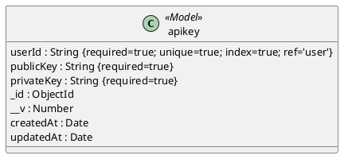

### Model `blog`

Nguồn: `server/src/models/blog.model.js:1`.

| Field | Kiểu khai báo | Options thực tế / ràng buộc |
| --- | --- | --- |
| title | String | type: String, require: true |
| content | String | type: String, require: true |
| image | String | type: String, require: true |

Options: timestamps=true. Index trong field xem cột options; index compound: không khai báo thêm. Không có hook, method hoặc static tự định nghĩa trong schema này.

Nguồn sơ đồ: [uml/class-model-blog.puml](uml/class-model-blog.puml). Chưa kiểm tra cú pháp bằng công cụ.

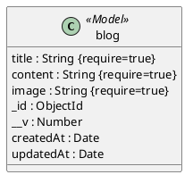

### Model `brand`

Nguồn: `server/src/models/brand.model.js:1`.

| Field | Kiểu khai báo | Options thực tế / ràng buộc |
| --- | --- | --- |
| name | String | type: String, required: true, trim: true |
| key | String | type: String, required: true, unique: true |

Options: timestamps=true. Index trong field xem cột options; index compound: không khai báo thêm. Không có hook, method hoặc static tự định nghĩa trong schema này.

Nguồn sơ đồ: [uml/class-model-brand.puml](uml/class-model-brand.puml). Chưa kiểm tra cú pháp bằng công cụ.

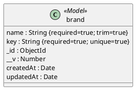

### Model `cartUser`

Nguồn: `server/src/models/cartUser.model.js:1`.

| Field | Kiểu khai báo | Options thực tế / ràng buộc |
| --- | --- | --- |
| userId | String | type: String, require: true, ref: 'user' |
| product | Array<subdocument> | Nhúng; _id tự sinh theo mặc định Mongoose |
| product[].productId | Schema.Types.ObjectId | type: Schema.Types.ObjectId, ref: 'product' |
| product[].quantity | Number | type: Number, require: true |
| fullName | String | type: String, require: true |
| phone | String | type: String, require: true |
| address | String | type: String, require: true |
| note | String | type: String, require: true |
| totalPrice | Number | type: Number, require: true |
| nameCoupon | String | type: String, require: true |

Options: timestamps=true. Index trong field xem cột options; index compound: không khai báo thêm. Không có hook, method hoặc static tự định nghĩa trong schema này.

Nguồn sơ đồ: [uml/class-model-cartuser.puml](uml/class-model-cartuser.puml). Chưa kiểm tra cú pháp bằng công cụ.

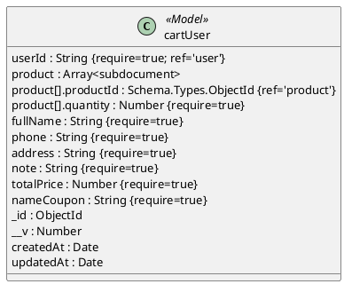

### Model `category`

Nguồn: `server/src/models/category.model.js:1`.

| Field | Kiểu khai báo | Options thực tế / ràng buộc |
| --- | --- | --- |
| name | String | type: String, require: true |

Options: timestamps=true. Index trong field xem cột options; index compound: không khai báo thêm. Không có hook, method hoặc static tự định nghĩa trong schema này.

Nguồn sơ đồ: [uml/class-model-category.puml](uml/class-model-category.puml). Chưa kiểm tra cú pháp bằng công cụ.

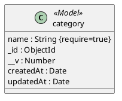

### Model `coupon`

Nguồn: `server/src/models/coupon.model.js:1`.

| Field | Kiểu khai báo | Options thực tế / ràng buộc |
| --- | --- | --- |
| nameCoupon | String | type: String, required: true |
| discount | Number | type: Number, required: true |
| quantity | Number | type: Number, required: true |
| startDate | Date | type: Date, required: true |
| endDate | Date | type: Date, required: true |
| minPrice | Number | type: Number, required: true |

Options: timestamps=true. Index trong field xem cột options; index compound: không khai báo thêm. Không có hook, method hoặc static tự định nghĩa trong schema này.

Nguồn sơ đồ: [uml/class-model-coupon.puml](uml/class-model-coupon.puml). Chưa kiểm tra cú pháp bằng công cụ.

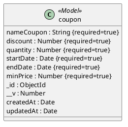

### Model `Message`

Nguồn: `server/src/models/message.model.js:1`.

| Field | Kiểu khai báo | Options thực tế / ràng buộc |
| --- | --- | --- |
| senderId | mongoose.Schema.Types.ObjectId | type: mongoose.Schema.Types.ObjectId, ref: 'User', required: true, |
| receiverId | mongoose.Schema.Types.ObjectId | type: mongoose.Schema.Types.ObjectId, ref: 'User', required: true, |
| conversationId | String | type: String, required: true, index: true, |
| text | String | type: String, required: true, |
| isRead | Boolean | type: Boolean, default: false, |
| createdAt | Date | type: Date, default: Date.now, index: true, |

Options: timestamps=false. Index trong field xem cột options; index compound: không khai báo thêm. Không có hook, method hoặc static tự định nghĩa trong schema này.

Nguồn sơ đồ: [uml/class-model-message.puml](uml/class-model-message.puml). Chưa kiểm tra cú pháp bằng công cụ.

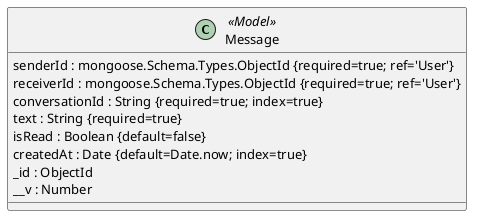

### Model `otp`

Nguồn: `server/src/models/otp.model.js:1`.

| Field | Kiểu khai báo | Options thực tế / ràng buộc |
| --- | --- | --- |
| email | String | type: String, required: true, trim: true, lowercase: true, ref: 'user' |
| otp | String | type: String, required: true |
| time | Date | type: Date, default: Date.now, index: { expires: 600 } |
| type | String | type: String, enum: ['forgotPassword', 'verifyAccount'], required: true |
| attempts | Number | type: Number, default: 0, min: 0 |
| resendAvailableAt | Date | type: Date |
| sendWindowStartedAt | Date | type: Date |
| sendCount | Number | type: Number, default: 0, min: 0 |
| registration | Object nhúng | Không phải ref |
| registration.fullName | String | type: String |
| registration.passwordHash | String | type: String |
| registration.phone | String | type: String |
| registration.address | String | type: String |

Options: timestamps=true. Index trong field xem cột options; index compound: không khai báo thêm. Không có hook, method hoặc static tự định nghĩa trong schema này.

Nguồn sơ đồ: [uml/class-model-otp.puml](uml/class-model-otp.puml). Chưa kiểm tra cú pháp bằng công cụ.

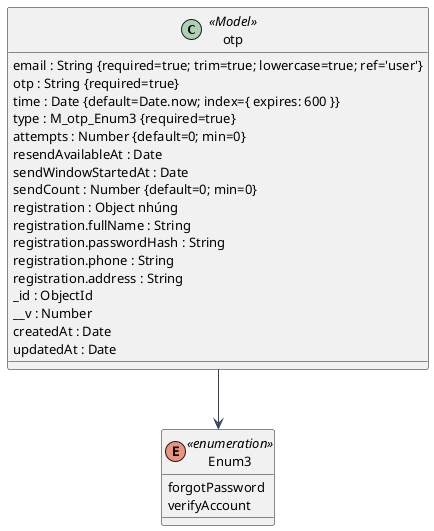

### Model `paymentAttempts`

Nguồn: `server/src/models/paymentAttempt.model.js:1`.

| Field | Kiểu khai báo | Options thực tế / ràng buộc |
| --- | --- | --- |
| orderId | mongoose.Schema.Types.ObjectId | type: mongoose.Schema.Types.ObjectId, ref: 'payments', required: true |
| transactionRef | String | type: String, required: true, unique: true |
| amount | Number | type: Number, required: true, min: 1 |
| status | String | type: String, enum: ['pending', 'paid', 'failed', 'expired', 'cancelled', 'refund_required'], default: 'pending' |
| expiresAt | Date | type: Date, required: true |
| paymentUrl | String | type: String, required: true, select: false |
| createDate | String | type: String, required: true |
| transactionNo | String | Không khai báo constraint riêng |
| bankCode | String | Không khai báo constraint riêng |
| responseCode | String | Không khai báo constraint riêng |
| transactionStatus | String | Không khai báo constraint riêng |
| payDate | String | Không khai báo constraint riêng |
| receivedAt | Date | Không khai báo constraint riêng |
| reconciledAt | Date | Không khai báo constraint riêng |
| nextQueryAt | Date | Không khai báo constraint riêng |
| confirmationSource | String | type: String, enum: ['ipn', 'querydr'] |

Options: timestamps=true. Index trong field xem cột options; index compound: không khai báo thêm. Không có hook, method hoặc static tự định nghĩa trong schema này.

Nguồn sơ đồ: [uml/class-model-paymentattempts.puml](uml/class-model-paymentattempts.puml). Chưa kiểm tra cú pháp bằng công cụ.

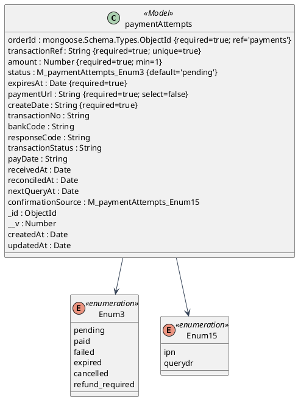

### Model `payments`

Nguồn: `server/src/models/payments.model.js:1`.

| Field | Kiểu khai báo | Options thực tế / ràng buộc |
| --- | --- | --- |
| userId | Schema.Types.ObjectId | type: Schema.Types.ObjectId, ref: 'users', require: true |
| product | Array<subdocument> | Nhúng; _id tự sinh theo mặc định Mongoose |
| product[].productId | Schema.Types.ObjectId | type: Schema.Types.ObjectId, ref: 'product' |
| product[].quantity | Number | type: Number, require: true |
| product[].unitPrice | Number | type: Number, min: 0 |
| product[].nameProduct | String | Không khai báo constraint riêng |
| product[].images | String | Không khai báo constraint riêng |
| fullName | String | type: String, require: true |
| phone | String | type: String, require: true |
| address | String | type: String, require: true |
| note | String | type: String, require: true |
| status | String | type: String, require: true, enum: ['pending', 'confirmed', 'shipped', 'delivered', 'cancelled'] |
| totalPrice | Number | type: Number, require: true |
| paymentMethod | String | type: String, require: true, enum: ['COD', 'VNPAY', 'MOMO'] |
| transactionRef | String | type: String, unique: true, sparse: true |
| checkoutKey | String | type: String, unique: true, sparse: true |
| paymentStatus | String | type: String, enum: ['unpaid', 'pending', 'paid', 'failed', 'expired', 'refund_required'], default: 'unpaid' |
| inventoryReserved | Boolean | Không khai báo constraint riêng |
| couponReserved | Boolean | Không khai báo constraint riêng |
| expiresAt | Date | Không khai báo constraint riêng |
| subtotal | Number | Không khai báo constraint riêng |
| couponDiscount | Number | Không khai báo constraint riêng |
| shippingFee | Number | type: Number, default: 0 |
| nameCoupon | String | type: String, require: true |

Options: timestamps=true. Index trong field xem cột options; index compound: modelPayments.index({ paymentMethod: 1, paymentStatus: 1, expiresAt: 1 });. Không có hook, method hoặc static tự định nghĩa trong schema này.

Nguồn sơ đồ: [uml/class-model-payments.puml](uml/class-model-payments.puml). Chưa kiểm tra cú pháp bằng công cụ.

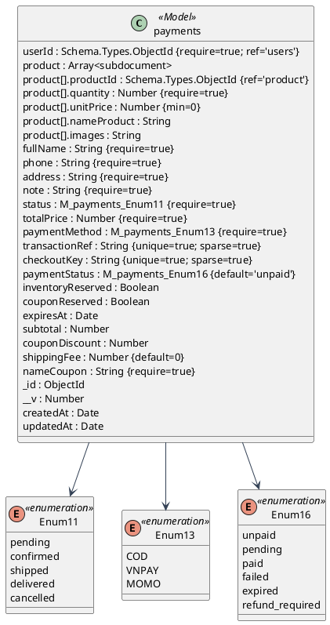

### Model `previewProduct`

Nguồn: `server/src/models/previewProduct.model.js:1`.

| Field | Kiểu khai báo | Options thực tế / ràng buộc |
| --- | --- | --- |
| userId | Schema.Types.ObjectId | type: Schema.Types.ObjectId, ref: 'users', require: true |
| productId | Schema.Types.ObjectId | type: Schema.Types.ObjectId, ref: 'products', require: true |
| content | String | type: String, require: true |
| rating | Number | type: Number, require: true |

Options: timestamps=true. Index trong field xem cột options; index compound: không khai báo thêm. Không có hook, method hoặc static tự định nghĩa trong schema này.

Nguồn sơ đồ: [uml/class-model-previewproduct.puml](uml/class-model-previewproduct.puml). Chưa kiểm tra cú pháp bằng công cụ.

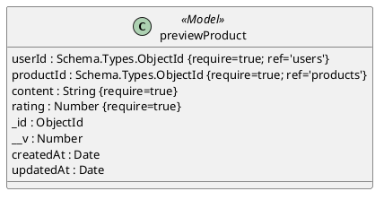

### Model `products`

Nguồn: `server/src/models/products.model.js:1`.

| Field | Kiểu khai báo | Options thực tế / ràng buộc |
| --- | --- | --- |
| nameProduct | String | type: String, required: true |
| modelNumber | String | type: String, required: true |
| brand | String | type: String, required: true |
| collection | String | type: String |
| category | String | type: String |
| origin | String | type: String, required: true |
| gender | String | type: String, required: true |
| glassMaterial | String | type: String, required: true |
| movement | String | type: String, required: true |
| powerReserve | String | type: String |
| warrantyGlobal | String | type: String |
| dialDiameter | Number | type: Number, required: true |
| caseThickness | Number | type: Number |
| bezelMaterial | String | type: String |
| strapMaterial | String | type: String, required: true |
| faceColor | String | type: String |
| waterResistance | String | type: String, required: true |
| price | Number | type: Number, required: true |
| discount | Number | type: Number, default: 0 |
| description | String | type: String, required: true |
| images | String | type: String, required: true |
| stock | Number | type: Number, required: true |
| soldCount | Number | type: Number, default: 0 |

Options: timestamps=true. Index trong field xem cột options; index compound: không khai báo thêm. Không có hook, method hoặc static tự định nghĩa trong schema này.

Nguồn sơ đồ: [uml/class-model-products.puml](uml/class-model-products.puml). Chưa kiểm tra cú pháp bằng công cụ.

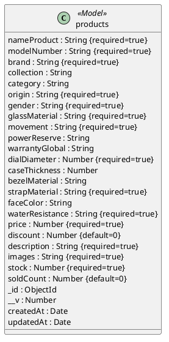

### Model `user`

Nguồn: `server/src/models/users.model.js:1`.

| Field | Kiểu khai báo | Options thực tế / ràng buộc |
| --- | --- | --- |
| fullName | String | type: String, require: true |
| phone | String | type: String, require: true |
| email | String | type: String, require: true |
| password | String | type: String, require: true |
| isAdmin | Boolean | type: Boolean, default: false |
| address | String | type: String, require: true |
| typeLogin | String | type: String, require: true, enum: ['email', 'google'] |
| lastLoginAt | Date | type: Date, default: Date.now |
| isOnline | Boolean | type: Boolean, default: true |

Options: timestamps=true. Index trong field xem cột options; index compound: không khai báo thêm. Không có hook, method hoặc static tự định nghĩa trong schema này.

Nguồn sơ đồ: [uml/class-model-user.puml](uml/class-model-user.puml). Chưa kiểm tra cú pháp bằng công cụ.

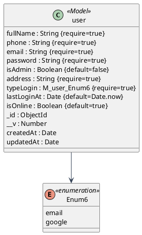

## Quan hệ, bội số và toàn vẹn

Mỗi association có bội số **logic mong muốn từ id**, không chứng nhận DB luôn có parent; MongoDB không tự enforce foreign key. Tên ref sai vẫn được biểu diễn nguyên trạng, vì controller thường truy vấn thủ công chứ không populate.

Nguồn sơ đồ: [uml/class-relations-commerce.puml](uml/class-relations-commerce.puml). Chưa kiểm tra cú pháp bằng công cụ.

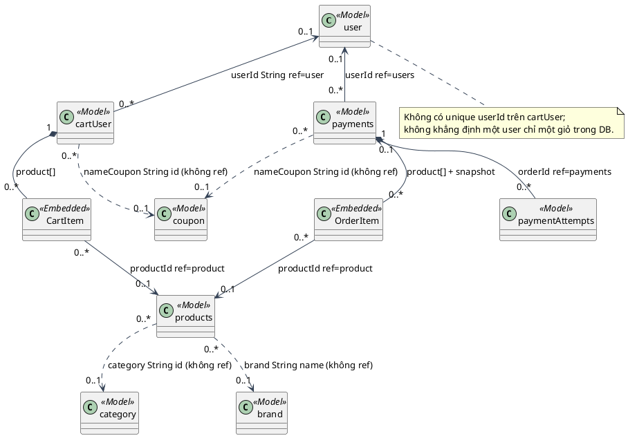

Nguồn sơ đồ: [uml/class-relations-account.puml](uml/class-relations-account.puml). Chưa kiểm tra cú pháp bằng công cụ.

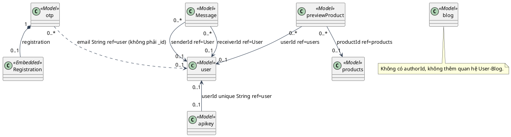

- `user` là tên model đăng ký, nhưng payments/previewProduct dùng ref `users`, Message dùng `User`; cart/order item dùng `product` trong khi model là `products`. Các đường truy vấn thủ công trong controller vẫn có thể chạy; `populate` theo các ref sai cần xác minh trước sử dụng. Nguồn: `server/src/models/users.model.js:1`, `server/src/models/message.model.js:1`, `server/src/models/payments.model.js:1`, `server/src/models/previewProduct.model.js:1`, `server/src/models/cartUser.model.js:1` (cùng thư mục server/src/models).
- Order chính là `payments`, không có model Order riêng. Mỗi order giữ snapshot unitPrice/nameProduct/images và nhiều paymentAttempts; order.transactionRef chỉ attempt hiện tại. `checkoutKey`, transactionRef và attempt.transactionRef có unique index; transaction yêu cầu replica set. Nguồn: `server/src/models/payments.model.js:1`, `server/src/models/paymentAttempt.model.js:1`, `server/src/services/vnpay.service.js:transaction`, `snapshot`, `newAttempt`.
- Stock/coupon reserve và release của COD/VNPAY nằm trong transaction; shipped/delivered kiểm transition; tăng soldCount khi delivered. MoMo là đường riêng có bù trừ reserveInventory nhưng chưa transaction cho toàn bộ thao tác. Nguồn: `server/src/services/vnpay.service.js:reserve`, `release`, `changeStatus`; `server/src/controllers/payments.controller.js:checkPaymentMomo`.
- Không có unique email trên user, unique email/type trên OTP, unique userId trên cart; luồng đọc rồi tạo không thay thế được constraint. Xóa category cascade products nhưng không xóa review, cart item, upload; đơn mới giữ snapshot. Nguồn: schema tương ứng; `server/src/controllers/category.controller.js:deleteCategory`.

## Cấu trúc backend

Routes và controllers là module/class JavaScript thực tế; stereotype chỉ chức năng kiến trúc. Hàm phụ trợ không nhất thiết là class. Nguồn: `server/src/routes/index.js:routes`, các routes/controller/service được liệt kê trong 00.

### Backend account

Phụ thuộc được lấy từ require/import của các module tương ứng, không thêm service layer cho controller thao tác DB trực tiếp.

Nguồn sơ đồ: [uml/class-backend-account.puml](uml/class-backend-account.puml). Chưa kiểm tra cú pháp bằng công cụ.

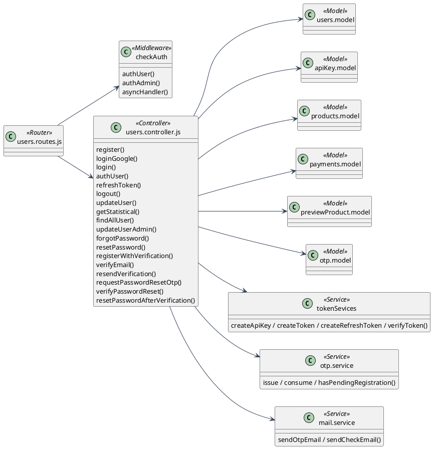

### Backend commerce

Phụ thuộc được lấy từ require/import của các module tương ứng, không thêm service layer cho controller thao tác DB trực tiếp.

Nguồn sơ đồ: [uml/class-backend-commerce.puml](uml/class-backend-commerce.puml). Chưa kiểm tra cú pháp bằng công cụ.

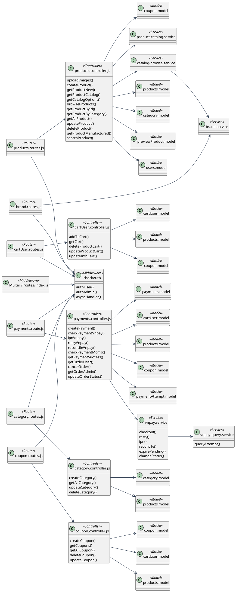

### Backend content

Phụ thuộc được lấy từ require/import của các module tương ứng, không thêm service layer cho controller thao tác DB trực tiếp.

Nguồn sơ đồ: [uml/class-backend-content.puml](uml/class-backend-content.puml). Chưa kiểm tra cú pháp bằng công cụ.

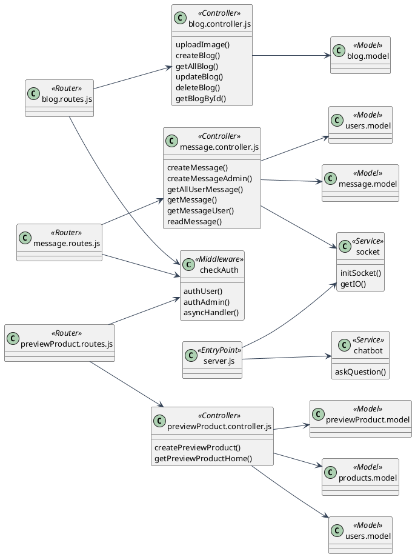

Upload là Multer middleware trong routes/index.js và blog.routes.js, không có upload.service. `utils/SendMail/sendMailForgotPassword.js` là nhánh legacy được import nhưng các lời gọi nằm sau return không tới được; mail.service mới xử lý luồng đang dùng. `config/vnpay.js` chỉ export cấu hình, không thấy nơi import trong src. Nguồn: các file và `server/src/controllers/users.controller.js:forgotPassword`, `resetPassword`.

## Cấu trúc client

Nguồn imports trực tiếp của mọi Pages/Components có trong bảng 00; các sơ đồ dưới tách module để đọc được. Ant Design/TinyMCE là thư viện UI, không phải backend.

Nguồn sơ đồ: [uml/class-client-core.puml](uml/class-client-core.puml). Chưa kiểm tra cú pháp bằng công cụ.

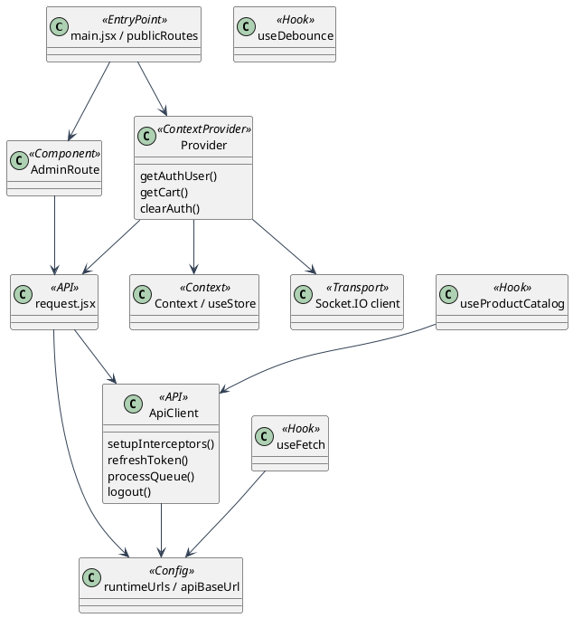

Nguồn sơ đồ: [uml/class-client-storefront.puml](uml/class-client-storefront.puml). Chưa kiểm tra cú pháp bằng công cụ.

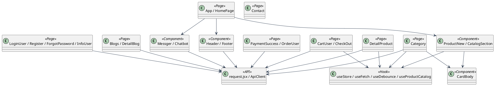

Nguồn sơ đồ: [uml/class-client-admin.puml](uml/class-client-admin.puml). Chưa kiểm tra cú pháp bằng công cụ.

```plantuml
@startuml
skinparam defaultFontName Arial
skinparam shadowing false
skinparam backgroundColor white
skinparam ArrowColor #334155
skinparam defaultFontSize 13
class "AdminLayout" as Admin <<Page>>
class "ManagerProduct" as Product <<Component>>
class "ManagerCategory" as Category <<Component>>
class "CouponManagement" as Coupon <<Component>>
class "BlogAdmin" as Blog <<Component>>
class "ManagerUser" as User <<Component>>
class "ManagerOrder" as Order <<Component>>
class "ManagerStatistical" as Stats <<Component>>
class "Messager" as Chat <<Component>>
class "UserSidebar" as Sidebar <<Component>>
class "ChatWindow" as Window <<Component>>
class "request.jsx" as Req <<API>>
Admin --> Product
Admin --> Category
Admin --> Coupon
Admin --> Blog
Admin --> User
Admin --> Order
Admin --> Stats
Admin --> Chat
Chat *-- Sidebar
Chat *-- Window
Product --> Req
Category --> Req
Coupon --> Req
Blog --> Req
User --> Req
Order --> Req
Stats --> Req
Chat --> Req
Window --> Req
@enduml
```

## Giả định và Phát hiện

Bội số thể hiện khả năng lưu trữ/khóa hiện tại, không dựa sample DB. Không suy ra collection có dữ liệu chỉ vì model tồn tại. Các thiếu constraint/ref sai và khác biệt UI/schema được tổng hợp tại 05.
