# 03 — Sequence theo luồng hiện tại

Mỗi sơ đồ ứng với một UC trong 01. Tên participant là alias kiến trúc: `Controller`/`Service` tham chiếu handler/service được dẫn nguồn, không giả định mọi handler có thêm service. `Model / MongoDB` chỉ nơi truy cập persistence; riêng upload ghi filesystem được ghi rõ trong mũi tên. Actor bên ngoài phù hợp từng UC; các participant không tham gia đã được bỏ khỏi sơ đồ.

Các lỗi chung: authUser/authAdmin 401; BadRequestError không truyền status mặc định 403; exception DB/query chưa xử lý trả 500 qua asyncHandler. Blog không có wrapper nên không bảo đảm đi tới error middleware. Nguồn: `server/src/auth/checkAuth.js:1`, `server/src/core/error.response.js:1`, `server/src/routes/blog.routes.js:1`. Mỗi sơ đồ ghi thêm các nhánh riêng; không mô phỏng sự cố mạng/DB chưa chạy thực tế.

## UC-01 — Đăng ký tài khoản

**Mô tả:** Server kiểm tra truthy các trường và regex email; bcrypt cost 10. UI password tối thiểu 6 và confirm khớp nhưng server chưa kiểm tra độ dài/confirm. Limiter gửi chung 5/giờ/IP, cooldown email/type 60s.

**Tiền điều kiện:** Ứng dụng được cấu hình và có thể truy cập API.

**Nguồn:** `server/src/controllers/users.controller.js:60`; `client/src/Pages/Register/Register.jsx:1`; `server/src/routes/users.routes.js:12`; `server/src/services/otp.service.js:20`; `server/src/services/mail.service.js:21`.

Nguồn sơ đồ: [uml/seq-01.puml](uml/seq-01.puml). Chưa kiểm tra cú pháp bằng công cụ.

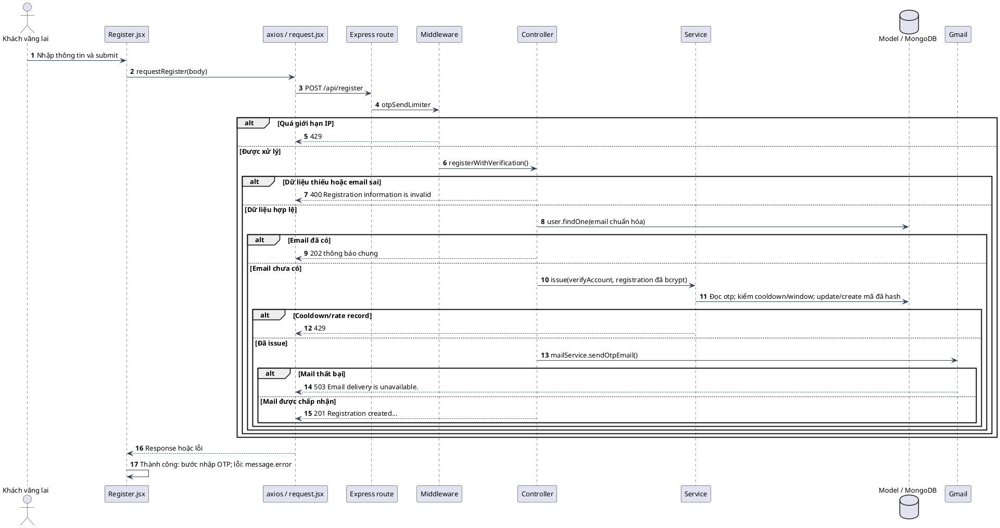

**Nhánh thay thế / giới hạn:** Email đã tồn tại trả 202 thông báo chung; email đủ điều kiện trả 201. Chưa tạo user trước verify. 400 Registration information is invalid; 429 COOLDOWN/RATE_LIMIT; 503 Email delivery is unavailable.

## UC-02 — Xác minh email đăng ký

**Mô tả:** TTL 10 phút được kiểm tra bằng code và TTL index; tối đa 5 lần sai; limiter verify chung 15/15 phút/IP. Không tự đăng nhập.

**Tiền điều kiện:** Có registration pending chưa hết hạn.

**Nguồn:** `server/src/controllers/users.controller.js:522`; `client/src/Pages/Register/Register.jsx:1`; `server/src/routes/users.routes.js:13`; `server/src/services/otp.service.js:20`; `server/src/services/mail.service.js:21`.

Nguồn sơ đồ: [uml/seq-02.puml](uml/seq-02.puml). Chưa kiểm tra cú pháp bằng công cụ.

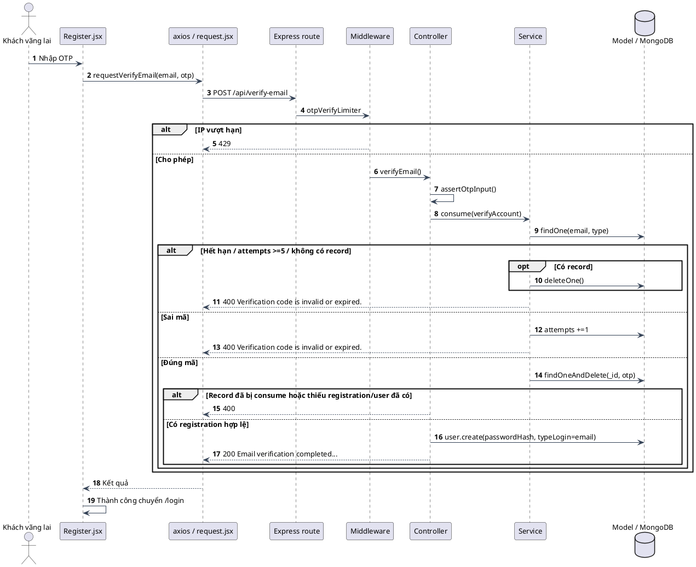

**Nhánh thay thế / giới hạn:** Không có nhánh thay thế riêng. 400 Email or verification code is invalid; 400 Verification code is invalid or expired (có biến thể dấu chấm từ service).

## UC-03 — Gửi lại mã xác minh đăng ký

**Mô tả:** 5/giờ/IP chung với register/forgot; issue kiểm tra 60s và 5 lần/email/type trong cửa sổ lưu ở record.

**Tiền điều kiện:** Ứng dụng được cấu hình và có thể truy cập API.

**Nguồn:** `server/src/controllers/users.controller.js:539`; `client/src/Pages/Register/Register.jsx:1`; `server/src/routes/users.routes.js:14`; `server/src/services/otp.service.js:20`; `server/src/services/mail.service.js:21`.

Nguồn sơ đồ: [uml/seq-03.puml](uml/seq-03.puml). Chưa kiểm tra cú pháp bằng công cụ.

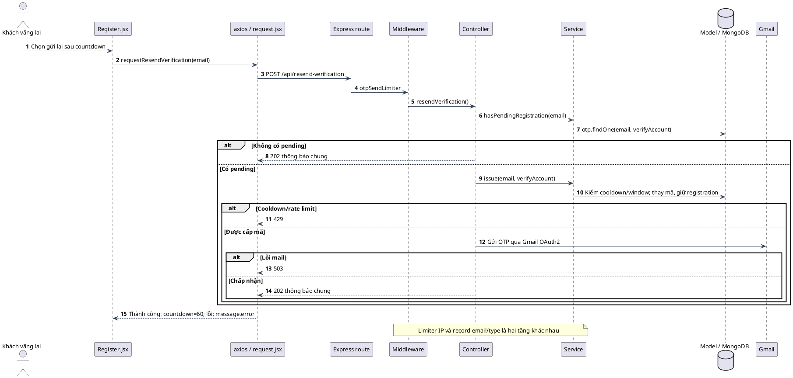

**Nhánh thay thế / giới hạn:** Không có pending cũng trả 202 thông báo chung. 429 Please wait before requesting a new code.; 503 Email delivery is unavailable.

## UC-04 — Đăng nhập email

**Mô tả:** Cookie token/refreshToken httpOnly; logged có thể đọc từ JS; production secure + Strict, dev Lax. Login không có rate limiter riêng.

**Tiền điều kiện:** Ứng dụng được cấu hình và có thể truy cập API.

**Nguồn:** `server/src/controllers/users.controller.js:92`; `client/src/Pages/LoginUser/LoginUser.jsx:1`; `server/src/routes/users.routes.js:15`.

Nguồn sơ đồ: [uml/seq-04.puml](uml/seq-04.puml). Chưa kiểm tra cú pháp bằng công cụ.

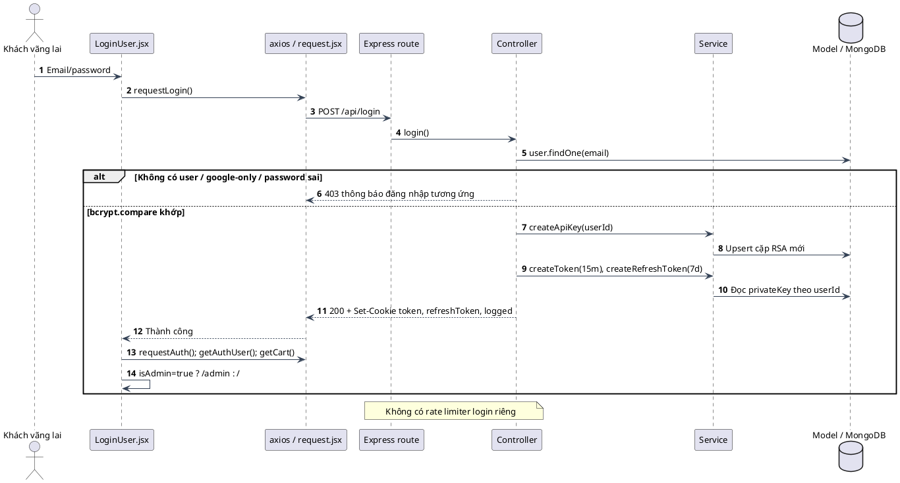

**Nhánh thay thế / giới hạn:** Không có nhánh thay thế riêng. 403 Tài khoản hoặc mật khẩu không chính xác !!!; 403 Vui lòng đăng nhập bằng Google. Lỗi bcrypt/cast không chuẩn hóa có thể thành 500.

## UC-05 — Đăng nhập Google

**Mô tả:** Không tin name/email do client tự gửi; cần credential và GOOGLE_CLIENT. Account cùng email được liên kết trực tiếp.

**Tiền điều kiện:** Ứng dụng được cấu hình và có thể truy cập API.

**Nguồn:** `server/src/controllers/users.controller.js:92`; `client/src/Pages/LoginUser/LoginUser.jsx:1`; `server/src/routes/users.routes.js:19`.

Nguồn sơ đồ: [uml/seq-05.puml](uml/seq-05.puml). Chưa kiểm tra cú pháp bằng công cụ.

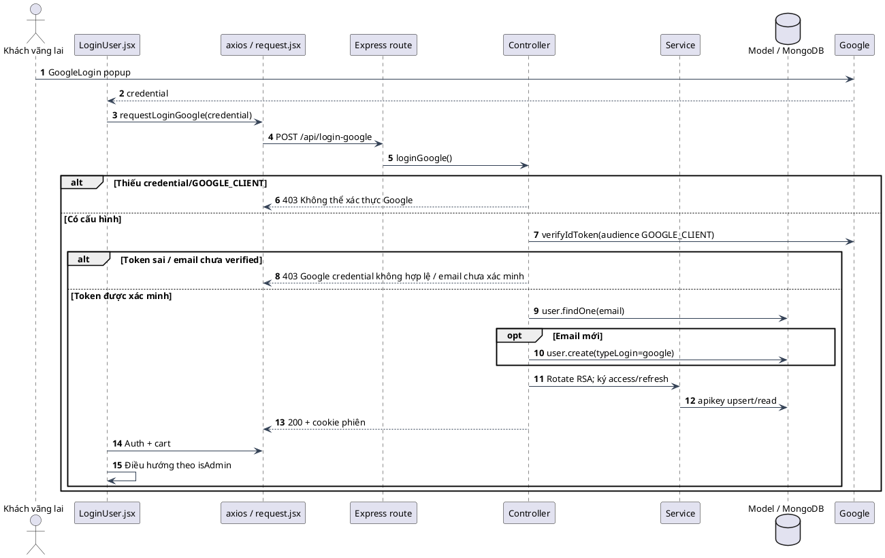

**Nhánh thay thế / giới hạn:** Email đã có: không tạo user mới; email mới: lưu name/email/typeLogin google. 403 Không thể xác thực Google; Google credential không hợp lệ; Email Google chưa được xác minh.

## UC-06 — Kiểm tra và gia hạn phiên

**Mô tả:** Access 15m/refresh 7d dùng cùng cặp RSA và verifyToken. /api/admin chạy authUser rồi authAdmin. logged chỉ là dấu hiệu để UI thử request.

**Tiền điều kiện:** Ứng dụng được cấu hình và có thể truy cập API.

**Nguồn:** `server/src/controllers/users.controller.js:166`; `client/src/store/Provider.jsx:1`; `server/src/routes/users.routes.js:16`; `server/src/routes/users.routes.js:17`; `server/src/routes/users.routes.js:30`.

Nguồn sơ đồ: [uml/seq-06.puml](uml/seq-06.puml). Chưa kiểm tra cú pháp bằng công cụ.

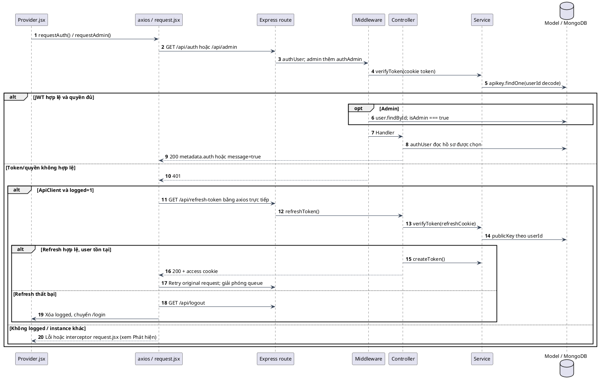

**Nhánh thay thế / giới hạn:** request.jsx có interceptor khác ApiClient; nhánh queue đầu tiên có bất thường ghi ở 05, không coi retry luôn thành công. 401 Vui lòng đăng nhập / Vui lòng đăng nhập lại / Bạn không có quyền truy cập; 403 Tài khoản không tồn tại từ refresh nếu user bị xóa.

## UC-07 — Đăng xuất

**Mô tả:** Không có auth middleware nên vẫn clear cookie khi access hết hạn; chỉ xóa key nếu access verify được.

**Tiền điều kiện:** Ứng dụng được cấu hình và có thể truy cập API.

**Nguồn:** `server/src/controllers/users.controller.js:203`; `client/src/Components/Header/Header.jsx:1`; `server/src/routes/users.routes.js:18`.

Nguồn sơ đồ: [uml/seq-07.puml](uml/seq-07.puml). Chưa kiểm tra cú pháp bằng công cụ.

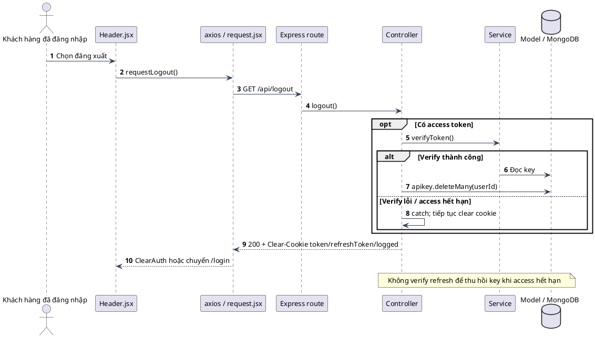

**Nhánh thay thế / giới hạn:** Không có nhánh thay thế riêng. 200 Đăng xuất thành công; lỗi DB xóa key bị catch trong khối verify/xóa.

## UC-08 — Khôi phục mật khẩu bằng OTP

**Mô tả:** OTP TTL 10m, 5 lần sai, resend 60s; rate send 5/giờ/IP và verify 15/15m/IP. Reset yêu cầu password truthy, confirm khớp; min 6 chỉ UI.

**Tiền điều kiện:** Ứng dụng được cấu hình và có thể truy cập API.

**Nguồn:** `server/src/controllers/users.controller.js:414`; `client/src/Pages/ForgotPassword/ForgotPassword.jsx:1`; `server/src/routes/users.routes.js:22`; `server/src/routes/users.routes.js:23`; `server/src/routes/users.routes.js:24`; `server/src/services/otp.service.js:20`; `server/src/services/mail.service.js:21`.

Nguồn sơ đồ: [uml/seq-08.puml](uml/seq-08.puml). Chưa kiểm tra cú pháp bằng công cụ.

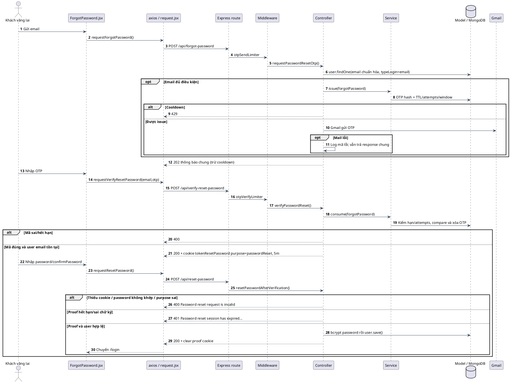

**Nhánh thay thế / giới hạn:** Email không tồn tại/google/không hợp lệ đều 202; lỗi mail reset được log và vẫn 202 (trừ cooldown). 429 cooldown; 400 mã không hợp lệ; 401 Password reset session has expired. Verify the code again.; 400 Password reset request is invalid.

## UC-09 — Xem và cập nhật hồ sơ

**Mô tả:** authUser; không nhận id hoặc isAdmin từ body để sửa chính mình; không có runValidators ở query update.

**Tiền điều kiện:** Ứng dụng được cấu hình và có thể truy cập API.

**Nguồn:** `server/src/controllers/users.controller.js:218`; `client/src/Pages/InfoUser/InfoUser.jsx:1`; `server/src/routes/users.routes.js:20`.

Nguồn sơ đồ: [uml/seq-09.puml](uml/seq-09.puml). Chưa kiểm tra cú pháp bằng công cụ.

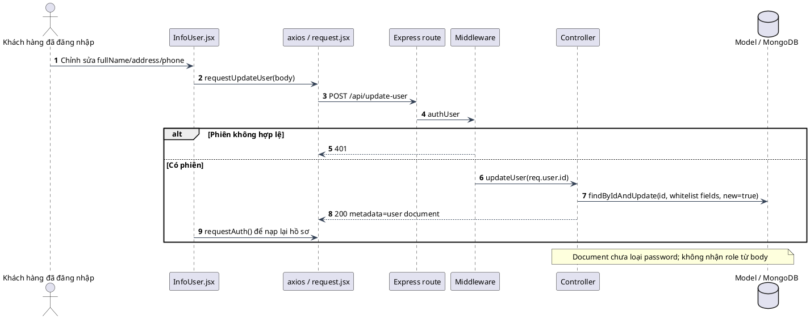

**Nhánh thay thế / giới hạn:** Không có nhánh thay thế riêng. 401 nếu không có phiên; lỗi cast/DB chuyển error middleware.

## UC-10 — Xem catalog trang chủ

**Mô tả:** PAGE_SIZE 10; sort createdAt/_id giảm; page nguyên dương và clamp về totalPages; new chỉ 1 trang. Legacy manufactured lọc discount >=10; by-category còn bộ lọc cũ.

**Tiền điều kiện:** Ứng dụng được cấu hình và có thể truy cập API.

**Nguồn:** `server/src/services/product-catalog.service.js:37`; `client/src/Components/HomePage/ProductNew/ProductNew.jsx:1`; `server/src/routes/products.routes.js:9`; `server/src/routes/products.routes.js:10`; `server/src/routes/products.routes.js:14`; `server/src/routes/products.routes.js:15`.

Nguồn sơ đồ: [uml/seq-10.puml](uml/seq-10.puml). Chưa kiểm tra cú pháp bằng công cụ.

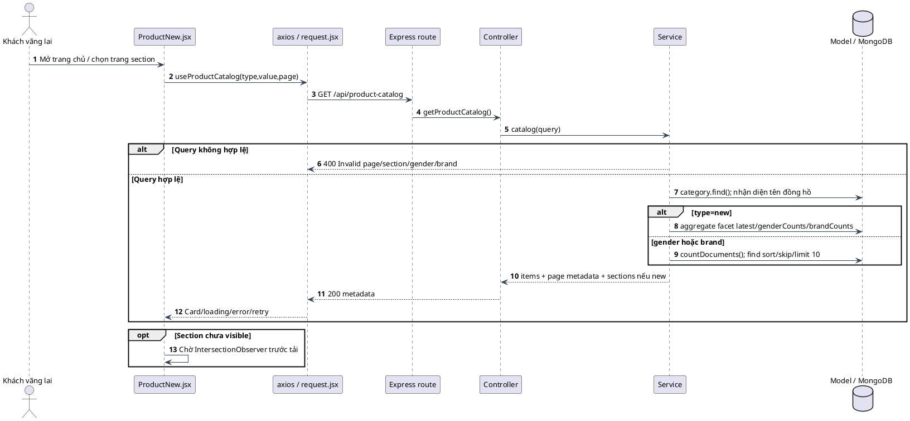

**Nhánh thay thế / giới hạn:** Legacy API get-product-new/manufactured/by-category vẫn có dù không phải đường gọi chính mới. 400 Invalid page/section type/section value/gender/brand.

## UC-11 — Tìm kiếm và lọc sản phẩm

**Mô tả:** Không chọn đồng thời category và brand; stock all/in/order; min/max là số nguyên không âm, min<=max; search tối đa 100. Legacy /api/search dùng regex trực tiếp chưa escape.

**Tiền điều kiện:** Ứng dụng được cấu hình và có thể truy cập API.

**Nguồn:** `server/src/services/catalog-browse.service.js:37`; `client/src/Pages/Category/Category.jsx:1`; `server/src/routes/products.routes.js:11`; `server/src/routes/products.routes.js:12`; `server/src/routes/products.routes.js:16`.

Nguồn sơ đồ: [uml/seq-11.puml](uml/seq-11.puml). Chưa kiểm tra cú pháp bằng công cụ.

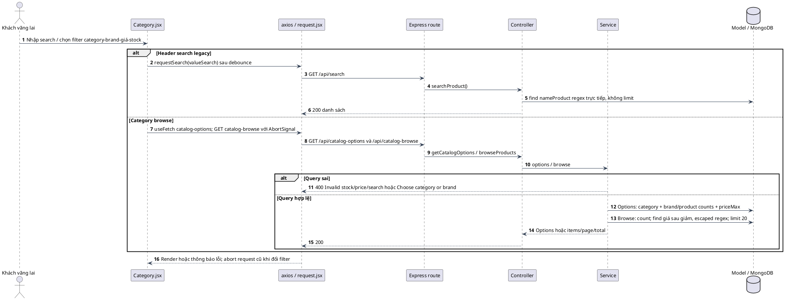

**Nhánh thay thế / giới hạn:** Không có nhánh thay thế riêng. 400 Choose category or brand / Invalid stock / Invalid price range / Invalid search; lỗi regex legacy có thể 500.

## UC-12 — Xem chi tiết sản phẩm và đánh giá

**Mô tả:** Public read. get-preview-product-home lấy 10 record không sort; tra user/product từng record.

**Tiền điều kiện:** Ứng dụng được cấu hình và có thể truy cập API.

**Nguồn:** `server/src/controllers/products.controller.js:118`; `client/src/Pages/DetailProduct/DetailProduct.jsx:1`; `server/src/routes/previewProduct.routes.js:9`; `server/src/routes/products.routes.js:13`.

Nguồn sơ đồ: [uml/seq-12.puml](uml/seq-12.puml). Chưa kiểm tra cú pháp bằng công cụ.

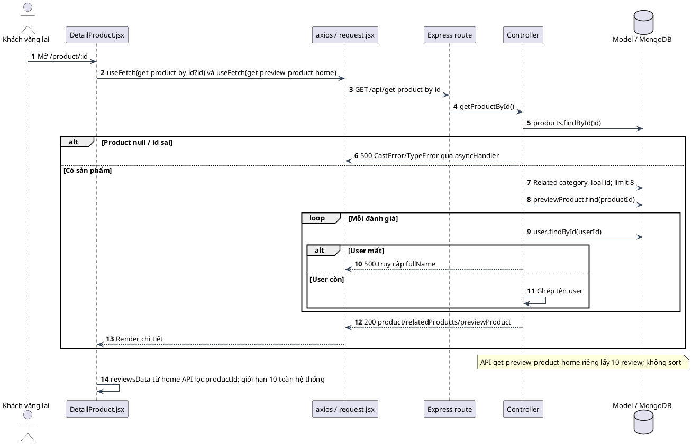

**Nhánh thay thế / giới hạn:** DetailProduct còn gọi get-preview-product-home qua useFetch rồi lọc theo productId; API chỉ trả tối đa 10 review toàn hệ thống. Wrapper requestGetPreviewProductHome không có consumer ngoài request.jsx. ID không hợp lệ hoặc product/user đã xóa có thể thành 500 do truy cập null; không có nhánh 404 chuẩn trong handler.

## UC-13 — Tạo đánh giá sản phẩm

**Mô tả:** As-is chỉ admin gọi được API; không kiểm tra đã mua/giao hàng, không giới hạn rating ở schema. UI khách hàng tồn tại nhưng bị server từ chối.

**Tiền điều kiện:** Ứng dụng được cấu hình và có thể truy cập API.

**Nguồn:** `server/src/controllers/previewProduct.controller.js:6`; `client/src/Pages/InfoUser/OrderUser/OrderUser.jsx:1`; `server/src/routes/previewProduct.routes.js:8`.

Nguồn sơ đồ: [uml/seq-13.puml](uml/seq-13.puml). Chưa kiểm tra cú pháp bằng công cụ.

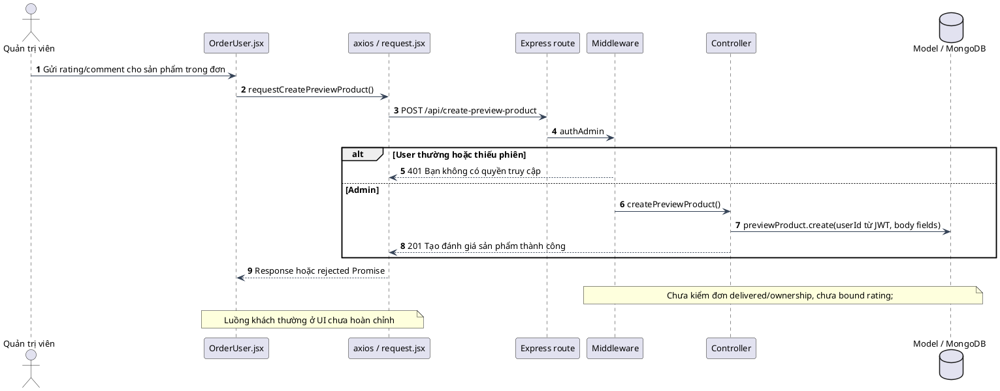

**Nhánh thay thế / giới hạn:** Không có nhánh thay thế riêng. 401 Bạn không có quyền truy cập với khách thường; lỗi schema/DB có thể 500.

## UC-14 — Xem giỏ hàng

**Mô tả:** authUser; GET có thể ghi sửa giỏ; không có cart trả 200 mảng rỗng và total=0.

**Tiền điều kiện:** Ứng dụng được cấu hình và có thể truy cập API.

**Nguồn:** `server/src/controllers/cartUser.controller.js:114`; `client/src/Pages/Cart/CartUser.jsx:1`; `server/src/routes/cartUser.routes.js:9`.

Nguồn sơ đồ: [uml/seq-14.puml](uml/seq-14.puml). Chưa kiểm tra cú pháp bằng công cụ.

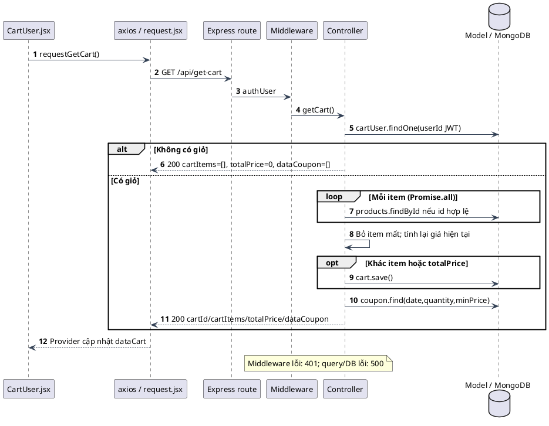

**Nhánh thay thế / giới hạn:** Không có nhánh thay thế riêng. 401 phiên; lỗi DB/cast thành 500.

## UC-15 — Thêm sản phẩm vào giỏ

**Mô tả:** authUser; chưa reserve stock; thao tác read/save giỏ không transaction; quantityProduct không dùng giá client.

**Tiền điều kiện:** Ứng dụng được cấu hình và có thể truy cập API.

**Nguồn:** `server/src/controllers/cartUser.controller.js:31`; `client/src/Components/CardBody/CardBody.jsx:1`; `server/src/routes/cartUser.routes.js:8`.

Nguồn sơ đồ: [uml/seq-15.puml](uml/seq-15.puml). Chưa kiểm tra cú pháp bằng công cụ.

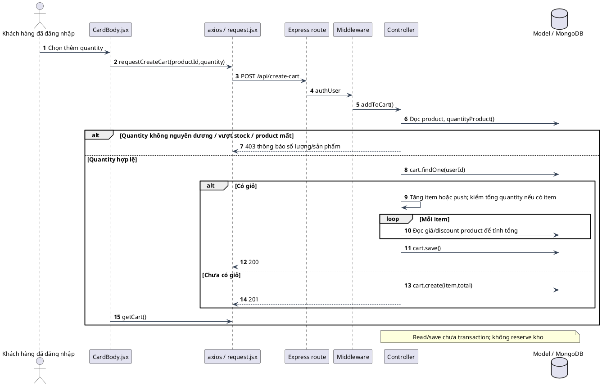

**Nhánh thay thế / giới hạn:** Không có nhánh thay thế riêng. 403 Số lượng sản phẩm không hợp lệ / Sản phẩm không tồn tại / Số lượng sản phẩm không đủ / Missing required fields.

## UC-16 — Sửa số lượng giỏ

**Mô tả:** Số nguyên dương không vượt stock; quantity=0 không phải thao tác xóa.

**Tiền điều kiện:** Ứng dụng được cấu hình và có thể truy cập API.

**Nguồn:** `server/src/controllers/cartUser.controller.js:196`; `client/src/Pages/Cart/CartUser.jsx:1`; `server/src/routes/cartUser.routes.js:11`.

Nguồn sơ đồ: [uml/seq-16.puml](uml/seq-16.puml). Chưa kiểm tra cú pháp bằng công cụ.

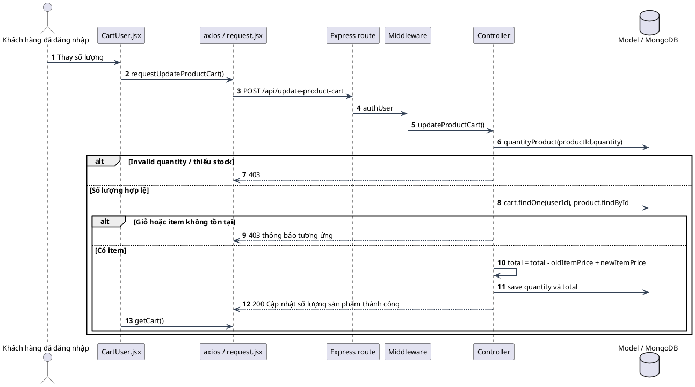

**Nhánh thay thế / giới hạn:** Không có nhánh thay thế riêng. 403 Giỏ hàng không tồn tại / Sản phẩm không tồn tại trong giỏ hàng / Số lượng sản phẩm không đủ.

## UC-17 — Xóa sản phẩm khỏi giỏ

**Mô tả:** authUser; nếu product đã xóa, deleteProductCart từ chối; getCart mới có cơ chế dọn item mất.

**Tiền điều kiện:** Ứng dụng được cấu hình và có thể truy cập API.

**Nguồn:** `server/src/controllers/cartUser.controller.js:160`; `client/src/Pages/Cart/CartUser.jsx:1`; `server/src/routes/cartUser.routes.js:10`.

Nguồn sơ đồ: [uml/seq-17.puml](uml/seq-17.puml). Chưa kiểm tra cú pháp bằng công cụ.

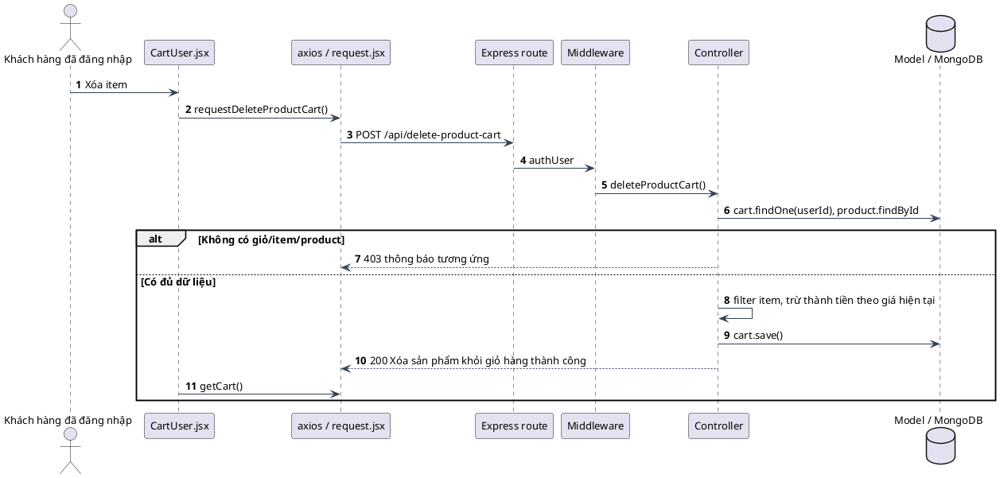

**Nhánh thay thế / giới hạn:** Không có nhánh thay thế riêng. 403 Giỏ hàng không tồn tại / Sản phẩm không tồn tại trong giỏ hàng / Không tìm thấy thông tin sản phẩm.

## UC-18 — Chọn coupon và thông tin giao hàng

**Mô tả:** UI phone 10 chữ số; checkout server kiểm shipping string dài <=500, coupon quantity/date/minPrice. /api/coupon là endpoint legacy lỗi req.user vì route thiếu auth, không phải nguồn coupon của UI hiện tại.

**Tiền điều kiện:** Ứng dụng được cấu hình và có thể truy cập API.

**Nguồn:** `server/src/controllers/cartUser.controller.js:235`; `client/src/Pages/CheckOut/CheckOut.jsx:1`; `server/src/routes/cartUser.routes.js:12`; `server/src/routes/coupon.routes.js:9`.

Nguồn sơ đồ: [uml/seq-18.puml](uml/seq-18.puml). Chưa kiểm tra cú pháp bằng công cụ.

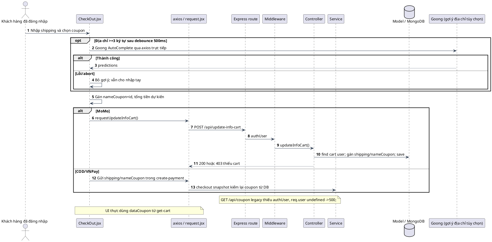

**Nhánh thay thế / giới hạn:** Gợi ý địa chỉ sau 3 ký tự và debounce 500ms; lỗi Goong xóa gợi ý, vẫn nhập tay được. 403 Giỏ hàng không tồn tại; checkout 400 Coupon is invalid, expired or unavailable; /api/coupon thường 500.

## UC-19 — Đặt hàng COD

**Mô tả:** Replica set transaction bắt buộc. checkoutKey unique sparse; không tin totalPrice từ client. unitPrice làm tròn VND bằng BigInt. Giá giảm hợp lệ 0..100%, số tiền safe integer.

**Tiền điều kiện:** Ứng dụng được cấu hình và có thể truy cập API.

**Nguồn:** `server/src/services/vnpay.service.js:132`; `client/src/Pages/CheckOut/CheckOut.jsx:1`; `server/src/routes/payments.route.js:7`.

Nguồn sơ đồ: [uml/seq-19.puml](uml/seq-19.puml). Chưa kiểm tra cú pháp bằng công cụ.

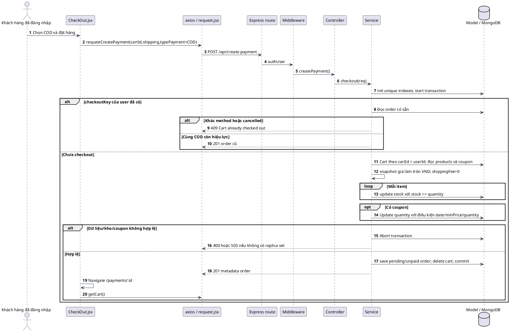

**Nhánh thay thế / giới hạn:** Không có nhánh thay thế riêng. 400 Cart is empty / Invalid cartId / Insufficient stock; 409 Cart already checked out; 503 Checkout requires MongoDB replica set transactions.

## UC-20 — Khởi tạo thanh toán VNPay

**Mô tả:** Gateway allowlist; production callback/client bắt buộc HTTPS công khai; không tạo URL khi tổng bằng 0. SDK nhận VND; callback amount đối chiếu *100. Retry checkout cùng cartId trả URL attempt pending còn hạn.

**Tiền điều kiện:** Ứng dụng được cấu hình và có thể truy cập API.

**Nguồn:** `server/src/services/vnpay.service.js:156`; `client/src/Pages/CheckOut/CheckOut.jsx:1`; `server/src/routes/payments.route.js:7`.

Nguồn sơ đồ: [uml/seq-20.puml](uml/seq-20.puml). Chưa kiểm tra cú pháp bằng công cụ.

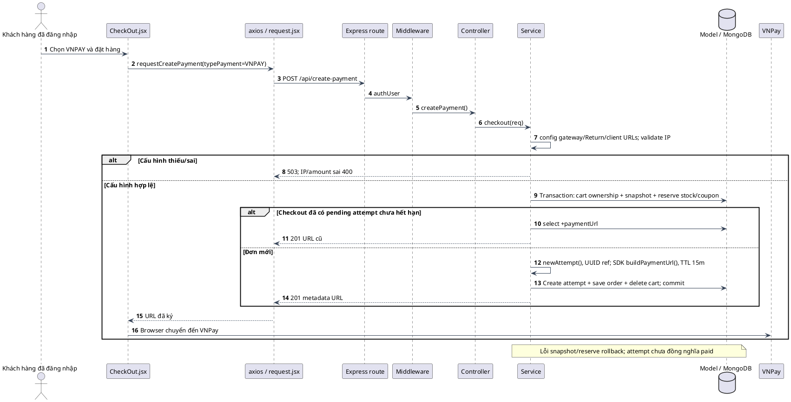

**Nhánh thay thế / giới hạn:** Không có nhánh thay thế riêng. 400 Invalid VNPay amount / Invalid client IP; 503 thiếu/cấu hình sai biến; 409 Use the order page to check payment status or retry.

## UC-21 — Hiển thị kết quả Return VNPay

**Mô tả:** Return endpoint công khai nhưng không cập nhật paid. Không phụ thuộc cookie trên request callback; trang kết quả cần phiên của chủ đơn.

**Tiền điều kiện:** Ứng dụng được cấu hình và có thể truy cập API.

**Nguồn:** `server/src/controllers/payments.controller.js:148`; `client/src/Pages/PaymentSuccess/PaymentSuccess.jsx:1`; `server/src/routes/payments.route.js:8`; `server/src/routes/payments.route.js:9`.

Nguồn sơ đồ: [uml/seq-21.puml](uml/seq-21.puml). Chưa kiểm tra cú pháp bằng công cụ.

```plantuml
@startuml
skinparam defaultFontName Arial
skinparam shadowing false
skinparam backgroundColor white
skinparam ArrowColor #334155
skinparam defaultFontSize 13
autonumber
participant "PaymentSuccess.jsx" as UI
participant "axios / request.jsx" as A
participant "Express route" as R
participant "Controller" as C
participant "Service" as S
database "Model / MongoDB" as DB
participant "VNPay" as E
E -> R : Browser GET /api/vnpay-return hoặc check-payment-vnpay
R -> C : checkPaymentVnpay(query)
C -> S : verify(query)
alt Sai chữ ký/params
C --> E : 400 Dữ liệu hoặc chữ ký VNPay không hợp lệ
else Verify hợp lệ
C -> DB : attempt.findOne(transactionRef)
alt Không tìm thấy
C --> E : 404 Không tìm thấy giao dịch
else Amount không khớp attempt *100
C --> E : 400 Số tiền thanh toán không khớp
else Khớp
C --> UI : 302 /payments/:orderId; production absolute client URL
UI -> A : get-payment-success (auth/ownership)
opt Trạng thái pending/failed/expired và đến lịch
UI -> A : reconcile-payment-vnpay
end
end
end
note over C,DB : Return không settle hoặc đánh dấu paid
@enduml
```

**Nhánh thay thế / giới hạn:** Không có nhánh thay thế riêng. 400 Dữ liệu hoặc chữ ký VNPay không hợp lệ / Số tiền thanh toán không khớp; 404 Không tìm thấy giao dịch.

## UC-22 — Xác nhận IPN VNPay

**Mô tả:** Thành công cần responseCode=00 và transactionStatus=00; idempotency qua receivedAt/reconciledAt trong transaction. Callback trễ không tự bán lại hàng hoặc tự hoàn tiền.

**Tiền điều kiện:** Ứng dụng được cấu hình và có thể truy cập API.

**Nguồn:** `server/src/services/vnpay.service.js:218`; `server/src/controllers/payments.controller.js:1`; `server/src/routes/payments.route.js:10`.

Nguồn sơ đồ: [uml/seq-22.puml](uml/seq-22.puml). Chưa kiểm tra cú pháp bằng công cụ.

```plantuml
@startuml
skinparam defaultFontName Arial
skinparam shadowing false
skinparam backgroundColor white
skinparam ArrowColor #334155
skinparam defaultFontSize 13
autonumber
participant "Express route" as R
participant "Controller" as C
participant "Service" as S
database "Model / MongoDB" as DB
participant "VNPay" as E
E -> R : GET /api/vnpay-ipn (query signed)
R -> C : ipnVnpay()
C -> S : ipn -> verify()
alt Chữ ký/params sai
S --> E : HTTP 200 RspCode=97
else Verify hợp lệ
S -> DB : Transaction: attempt + order
alt Không khớp order/method/orderInfo
S --> E : HTTP 200 RspCode=01
else Amount khác attempt*100 hoặc totalPrice
S --> E : HTTP 200 RspCode=04
else receivedAt hoặc reconciledAt đã có
S --> E : HTTP 200 RspCode=02
else Callback mới
S -> DB : Ghi response fields, receivedAt, source=ipn
alt code=00,status=00 và attempt hiện tại, đơn pending còn reserved
S -> DB : attempt.status=paid; order.paymentStatus=paid
else Thành công nhưng muộn/attempt cũ/đơn không đủ điều kiện
S -> DB : refund_required; release nếu còn reserve và pending
else Thanh toán thất bại/hủy
S -> DB : attempt.failed; nếu current pending: release, order.failed
end
S -> DB : save attempt/order; commit
S --> E : HTTP 200 RspCode=00
end
end
opt Exception
C --> E : HTTP 200 RspCode=99
end
@enduml
```

**Nhánh thay thế / giới hạn:** Không có nhánh thay thế riêng. RspCode 97 chữ ký/params; 01 không khớp đơn; 04 amount; 02 đã xác nhận; 99 unknown error; 00 confirm success.

## UC-23 — Thanh toán lại VNPay

**Mô tả:** Đơn status phải pending; không được retry paid/refund_required/cancelled; snapshot giá đơn được giữ.

**Tiền điều kiện:** Ứng dụng được cấu hình và có thể truy cập API.

**Nguồn:** `server/src/services/vnpay.service.js:179`; `client/src/Pages/PaymentSuccess/PaymentSuccess.jsx:1`; `server/src/routes/payments.route.js:11`.

Nguồn sơ đồ: [uml/seq-23.puml](uml/seq-23.puml). Chưa kiểm tra cú pháp bằng công cụ.

```plantuml
@startuml
skinparam defaultFontName Arial
skinparam shadowing false
skinparam backgroundColor white
skinparam ArrowColor #334155
skinparam defaultFontSize 13
autonumber
actor "Khách hàng đã đăng nhập" as U
participant "PaymentSuccess.jsx" as UI
participant "axios / request.jsx" as A
participant "Express route" as R
participant "Middleware" as W
participant "Controller" as C
participant "Service" as S
database "Model / MongoDB" as DB
participant "VNPay" as E
U -> UI : Thanh toán lại
UI -> A : requestRetryVnpay(idOrder)
A -> R : POST /api/retry-payment-vnpay
R -> W : authUser
W -> C : retryVnpay()
C -> S : retry(req)
S -> DB : Transaction; order thuộc user, VNPAY, status pending
alt Không đủ điều kiện / paymentStatus ngoài pending-failed-expired
S --> A : 409 Order cannot be paid
else paymentStatus=pending
S -> DB : Read attempt với +paymentUrl
alt Attempt còn hạn
S --> A : 200 URL hiện tại
else Đã quá hạn nhưng worker chưa xử lý
S --> A : 409 Payment is awaiting expiry processing; retry shortly
end
else paymentStatus failed/expired
S -> DB : Reserve kho/coupon theo snapshot
alt Thiếu kho/coupon
S -> DB : Rollback
S --> A : 400
else Reserve thành công
S -> S : newAttempt() ref mới
S -> DB : Save attempt và order pending; commit
S --> A : 200 URL mới
end
end
A --> UI : URL hoặc message.error
opt Có URL
UI -> E : Browser chuyển VNPay
end
@enduml
```

**Nhánh thay thế / giới hạn:** Không có nhánh thay thế riêng. 409 Order cannot be paid / Payment is awaiting expiry processing; retry shortly; 400 Insufficient stock/coupon; 401 phiên.

## UC-24 — Đối soát trạng thái VNPay

**Mô tả:** Lease hạn chế nhiều tab/worker; lỗi mạng giữ trạng thái cũ và lịch query; không tin query string browser để paid.

**Tiền điều kiện:** Ứng dụng được cấu hình và có thể truy cập API.

**Nguồn:** `server/src/services/vnpay.service.js:232`; `client/src/Pages/PaymentSuccess/PaymentSuccess.jsx:1`; `server/src/routes/payments.route.js:12`.

Nguồn sơ đồ: [uml/seq-24.puml](uml/seq-24.puml). Chưa kiểm tra cú pháp bằng công cụ.

```plantuml
@startuml
skinparam defaultFontName Arial
skinparam shadowing false
skinparam backgroundColor white
skinparam ArrowColor #334155
skinparam defaultFontSize 13
autonumber
participant "PaymentSuccess.jsx" as UI
participant "axios / request.jsx" as A
participant "Express route" as R
participant "Middleware" as W
participant "Controller" as C
participant "Service" as S
database "Model / MongoDB" as DB
participant "VNPay" as E
UI -> A : requestReconcileVnpay(idOrder)
A -> R : POST /api/reconcile-payment-vnpay
R -> W : authUser
W -> C : reconcileVnpay()
C -> S : reconcile(idOrder,userId)
S -> DB : Find order đúng owner/VNPAY
alt ID sai / không có đơn
S --> A : 400 / 404
else Không ở pending/expired/failed
S --> A : 200 summary hiện tại
else Cần query
S -> DB : findOneAndUpdate lease nextQueryAt +5 phút
alt Đang lease hoặc đã nhận confirmation
S --> A : 200 trạng thái cũ + lịch query
else Lấy được lease
S -> E : queryAttempt HMAC querydr, timeout 10s, redirect=error
alt Mạng/provider lỗi hoặc response không verified
S --> A : 200 summary cũ + lịch query
else verified và responseCode=00, transactionStatus=00/02
S -> DB : settle transaction (giống IPN), source=querydr
S -> DB : Đọc paymentStatus mới
S --> A : 200 summary
else Response khác
S -> DB : Đọc lại trạng thái, không settle
S --> A : 200 summary
end
end
end
A --> UI : paymentStatus và nextCheckAt
@enduml
```

**Nhánh thay thế / giới hạn:** paid/refund_required/unpaid trả summary ngay; đang lease trả nextQueryAt hiện tại. 400 Invalid order ID; 404 Order not found; provider lỗi trả summary cũ (không throw về UI).

## UC-25 — Thanh toán MoMo

**Mô tả:** Đường xử lý legacy riêng, không dùng snapshot/transaction/attempt như VNPay. Chỉ kiểm transactionRef unique để chống lặp; chưa verify callback chữ ký.

**Tiền điều kiện:** Ứng dụng được cấu hình và có thể truy cập API.

**Nguồn:** `server/src/controllers/payments.controller.js:180`; `client/src/Pages/CheckOut/CheckOut.jsx:1`; `server/src/routes/payments.route.js:7`; `server/src/routes/payments.route.js:13`.

Nguồn sơ đồ: [uml/seq-25.puml](uml/seq-25.puml). Chưa kiểm tra cú pháp bằng công cụ.

```plantuml
@startuml
skinparam defaultFontName Arial
skinparam shadowing false
skinparam backgroundColor white
skinparam ArrowColor #334155
skinparam defaultFontSize 13
autonumber
actor "Khách hàng đã đăng nhập" as U
participant "CheckOut.jsx" as UI
participant "axios / request.jsx" as A
participant "Express route" as R
participant "Middleware" as W
participant "Controller" as C
database "Model / MongoDB" as DB
participant "MoMo" as E
U -> UI : Chọn MOMO
UI -> A : update-info-cart rồi create-payment
A -> R : POST /api/create-payment (MOMO)
R -> W : authUser
W -> C : createPayment()
C -> DB : Đọc cart; coupon cho totalPrice
C -> C : requireConfig + HMAC SHA256 request
C -> E : POST MOMO_ENDPOINT
E --> C : payUrl
C --> A : 201 metadata payUrl
A --> UI : URL
UI -> E : Chuyển browser
E -> R : GET /api/check-payment-momo
R -> C : checkPaymentMomo(query)
alt resultCode=0
C -> DB : Tìm transactionRef MOMO:orderId
alt Đã tồn tại
C --> UI : 302 đơn cũ
else Chưa có
C -> DB : Cart theo orderInfo.split()[2]
C -> DB : reserveInventory từng item
alt save order lỗi
C -> DB : Bù kho reserved
C --> A : Error middleware
else save được
C -> DB : Trừ coupon; xóa cart
C --> UI : 302 /payments/:id
end
end
else resultCode khác 0
note over C : Không có nhánh kết thúc response
end
note over R,C : Chưa verify chữ ký callback hoặc amount
@enduml
```

**Nhánh thay thế / giới hạn:** Không có nhánh thay thế riêng. Thiếu cấu hình throw Error →500; callback resultCode khác 0 không kết thúc response; reserve lỗi 403.

## UC-26 — Xem đơn hàng của mình

**Mô tả:** Ownership phía server; order mới độc lập giá hiện tại; ảnh/tên legacy có fallback sản phẩm đã xóa.

**Tiền điều kiện:** Ứng dụng được cấu hình và có thể truy cập API.

**Nguồn:** `server/src/controllers/payments.controller.js:269`; `client/src/Pages/InfoUser/OrderUser/OrderUser.jsx:1`; `server/src/routes/payments.route.js:14`; `server/src/routes/payments.route.js:15`.

Nguồn sơ đồ: [uml/seq-26.puml](uml/seq-26.puml). Chưa kiểm tra cú pháp bằng công cụ.

```plantuml
@startuml
skinparam defaultFontName Arial
skinparam shadowing false
skinparam backgroundColor white
skinparam ArrowColor #334155
skinparam defaultFontSize 13
autonumber
actor "Khách hàng đã đăng nhập" as U
participant "OrderUser.jsx" as UI
participant "axios / request.jsx" as A
participant "Express route" as R
participant "Middleware" as W
participant "Controller" as C
database "Model / MongoDB" as DB
U -> UI : Mở lịch sử /payments/:id
UI -> A : requestGetOrderUser hoặc requestGetPaymentSuccess
A -> R : GET /api/get-order-user hoặc get-payment-success
R -> W : authUser
W -> C : getOrderUser / getPaymentSuccess
C -> DB : Find orders với userId JWT, thêm _id nếu detail
alt Detail không thấy đơn thuộc user
C --> A : 403 Không tìm thấy đơn hàng
else Có dữ liệu
loop Mỗi item của mỗi đơn
C -> DB : Đọc product hiện tại cho legacy fallback
C -> C : Ưu tiên snapshot unitPrice/nameProduct/images
end
C --> A : 200 thông tin đơn và paymentStatus
A --> UI : Hiển thị bảng/chi tiết
end
@enduml
```

**Nhánh thay thế / giới hạn:** Không có nhánh thay thế riêng. 403 Không tìm thấy đơn hàng / Có lỗi xảy ra khi lấy đơn hàng; 401 phiên.

## UC-27 — Hủy đơn hàng của mình

**Mô tả:** User chỉ được hủy pending; cùng status trả ngay không cộng kho lần nữa. COD có thể hủy trước confirmed đối với user.

**Tiền điều kiện:** Ứng dụng được cấu hình và có thể truy cập API.

**Nguồn:** `server/src/services/vnpay.service.js:327`; `client/src/Pages/InfoUser/OrderUser/OrderUser.jsx:1`; `server/src/routes/payments.route.js:16`.

Nguồn sơ đồ: [uml/seq-27.puml](uml/seq-27.puml). Chưa kiểm tra cú pháp bằng công cụ.

```plantuml
@startuml
skinparam defaultFontName Arial
skinparam shadowing false
skinparam backgroundColor white
skinparam ArrowColor #334155
skinparam defaultFontSize 13
autonumber
actor "Khách hàng đã đăng nhập" as U
participant "OrderUser.jsx" as UI
participant "axios / request.jsx" as A
participant "Express route" as R
participant "Middleware" as W
participant "Controller" as C
participant "Service" as S
database "Model / MongoDB" as DB
U -> UI : Hủy đơn
UI -> A : requestCancelOrder(idOrder)
A -> R : POST /api/cancel-order
R -> W : authUser
W -> C : cancelOrder()
C -> S : changeStatus(idOrder,cancelled,userId)
S -> DB : Transaction tìm order theo owner
alt Không tồn tại
S --> A : 404 Order not found
else Đã cancelled
S --> A : 200 không release lần nữa
else Không pending / online paid hoặc refund_required
S --> A : 409 theo rule trạng thái/thanh toán
else Được hủy
S -> DB : Release kho/coupon, cancel attempt pending nếu VNPAY
S -> DB : status=cancelled; VNPAY paymentStatus=failed; commit
C --> A : 200 Đơn hàng đã được hủy bỏ
UI -> A : Tải lại order-user
end
@enduml
```

**Nhánh thay thế / giới hạn:** Không có nhánh thay thế riêng. 400 Invalid order status or ID; 404 Order not found; 409 Invalid order status transition / Paid online orders require a refund workflow.

## UC-28 — Đọc blog

**Mô tả:** Public read, không pagination; HTML render bằng dangerouslySetInnerHTML.

**Tiền điều kiện:** Ứng dụng được cấu hình và có thể truy cập API.

**Nguồn:** `server/src/controllers/blog.controller.js:58`; `client/src/Pages/DetailBlog/DetailBlog.jsx:1`; `server/src/routes/blog.routes.js:24`; `server/src/routes/blog.routes.js:27`.

Nguồn sơ đồ: [uml/seq-28.puml](uml/seq-28.puml). Chưa kiểm tra cú pháp bằng công cụ.

```plantuml
@startuml
skinparam defaultFontName Arial
skinparam shadowing false
skinparam backgroundColor white
skinparam ArrowColor #334155
skinparam defaultFontSize 13
autonumber
actor "Khách vãng lai" as U
participant "DetailBlog.jsx" as UI
participant "axios / request.jsx" as A
participant "Express route" as R
participant "Controller" as C
database "Model / MongoDB" as DB
U -> UI : Mở blog / chọn bài
UI -> A : requestGetAllBlog / requestGetBlogById
A -> R : GET /api/blog/get-all hoặc get-by-id
R -> C : getAllBlog / getBlogById (không wrapper)
C -> DB : find / findById
alt Query thành công
C --> A : 200 metadata blogs/blog hoặc null
A --> UI : Render content HTML
else Promise rejected
note over R,C : Express 4 không tự chuyển rejected Promise;
note over UI,C : Không đảm bảo JSON error; client có thể nhận lỗi mạng/treo
end
@enduml
```

**Nhánh thay thế / giới hạn:** Không có nhánh thay thế riêng. Không có nhánh not found rõ ở get-by-id; lỗi query trong async handler không có wrapper (xem 05).

## UC-29 — Chat với quản trị viên

**Mô tả:** authUser; sender lấy từ JWT; socket identity từ token đã verify. Không queue giao nhận realtime, lịch sử trong DB.

**Tiền điều kiện:** Ứng dụng được cấu hình và có thể truy cập API.

**Nguồn:** `server/src/controllers/message.controller.js:15`; `client/src/Components/Messger/Messger.jsx:1`; `server/src/routes/message.routes.js:8`; `server/src/routes/message.routes.js:13`; `server/src/routes/message.routes.js:14`.

Nguồn sơ đồ: [uml/seq-29.puml](uml/seq-29.puml). Chưa kiểm tra cú pháp bằng công cụ.

```plantuml
@startuml
skinparam defaultFontName Arial
skinparam shadowing false
skinparam backgroundColor white
skinparam ArrowColor #334155
skinparam defaultFontSize 13
autonumber
actor "Khách hàng đã đăng nhập" as U
participant "Messger.jsx" as UI
participant "axios / request.jsx" as A
participant "Express route" as R
participant "Middleware" as W
participant "Controller" as C
database "Model / MongoDB" as DB
participant "Socket.IO" as Sock
U -> UI : Mở khung chat / nhập text
UI -> A : GET get-message-user
A -> R : /api/message/get-message-user
R -> W : authUser
W -> C : getMessageUser()
C -> DB : findOne(senderId JWT); find conversation
alt Chưa từng gửi tin
C --> A : 500 khi đọc data.receiverId
else Có conversation
C --> A : 200 lịch sử
end
UI -> A : requestCreateMessage(text)
A -> R : POST /api/message/create
R -> W : authUser
W -> C : createMessage()
C -> DB : findOne admin; Message.create
alt Có socket admin
C -> Sock : emit newMessage(document)
Sock --> UI : Provider admin nhận newMessageAdmin
else Admin offline
C -> C : Log; DB vẫn đã lưu
end
C --> A : 201 metadata Message
Sock --> UI : newMessageUser khi admin trả lời
note over C,DB : Thiếu admin có thể null ->500 trước ghi
@enduml
```

**Nhánh thay thế / giới hạn:** Không có nhánh thay thế riêng. Không có admin hoặc khách chưa từng gửi tin khiến truy cập null ở controller →500; lỗi socket có thể sau khi DB đã ghi.

## UC-30 — Quản trị hội thoại

**Mô tả:** authAdmin cho all/get-message/create-admin; read-message dùng authUser. get-message lấy sender/receiver từ query, không ràng buộc admin hiện tại.

**Tiền điều kiện:** Ứng dụng được cấu hình và có thể truy cập API.

**Nguồn:** `server/src/controllers/message.controller.js:42`; `client/src/Pages/Admin/Components/Messager/Messager.jsx:1`; `server/src/routes/message.routes.js:9`; `server/src/routes/message.routes.js:11`; `server/src/routes/message.routes.js:12`.

Nguồn sơ đồ: [uml/seq-30.puml](uml/seq-30.puml). Chưa kiểm tra cú pháp bằng công cụ.

```plantuml
@startuml
skinparam defaultFontName Arial
skinparam shadowing false
skinparam backgroundColor white
skinparam ArrowColor #334155
skinparam defaultFontSize 13
autonumber
actor "Quản trị viên" as U
participant "Messager.jsx" as UI
participant "axios / request.jsx" as A
participant "Express route" as R
participant "Middleware" as W
participant "Controller" as C
database "Model / MongoDB" as DB
participant "Socket.IO" as Sock
U -> UI : Mở tab tin nhắn và chọn khách
UI -> A : requestGetAllMessage()
A -> R : GET /api/message/all
R -> W : authAdmin
W -> C : getAllUserMessage()
C -> DB : Aggregate latest sender + unread + users
C --> A : 200 sidebar
UI -> A : read-message + get-message(senderId,receiverId)
A -> R : GET /api/message/read-message, get-message
R -> C : readMessage (authUser) / getMessage (authAdmin)
C -> DB : updateMany isRead; find conversation
C --> A : 200
U -> UI : Nhập trả lời
UI -> A : requestCreateMessageAdmin(receiverId,text)
A -> R : POST /api/message/create-admin
R -> W : authAdmin
W -> C : createMessageAdmin()
C -> DB : Message.create
opt Khách online trong map
C -> Sock : emit newMessageUser
Sock --> UI : Provider khách nhận
end
C --> A : 201
note over C,DB : readMessage đánh dấu cả conversation, không chỉ tin nhận;
note over UI,Sock : Không có socket read receipt; auth lỗi 401, DB/cast lỗi 500
@enduml
```

**Nhánh thay thế / giới hạn:** Không có nhánh thay thế riêng. 401 quyền; cast/DB lỗi có thể 500; receiver offline chỉ bỏ push, vẫn lưu DB.

## UC-31 — Tư vấn bằng chatbot Gemini

**Mô tả:** 10/phút/IP; history tối đa 10 message role user/model, mỗi text<=1000; UI hiện chỉ gửi question, không history; timeout SDK 30s mỗi lần.

**Tiền điều kiện:** Ứng dụng được cấu hình và có thể truy cập API.

**Nguồn:** `server/src/utils/chatbot.js:156`; `client/src/utils/Chatbot/Chatbot.jsx:1`; `server/src/server.js:64`.

Nguồn sơ đồ: [uml/seq-31.puml](uml/seq-31.puml). Chưa kiểm tra cú pháp bằng công cụ.

```plantuml
@startuml
skinparam defaultFontName Arial
skinparam shadowing false
skinparam backgroundColor white
skinparam ArrowColor #334155
skinparam defaultFontSize 13
autonumber
actor "Khách vãng lai" as U
participant "Chatbot.jsx" as UI
participant "axios / request.jsx" as A
participant "Express route" as R
participant "Middleware" as W
participant "Controller" as C
participant "Service" as S
database "Model / MongoDB" as DB
participant "Gemini" as E
U -> UI : Gửi câu hỏi
UI -> A : requestChatbot({question})
A -> R : POST /api/chatbot
R -> W : chatbotRateLimit 10/phút/IP
alt Quá hạn IP
W --> A : 429 RATE_LIMIT
else Được phép
R -> C : Validate question/history và tạo requestId
alt Input sai
C --> A : 400 INVALID_INPUT
else Input hợp lệ
C -> S : askQuestion()
alt Thiếu GEMINI_API_KEY
S --> A : 503 INVALID_KEY
else Key được cấu hình
S -> DB : Products stock>0, limit 10, lean
S -> S : Dựng systemInstruction catalog công khai
loop Tối đa 3 lần gọi; chỉ retry quota/network/503
S -> E : generateContent, timeout 30s/lần
alt Retryable và còn lượt
S -> S : Delay 300ms rồi 600ms
else Không retry hoặc đã hết lượt
S -> S : Kiểm safety/STOP/text hoặc classifyError
end
end
alt Nội dung hợp lệ
S --> A : 200 metadata string
else Lỗi cuối
S --> A : 422/429/502/503/504 + errorCode/requestId
end
end
end
end
A --> UI : Render text đã lọc control chars; lỗi có nút thử lại
@enduml
```

**Nhánh thay thế / giới hạn:** Không có nhánh thay thế riêng. 400 INVALID_INPUT; 429 RATE_LIMIT/QUOTA_429; 503 INVALID_KEY/NETWORK/UNAVAILABLE_5xx; 504 TIMEOUT; 502 MODEL_NOT_FOUND/EMPTY_RESPONSE/UNKNOWN; 422 BLOCKED_BY_SAFETY.

## UC-32 — Quản lý sản phẩm

**Mô tả:** Ghi yêu cầu authAdmin; get-all public. Không có brand CRUD. Update dùng name/size không có trong schema, không cập nhật toàn bộ thông số tạo.

**Tiền điều kiện:** Ứng dụng được cấu hình và có thể truy cập API.

**Nguồn:** `server/src/controllers/products.controller.js:17`; `client/src/Pages/Admin/Components/ManagerProduct/ManagerProduct.jsx:1`; `server/src/routes/products.routes.js:8`; `server/src/routes/products.routes.js:18`; `server/src/routes/products.routes.js:19`; `server/src/routes/products.routes.js:20`.

Nguồn sơ đồ: [uml/seq-32.puml](uml/seq-32.puml). Chưa kiểm tra cú pháp bằng công cụ.

```plantuml
@startuml
skinparam defaultFontName Arial
skinparam shadowing false
skinparam backgroundColor white
skinparam ArrowColor #334155
skinparam defaultFontSize 13
autonumber
actor "Quản trị viên" as U
participant "ManagerProduct.jsx" as UI
participant "axios / request.jsx" as A
participant "Express route" as R
participant "Middleware" as W
participant "Controller" as C
database "Model / MongoDB" as DB
U -> UI : Mở quản lý sản phẩm
UI -> A : get-all-product, get-all-category, brands
A -> R : GET các danh sách
R -> C : getAllProduct / category / brand
C -> DB : Product.find + category từng product
C --> A : 200 hoặc 500 nếu category mất
U -> UI : Tạo / sửa / xóa
opt Có ảnh mới
UI -> A : Upload FormData images (UC-39)
end
UI -> A : requestCreateProduct / UpdateProduct / DeleteProduct
A -> R : POST create/update; DELETE delete
R -> W : authAdmin
alt Không đủ quyền
W --> A : 401
else Admin
W -> C : Handler tương ứng
alt Create
C -> C : Kiểm trường truthy
C -> DB : createProduct đủ thông số
C --> A : 201 hoặc 403 thiếu field
else Update
C -> DB : findByIdAndUpdate whitelist cũ name/size/giá/stock/brand...
C --> A : 200 (không cập nhật nameProduct)
else Delete
C -> DB : findByIdAndDelete
C --> A : 200 hoặc 403 không có product
end
end
A --> UI : Refresh bảng / message.error
@enduml
```

**Nhánh thay thế / giới hạn:** Không có nhánh thay thế riêng. 403 Vui lòng nhập đầy đủ thông tin bắt buộc / Sản phẩm không tồn tại; get-all có category null →500.

## UC-33 — Quản lý danh mục

**Mô tả:** Read public; write authAdmin; xóa cứng cascade products, không transaction/cascade cart/review/upload.

**Tiền điều kiện:** Ứng dụng được cấu hình và có thể truy cập API.

**Nguồn:** `server/src/controllers/category.controller.js:40`; `client/src/Pages/Admin/Components/ManagerCategory/ManagerCategory.jsx:1`; `server/src/routes/category.routes.js:8`; `server/src/routes/category.routes.js:9`; `server/src/routes/category.routes.js:10`; `server/src/routes/category.routes.js:11`.

Nguồn sơ đồ: [uml/seq-33.puml](uml/seq-33.puml). Chưa kiểm tra cú pháp bằng công cụ.

```plantuml
@startuml
skinparam defaultFontName Arial
skinparam shadowing false
skinparam backgroundColor white
skinparam ArrowColor #334155
skinparam defaultFontSize 13
autonumber
actor "Quản trị viên" as U
participant "ManagerCategory.jsx" as UI
participant "axios / request.jsx" as A
participant "Express route" as R
participant "Middleware" as W
participant "Controller" as C
database "Model / MongoDB" as DB
U -> UI : Tạo / sửa / xóa danh mục
UI -> A : requestGetAllCategory và mutation
A -> R : GET get-all-category; POST create/update; DELETE delete
alt Read
R -> C : getAllCategory (public)
C -> DB : find()
C --> A : 200
else Mutation
R -> W : authAdmin
W -> C : Handler
alt Tạo thiếu name
C --> A : 403 Vui lòng nhập đầy đủ thông tin
else Create/update hợp lệ
C -> DB : create hoặc findByIdAndUpdate
C --> A : 201 hoặc 200
else Delete
C -> DB : findByIdAndDelete category
alt Không tồn tại
C --> A : 500 NotFoundError chưa import
else Tồn tại
C -> DB : products.deleteMany(category=id)
C --> A : 200
end
end
end
note over C,DB : Không transaction khi xóa category + products;
A --> UI : Tải lại bảng
@enduml
```

**Nhánh thay thế / giới hạn:** Không có nhánh thay thế riêng. 403 Vui lòng nhập đầy đủ thông tin; category không tồn tại gọi NotFoundError chưa import →500.

## UC-34 — Quản lý coupon

**Mô tả:** GET coupons public; write authAdmin; discount là số tiền, không phần trăm. Schema required nhưng thiếu min/max; query update không runValidators.

**Tiền điều kiện:** Ứng dụng được cấu hình và có thể truy cập API.

**Nguồn:** `server/src/controllers/coupon.controller.js:10`; `client/src/Pages/Admin/Components/ManagerCoupon/CouponManagement.jsx:1`; `server/src/routes/coupon.routes.js:8`; `server/src/routes/coupon.routes.js:10`; `server/src/routes/coupon.routes.js:11`; `server/src/routes/coupon.routes.js:12`.

Nguồn sơ đồ: [uml/seq-34.puml](uml/seq-34.puml). Chưa kiểm tra cú pháp bằng công cụ.

```plantuml
@startuml
skinparam defaultFontName Arial
skinparam shadowing false
skinparam backgroundColor white
skinparam ArrowColor #334155
skinparam defaultFontSize 13
autonumber
actor "Quản trị viên" as U
participant "CouponManagement.jsx" as UI
participant "axios / request.jsx" as A
participant "Express route" as R
participant "Middleware" as W
participant "Controller" as C
database "Model / MongoDB" as DB
U -> UI : Mở bảng / tạo-sửa-xóa coupon
UI -> A : requestGetAllCoupon hoặc mutation
A -> R : GET /api/coupons; POST create/update; DELETE delete
alt List public
R -> C : getAllCoupon()
C -> DB : coupon.find()
C --> A : 200 {success,coupons}
else Write admin
R -> W : authAdmin
W -> C : Handler
alt Create thiếu field truthy
C --> A : 400 thông báo thiếu thông tin
else Create hợp lệ
C -> DB : new coupon + save
C --> A : 201 thông báo tạo
else Update
C -> DB : findByIdAndUpdate(_id, fields)
C --> A : 200 thông báo cập nhật
else Delete
C -> DB : findByIdAndDelete(id)
C --> A : 200 hoặc 500 message=error
end
end
A --> UI : Cập nhật bảng/thông báo
@enduml
```

**Nhánh thay thế / giới hạn:** Không có nhánh thay thế riêng. 400 Vui lòng nhập đầy đủ thông tin (dấu Unicode trong code); delete catch trả 500 message error.

## UC-35 — Quản lý bài viết

**Mô tả:** authAdmin cho write; handlers async không bọc asyncHandler trên Express 4; schema dùng require thay required.

**Tiền điều kiện:** Ứng dụng được cấu hình và có thể truy cập API.

**Nguồn:** `server/src/controllers/blog.controller.js:20`; `client/src/Pages/Admin/Components/ManagerBlog/BlogAdmin.jsx:1`; `server/src/routes/blog.routes.js:23`; `server/src/routes/blog.routes.js:25`; `server/src/routes/blog.routes.js:26`.

Nguồn sơ đồ: [uml/seq-35.puml](uml/seq-35.puml). Chưa kiểm tra cú pháp bằng công cụ.

```plantuml
@startuml
skinparam defaultFontName Arial
skinparam shadowing false
skinparam backgroundColor white
skinparam ArrowColor #334155
skinparam defaultFontSize 13
autonumber
actor "Quản trị viên" as U
participant "BlogAdmin.jsx" as UI
participant "axios / request.jsx" as A
participant "Express route" as R
participant "Middleware" as W
participant "Controller" as C
database "Model / MongoDB" as DB
U -> UI : Soạn/sửa/xóa bài viết
UI -> A : get-all; upload ảnh nếu có; create/update/delete blog
A -> R : /api/blog/*
opt Mutation bài viết
R -> W : authAdmin
end
R -> C : Async handler không có wrapper
alt Create
C -> DB : blog.create(title,content,image)
C --> A : 201
else Update
C -> DB : findById(id)
alt Không có bài
C -> C : next(new NotFoundError chưa import)
else Có bài
C -> DB : findByIdAndUpdate
C --> A : 200 metadata document trước update
end
else Delete
C -> DB : findByIdAndDelete
C --> A : 200
end
note over R,C : Rejection có thể không tới error middleware Express 4
A --> UI : Refresh/preview content HTML
@enduml
```

**Nhánh thay thế / giới hạn:** Không có nhánh thay thế riêng. Update không tìm thấy bài gọi NotFoundError chưa import; promise rejection không được forward nhất quán.

## UC-36 — Xem người dùng và đổi quyền

**Mô tả:** authAdmin; không có endpoint CRUD user đầy đủ; không kiểm giữ ít nhất một admin, findAdmin được đọc nhưng không dùng.

**Tiền điều kiện:** Ứng dụng được cấu hình và có thể truy cập API.

**Nguồn:** `server/src/controllers/users.controller.js:401`; `client/src/Pages/Admin/Components/ManagerUser/ManagerUser.jsx:1`; `server/src/routes/users.routes.js:27`; `server/src/routes/users.routes.js:28`.

Nguồn sơ đồ: [uml/seq-36.puml](uml/seq-36.puml). Chưa kiểm tra cú pháp bằng công cụ.

```plantuml
@startuml
skinparam defaultFontName Arial
skinparam shadowing false
skinparam backgroundColor white
skinparam ArrowColor #334155
skinparam defaultFontSize 13
autonumber
actor "Quản trị viên" as U
participant "ManagerUser.jsx" as UI
participant "axios / request.jsx" as A
participant "Express route" as R
participant "Middleware" as W
participant "Controller" as C
database "Model / MongoDB" as DB
U -> UI : Mở users / đổi switch quyền
UI -> A : requestGetAllUser()
A -> R : GET /api/users
R -> W : authAdmin
W -> C : findAllUser()
C -> DB : user.find() không projection
C --> A : 200 users gồm password field
U -> UI : Đổi isAdminUser
UI -> A : requestUpdateUserAdmin(id,isAdminUser)
A -> R : POST /api/update-user-admin
R -> W : authAdmin
W -> C : updateUserAdmin()
C -> DB : findOne admin (không dùng kết quả); update isAdmin
C --> A : 200 metadata user document
note over C,DB : Không bảo vệ admin cuối cùng; DB/cast lỗi 500
A --> UI : Refresh bảng
@enduml
```

**Nhánh thay thế / giới hạn:** Không có nhánh thay thế riêng. 401 quyền; cast/DB lỗi 500; user không tồn tại có thể metadata null.

## UC-37 — Xử lý đơn hàng phía quản trị

**Mô tả:** pending→confirmed/cancelled; confirmed→shipped/cancelled; shipped→delivered; delivered/cancelled terminal. VNPAY muốn tiếp tục phải paid, refund_required bị chặn.

**Tiền điều kiện:** Ứng dụng được cấu hình và có thể truy cập API.

**Nguồn:** `server/src/services/vnpay.service.js:327`; `client/src/Pages/Admin/Components/ManagerOrder/ManagerOrder.jsx:1`; `server/src/routes/payments.route.js:17`; `server/src/routes/payments.route.js:18`.

Nguồn sơ đồ: [uml/seq-37.puml](uml/seq-37.puml). Chưa kiểm tra cú pháp bằng công cụ.

```plantuml
@startuml
skinparam defaultFontName Arial
skinparam shadowing false
skinparam backgroundColor white
skinparam ArrowColor #334155
skinparam defaultFontSize 13
autonumber
actor "Quản trị viên" as U
participant "ManagerOrder.jsx" as UI
participant "axios / request.jsx" as A
participant "Express route" as R
participant "Middleware" as W
participant "Controller" as C
participant "Service" as S
database "Model / MongoDB" as DB
U -> UI : Mở orders; chọn trạng thái tiếp theo
UI -> A : get-order-admin rồi update-order-status
A -> R : GET /api/get-order-admin; POST /api/update-order-status
R -> W : authAdmin
W -> C : getOrderAdmin / updateOrderStatus
C -> DB : List orders + product snapshots + attempts
C -> S : changeStatus(id,status)
S -> DB : Transaction đọc order
alt ID/status sai hoặc không thấy
S --> A : 400 / 404
else Trạng thái không đổi
S --> A : 200, không tăng/hoàn kho lặp
else Transition sai / VNPAY chưa paid hoặc refund_required
S --> A : 409
else Transition hợp lệ
alt Hủy
S -> DB : Release stock/coupon; cancel pending attempt
else Delivered
S -> DB : soldCount += quantity; COD paymentStatus=paid
else Confirmed/shipped
S -> S : Đổi status
end
S -> DB : save order; commit
C --> A : 200 Cập nhật trạng thái đơn hàng thành công
end
A --> UI : Refresh bảng và modal
@enduml
```

**Nhánh thay thế / giới hạn:** Không có nhánh thay thế riêng. 400 id/status sai; 404 Order not found; 409 Invalid order status transition / Payment has not been confirmed or requires reconciliation.

## UC-38 — Xem thống kê

**Mô tả:** authAdmin; không có filter năm; byLoginType dùng loginType khác schema typeLogin, review group dùng product khác productId (xem 05).

**Tiền điều kiện:** Ứng dụng được cấu hình và có thể truy cập API.

**Nguồn:** `server/src/controllers/users.controller.js:225`; `client/src/Pages/Admin/Components/ManagerStatistical/ManagerStatistical.jsx:1`; `server/src/routes/users.routes.js:26`.

Nguồn sơ đồ: [uml/seq-38.puml](uml/seq-38.puml). Chưa kiểm tra cú pháp bằng công cụ.

```plantuml
@startuml
skinparam defaultFontName Arial
skinparam shadowing false
skinparam backgroundColor white
skinparam ArrowColor #334155
skinparam defaultFontSize 13
autonumber
actor "Quản trị viên" as U
participant "ManagerStatistical.jsx" as UI
participant "axios / request.jsx" as A
participant "Express route" as R
participant "Middleware" as W
participant "Controller" as C
database "Model / MongoDB" as DB
U -> UI : Mở dashboard
UI -> A : requestStatistical()
A -> R : GET /api/statistical
R -> W : authAdmin
W -> C : getStatistical()
C -> DB : aggregate users facets
C -> DB : aggregate products total/category/topSelling
C -> DB : aggregate orders status/paymentMethod
C -> DB : aggregate delivered revenue total/month/7 days
C -> DB : aggregate reviews total/average/bestRated
alt Các query thành công
C --> A : 200 metadata kết quả
A --> UI : Cards/biểu đồ/bảng
else Query lỗi
C --> A : 500 message + error.message
end
note over C,DB : Các aggregate chạy tuần tự; không dùng par;
note over C,DB : loginType/product/name khác field schema thực tế (xem 05)
@enduml
```

**Nhánh thay thế / giới hạn:** Không có nhánh thay thế riêng. 500 Đã xảy ra lỗi khi lấy dữ liệu thống kê; body có error.message.

## UC-39 — Tải ảnh sản phẩm hoặc blog

**Mô tả:** Products có authAdmin rồi array(images); blog single(image) không có authAdmin nên thực tế khách vãng lai cũng upload được. Không thấy limits/fileFilter/maxCount.

**Tiền điều kiện:** Ứng dụng được cấu hình và có thể truy cập API.

**Nguồn:** `server/src/routes/index.js:1`; `client/src/Pages/Admin/Components/ManagerProduct/ManagerProduct.jsx:1`; `server/src/routes/blog.routes.js:22`; `server/src/routes/index.js:103`.

Nguồn sơ đồ: [uml/seq-39.puml](uml/seq-39.puml). Chưa kiểm tra cú pháp bằng công cụ.

```plantuml
@startuml
skinparam defaultFontName Arial
skinparam shadowing false
skinparam backgroundColor white
skinparam ArrowColor #334155
skinparam defaultFontSize 13
autonumber
actor "Quản trị viên" as U
participant "ManagerProduct.jsx" as UI
participant "axios / request.jsx" as A
participant "Express route" as R
participant "Middleware" as W
participant "Controller" as C
database "Model / MongoDB" as DB
U -> UI : Chọn file
UI -> A : FormData images[] hoặc image
alt Product upload
A -> R : POST /api/upload-image
R -> W : authAdmin rồi Multer array(images)
else Blog upload
A -> R : POST /api/blog/upload-image
R -> W : Multer single(image), không authAdmin
end
W -> DB : Ghi filesystem src/uploads (không phải MongoDB)
W -> C : req.files hoặc req.file
alt Không có file
C --> A : Product 400 nếu files falsy; blog 403 qua next
else Có file
C --> A : Product 200 images[]; blog 200 metadata URL
A --> UI : Lưu URL vào payload entity
end
note over W,DB : Không fileFilter/limits; Date.now + extname gốc;
note over C,DB : Không cleanup file khi entity lưu thất bại
@enduml
```

**Nhánh thay thế / giới hạn:** Blog uploadImage trả metadata string; sản phẩm trả images array ngoài metadata. Products không có file trả 400 No file uploaded nếu req.files falsy (mảng rỗng vẫn truthy); Blog không có file forward BadRequestError mặc định 403.

## UC-40 — Xem danh sách thương hiệu

**Mô tả:** GET /api/brands authAdmin; catalog-options public gọi cùng list nhưng chỉ trả mảng tên. Không có create/update/delete brand route.

**Tiền điều kiện:** Ứng dụng được cấu hình và có thể truy cập API.

**Nguồn:** `server/src/services/brand.service.js:4`; `client/src/Pages/Admin/Components/ManagerProduct/ManagerProduct.jsx:1`; `server/src/routes/brand.routes.js:8`.

Nguồn sơ đồ: [uml/seq-40.puml](uml/seq-40.puml). Chưa kiểm tra cú pháp bằng công cụ.

```plantuml
@startuml
skinparam defaultFontName Arial
skinparam shadowing false
skinparam backgroundColor white
skinparam ArrowColor #334155
skinparam defaultFontSize 13
autonumber
actor "Quản trị viên" as U
participant "ManagerProduct.jsx" as UI
participant "axios / request.jsx" as A
participant "Express route" as R
participant "Middleware" as W
participant "Service" as S
database "Model / MongoDB" as DB
U -> UI : Mở form sản phẩm
UI -> A : requestGetBrands()
A -> R : GET /api/brands
R -> W : authAdmin
alt Không đủ quyền
W --> A : 401
else Admin
W -> S : brandService.list()
S -> DB : Promise.all: brands.find + products.aggregate brand counts
S -> S : Merge lowercase/trim; cộng count; sort locale vi
S --> R : [{name,productCount}]
R --> A : 200 metadata
A --> UI : Gợi ý thương hiệu
end
note over S,DB : Catalog-options public dùng list nhưng chỉ lấy name;
note over R,S : Không có endpoint ghi thương hiệu
@enduml
```

**Nhánh thay thế / giới hạn:** Không có nhánh thay thế riêng. 401 quyền; lỗi DB 500.

## UC-41 — Xem thông tin liên hệ

**Mô tả:** Không có API gửi form liên hệ, không ghi DB. Liên kết ngoài mở tab với noopener noreferrer.

**Tiền điều kiện:** Ứng dụng được cấu hình và có thể truy cập API.

**Nguồn:** `client/src/Pages/Contact/Contact.jsx:8`; `client/src/Pages/Contact/Contact.jsx:1`.

Nguồn sơ đồ: [uml/seq-41.puml](uml/seq-41.puml). Chưa kiểm tra cú pháp bằng công cụ.

```plantuml
@startuml
skinparam defaultFontName Arial
skinparam shadowing false
skinparam backgroundColor white
skinparam ArrowColor #334155
skinparam defaultFontSize 13
autonumber
actor "Khách vãng lai" as U
participant "Contact.jsx" as UI
participant "Google Maps và các kênh liên hệ (liên kết ngoài)" as E
U -> UI : Mở /contact
UI -> UI : Đọc config/contactInfo.js và render
alt Có phone/email/social link
UI --> U : Hiển thị liên kết
opt Người dùng click
U -> E : Mở tel/mailto/bản đồ/mạng xã hội
end
else Chưa cấu hình
UI --> U : Đang cập nhật / liên kết chưa có
end
note over UI : Không gọi API backend hoặc ghi dữ liệu
@enduml
```

**Nhánh thay thế / giới hạn:** Không có nhánh thay thế riêng. Không có HTTP lỗi nghiệp vụ riêng vì trang chỉ render cấu hình.

## Chỉ mục

| UC | Luồng | Nguồn UML |
| --- | --- | --- |
| UC-01 | Đăng ký tài khoản | seq-01.puml |
| UC-02 | Xác minh email đăng ký | seq-02.puml |
| UC-03 | Gửi lại mã xác minh đăng ký | seq-03.puml |
| UC-04 | Đăng nhập email | seq-04.puml |
| UC-05 | Đăng nhập Google | seq-05.puml |
| UC-06 | Kiểm tra và gia hạn phiên | seq-06.puml |
| UC-07 | Đăng xuất | seq-07.puml |
| UC-08 | Khôi phục mật khẩu bằng OTP | seq-08.puml |
| UC-09 | Xem và cập nhật hồ sơ | seq-09.puml |
| UC-10 | Xem catalog trang chủ | seq-10.puml |
| UC-11 | Tìm kiếm và lọc sản phẩm | seq-11.puml |
| UC-12 | Xem chi tiết sản phẩm và đánh giá | seq-12.puml |
| UC-13 | Tạo đánh giá sản phẩm | seq-13.puml |
| UC-14 | Xem giỏ hàng | seq-14.puml |
| UC-15 | Thêm sản phẩm vào giỏ | seq-15.puml |
| UC-16 | Sửa số lượng giỏ | seq-16.puml |
| UC-17 | Xóa sản phẩm khỏi giỏ | seq-17.puml |
| UC-18 | Chọn coupon và thông tin giao hàng | seq-18.puml |
| UC-19 | Đặt hàng COD | seq-19.puml |
| UC-20 | Khởi tạo thanh toán VNPay | seq-20.puml |
| UC-21 | Hiển thị kết quả Return VNPay | seq-21.puml |
| UC-22 | Xác nhận IPN VNPay | seq-22.puml |
| UC-23 | Thanh toán lại VNPay | seq-23.puml |
| UC-24 | Đối soát trạng thái VNPay | seq-24.puml |
| UC-25 | Thanh toán MoMo | seq-25.puml |
| UC-26 | Xem đơn hàng của mình | seq-26.puml |
| UC-27 | Hủy đơn hàng của mình | seq-27.puml |
| UC-28 | Đọc blog | seq-28.puml |
| UC-29 | Chat với quản trị viên | seq-29.puml |
| UC-30 | Quản trị hội thoại | seq-30.puml |
| UC-31 | Tư vấn bằng chatbot Gemini | seq-31.puml |
| UC-32 | Quản lý sản phẩm | seq-32.puml |
| UC-33 | Quản lý danh mục | seq-33.puml |
| UC-34 | Quản lý coupon | seq-34.puml |
| UC-35 | Quản lý bài viết | seq-35.puml |
| UC-36 | Xem người dùng và đổi quyền | seq-36.puml |
| UC-37 | Xử lý đơn hàng phía quản trị | seq-37.puml |
| UC-38 | Xem thống kê | seq-38.puml |
| UC-39 | Tải ảnh sản phẩm hoặc blog | seq-39.puml |
| UC-40 | Xem danh sách thương hiệu | seq-40.puml |
| UC-41 | Xem thông tin liên hệ | seq-41.puml |
