# 04 — Activity và state machine

Activity có swimlane theo trách nhiệm thực tế; không thêm fork/join khi code chạy tuần tự hoặc hai callback độc lập không có đồng bộ. Các nhánh lỗi rút gọn từ sequence tương ứng; lỗi DB sau ghi ngoài transaction có thể để lại dữ liệu một phần. Sơ đồ không có nghĩa đã chạy hệ thống.

## Đăng ký và xác minh email

**Phạm vi:** UC-01, UC-02, UC-03.

**Mô tả:** Luồng điều khiển theo các handler/điều kiện trong code; các nhánh thành công, từ chối và lỗi được thể hiện ở các decision tương ứng.

**Nguồn:** `server/src/controllers/users.controller.js:60`; `client/src/Pages/Register/Register.jsx:1`; `server/src/routes/users.routes.js:12`; `server/src/services/otp.service.js:20`; `server/src/services/mail.service.js:21`; `server/src/controllers/users.controller.js:522`; `client/src/Pages/Register/Register.jsx:1`; `server/src/routes/users.routes.js:13`; `server/src/services/otp.service.js:20`; `server/src/services/mail.service.js:21`; `server/src/controllers/users.controller.js:539`; `client/src/Pages/Register/Register.jsx:1`; `server/src/routes/users.routes.js:14`; `server/src/services/otp.service.js:20`; `server/src/services/mail.service.js:21`.

Nguồn sơ đồ: [uml/act-01.puml](uml/act-01.puml). Chưa kiểm tra cú pháp bằng công cụ.

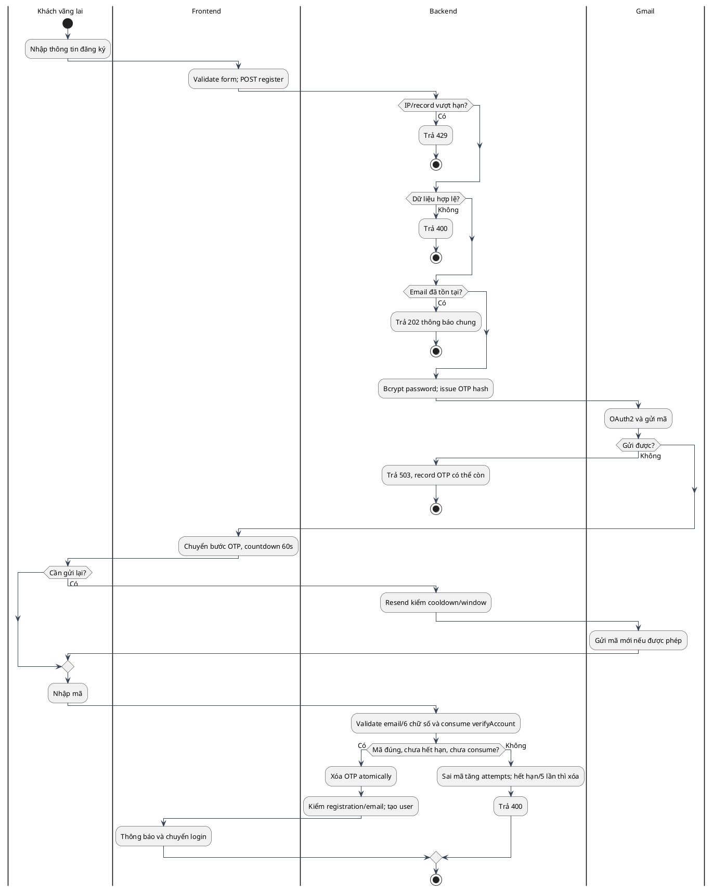

## Đăng nhập email/Google và quyền admin

**Phạm vi:** UC-04, UC-05, UC-06, UC-07.

**Mô tả:** Luồng điều khiển theo các handler/điều kiện trong code; các nhánh thành công, từ chối và lỗi được thể hiện ở các decision tương ứng.

**Nguồn:** `server/src/controllers/users.controller.js:92`; `client/src/Pages/LoginUser/LoginUser.jsx:1`; `server/src/routes/users.routes.js:15`; `server/src/controllers/users.controller.js:92`; `client/src/Pages/LoginUser/LoginUser.jsx:1`; `server/src/routes/users.routes.js:19`; `server/src/controllers/users.controller.js:166`; `client/src/store/Provider.jsx:1`; `server/src/routes/users.routes.js:16`; `server/src/routes/users.routes.js:17`; `server/src/routes/users.routes.js:30`; `server/src/controllers/users.controller.js:203`; `client/src/Components/Header/Header.jsx:1`; `server/src/routes/users.routes.js:18`.

Nguồn sơ đồ: [uml/act-02.puml](uml/act-02.puml). Chưa kiểm tra cú pháp bằng công cụ.

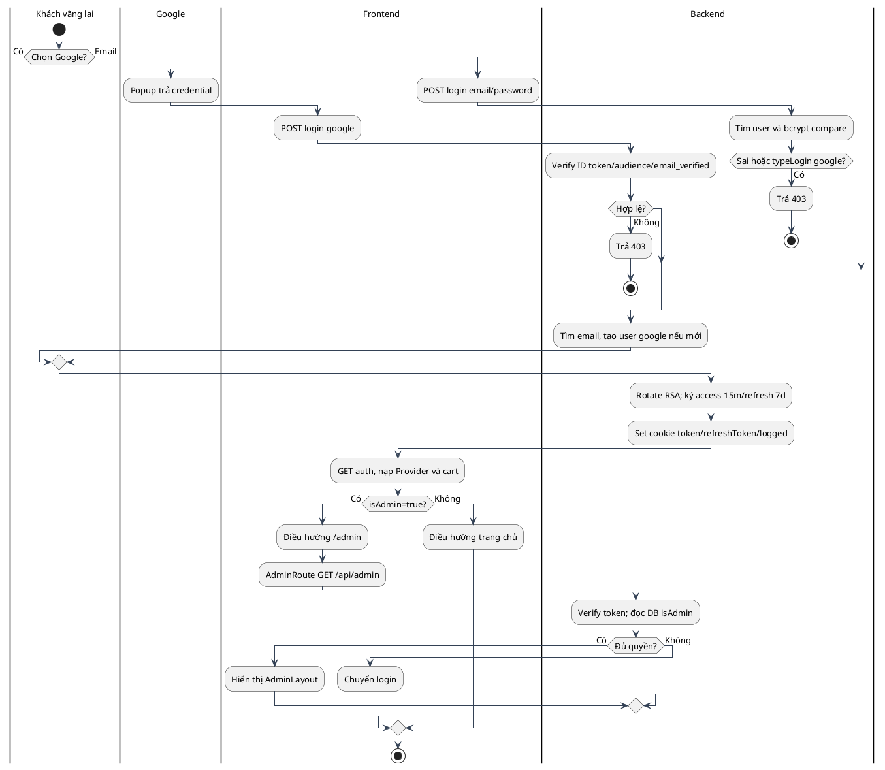

## Khôi phục mật khẩu

**Phạm vi:** UC-08.

**Mô tả:** Luồng điều khiển theo các handler/điều kiện trong code; các nhánh thành công, từ chối và lỗi được thể hiện ở các decision tương ứng.

**Nguồn:** `server/src/controllers/users.controller.js:414`; `client/src/Pages/ForgotPassword/ForgotPassword.jsx:1`; `server/src/routes/users.routes.js:22`; `server/src/routes/users.routes.js:23`; `server/src/routes/users.routes.js:24`; `server/src/services/otp.service.js:20`; `server/src/services/mail.service.js:21`.

Nguồn sơ đồ: [uml/act-03.puml](uml/act-03.puml). Chưa kiểm tra cú pháp bằng công cụ.

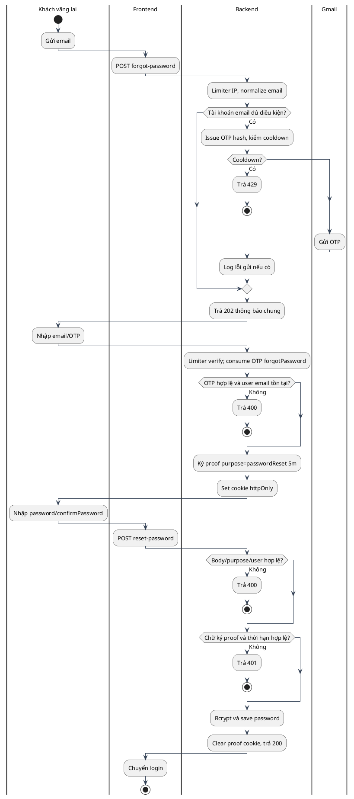

## Mua hàng từ catalog đến đơn

**Phạm vi:** UC-10, UC-11, UC-12, UC-14, UC-15, UC-16, UC-17, UC-18, UC-19, UC-20, UC-26, UC-27.

**Mô tả:** Luồng điều khiển theo các handler/điều kiện trong code; các nhánh thành công, từ chối và lỗi được thể hiện ở các decision tương ứng.

**Nguồn:** `server/src/services/product-catalog.service.js:37`; `client/src/Components/HomePage/ProductNew/ProductNew.jsx:1`; `server/src/routes/products.routes.js:9`; `server/src/routes/products.routes.js:10`; `server/src/routes/products.routes.js:14`; `server/src/routes/products.routes.js:15`; `server/src/services/catalog-browse.service.js:37`; `client/src/Pages/Category/Category.jsx:1`; `server/src/routes/products.routes.js:11`; `server/src/routes/products.routes.js:12`; `server/src/routes/products.routes.js:16`; `server/src/controllers/products.controller.js:118`; `client/src/Pages/DetailProduct/DetailProduct.jsx:1`; `server/src/routes/previewProduct.routes.js:9`; `server/src/routes/products.routes.js:13`; `server/src/controllers/cartUser.controller.js:114`; `client/src/Pages/Cart/CartUser.jsx:1`; `server/src/routes/cartUser.routes.js:9`; `server/src/controllers/cartUser.controller.js:31`; `client/src/Components/CardBody/CardBody.jsx:1`; `server/src/routes/cartUser.routes.js:8`; `server/src/controllers/cartUser.controller.js:196`; `client/src/Pages/Cart/CartUser.jsx:1`; `server/src/routes/cartUser.routes.js:11`; `server/src/controllers/cartUser.controller.js:160`; `client/src/Pages/Cart/CartUser.jsx:1`; `server/src/routes/cartUser.routes.js:10`; `server/src/controllers/cartUser.controller.js:235`; `client/src/Pages/CheckOut/CheckOut.jsx:1`; `server/src/routes/cartUser.routes.js:12`; `server/src/routes/coupon.routes.js:9`; `server/src/services/vnpay.service.js:132`; `client/src/Pages/CheckOut/CheckOut.jsx:1`; `server/src/routes/payments.route.js:7`; `server/src/services/vnpay.service.js:156`; `client/src/Pages/CheckOut/CheckOut.jsx:1`; `server/src/routes/payments.route.js:7`; `server/src/controllers/payments.controller.js:269`; `client/src/Pages/InfoUser/OrderUser/OrderUser.jsx:1`; `server/src/routes/payments.route.js:14`; `server/src/routes/payments.route.js:15`; `server/src/services/vnpay.service.js:327`; `client/src/Pages/InfoUser/OrderUser/OrderUser.jsx:1`; `server/src/routes/payments.route.js:16`.

Nguồn sơ đồ: [uml/act-04.puml](uml/act-04.puml). Chưa kiểm tra cú pháp bằng công cụ.

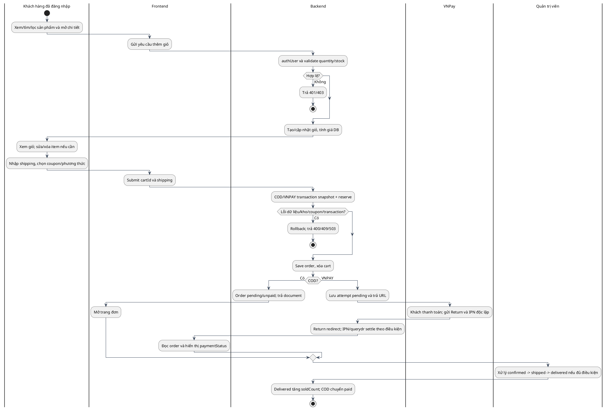

## VNPay: tạo URL, Return và xác nhận

**Phạm vi:** UC-20, UC-21, UC-22, UC-24.

**Mô tả:** Luồng điều khiển theo các handler/điều kiện trong code; các nhánh thành công, từ chối và lỗi được thể hiện ở các decision tương ứng.

**Nguồn:** `server/src/services/vnpay.service.js:156`; `client/src/Pages/CheckOut/CheckOut.jsx:1`; `server/src/routes/payments.route.js:7`; `server/src/controllers/payments.controller.js:148`; `client/src/Pages/PaymentSuccess/PaymentSuccess.jsx:1`; `server/src/routes/payments.route.js:8`; `server/src/routes/payments.route.js:9`; `server/src/services/vnpay.service.js:218`; `server/src/controllers/payments.controller.js:1`; `server/src/routes/payments.route.js:10`; `server/src/services/vnpay.service.js:232`; `client/src/Pages/PaymentSuccess/PaymentSuccess.jsx:1`; `server/src/routes/payments.route.js:12`.

Nguồn sơ đồ: [uml/act-05.puml](uml/act-05.puml). Chưa kiểm tra cú pháp bằng công cụ.

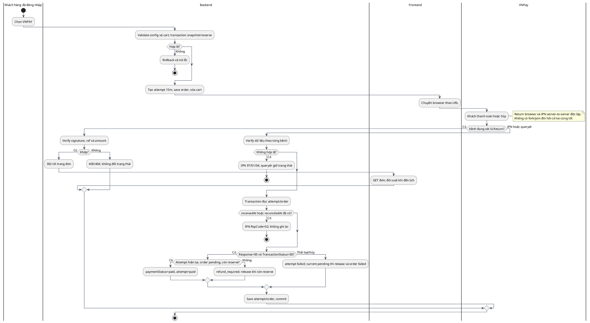

## VNPay: hết hạn, retry, đối soát và callback muộn

**Phạm vi:** UC-22, UC-23, UC-24.

**Mô tả:** Luồng điều khiển theo các handler/điều kiện trong code; các nhánh thành công, từ chối và lỗi được thể hiện ở các decision tương ứng.

**Nguồn:** `server/src/services/vnpay.service.js:218`; `server/src/controllers/payments.controller.js:1`; `server/src/routes/payments.route.js:10`; `server/src/services/vnpay.service.js:179`; `client/src/Pages/PaymentSuccess/PaymentSuccess.jsx:1`; `server/src/routes/payments.route.js:11`; `server/src/services/vnpay.service.js:232`; `client/src/Pages/PaymentSuccess/PaymentSuccess.jsx:1`; `server/src/routes/payments.route.js:12`.

Nguồn worker: `server/src/server.js:runPaymentExpiry`, `server/src/services/vnpay.service.js:expirePending`, `retry`, `settle`, `reconcile`.

Nguồn sơ đồ: [uml/act-06.puml](uml/act-06.puml). Chưa kiểm tra cú pháp bằng công cụ.

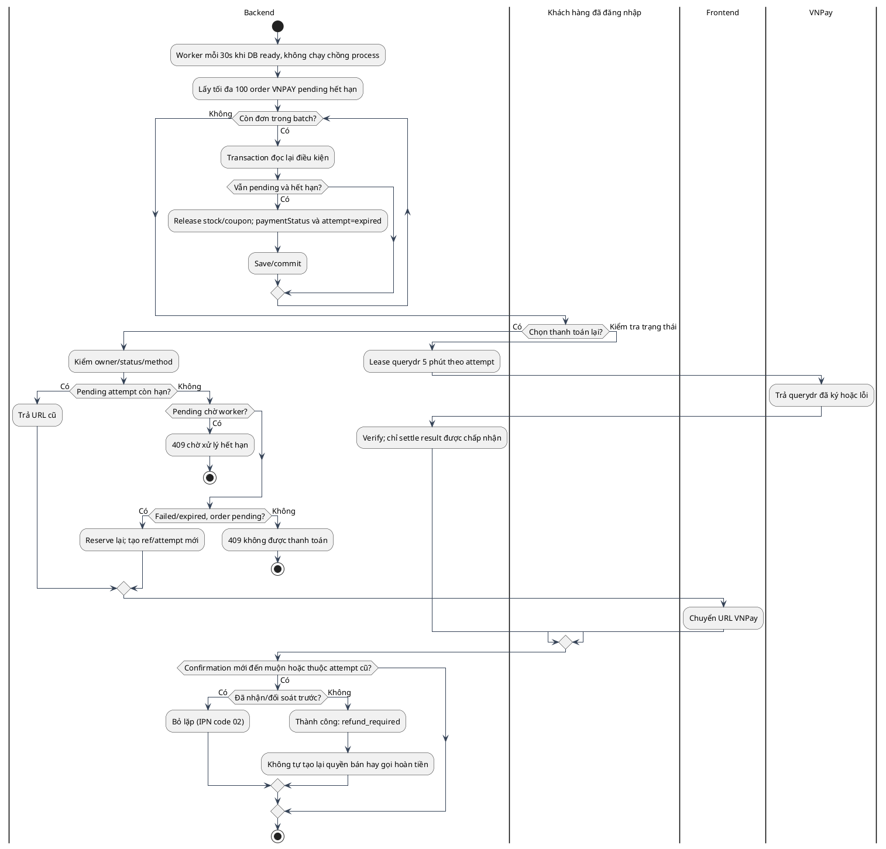

## Xử lý trạng thái đơn hàng phía admin

**Phạm vi:** UC-27, UC-37.

**Mô tả:** Luồng điều khiển theo các handler/điều kiện trong code; các nhánh thành công, từ chối và lỗi được thể hiện ở các decision tương ứng.

**Nguồn:** `server/src/services/vnpay.service.js:327`; `client/src/Pages/InfoUser/OrderUser/OrderUser.jsx:1`; `server/src/routes/payments.route.js:16`; `server/src/services/vnpay.service.js:327`; `client/src/Pages/Admin/Components/ManagerOrder/ManagerOrder.jsx:1`; `server/src/routes/payments.route.js:17`; `server/src/routes/payments.route.js:18`.

Nguồn sơ đồ: [uml/act-07.puml](uml/act-07.puml). Chưa kiểm tra cú pháp bằng công cụ.

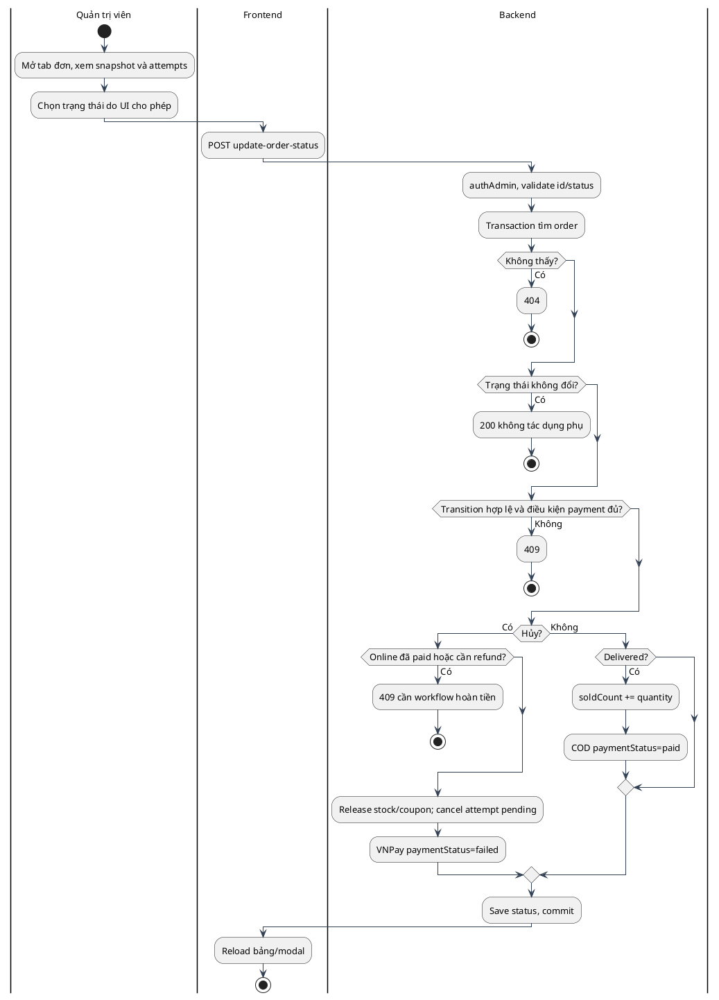

## Quản lý sản phẩm, danh mục, coupon

**Phạm vi:** UC-32, UC-33, UC-34, UC-39, UC-40.

**Mô tả:** Luồng điều khiển theo các handler/điều kiện trong code; các nhánh thành công, từ chối và lỗi được thể hiện ở các decision tương ứng.

**Nguồn:** `server/src/controllers/products.controller.js:17`; `client/src/Pages/Admin/Components/ManagerProduct/ManagerProduct.jsx:1`; `server/src/routes/products.routes.js:8`; `server/src/routes/products.routes.js:18`; `server/src/routes/products.routes.js:19`; `server/src/routes/products.routes.js:20`; `server/src/controllers/category.controller.js:40`; `client/src/Pages/Admin/Components/ManagerCategory/ManagerCategory.jsx:1`; `server/src/routes/category.routes.js:8`; `server/src/routes/category.routes.js:9`; `server/src/routes/category.routes.js:10`; `server/src/routes/category.routes.js:11`; `server/src/controllers/coupon.controller.js:10`; `client/src/Pages/Admin/Components/ManagerCoupon/CouponManagement.jsx:1`; `server/src/routes/coupon.routes.js:8`; `server/src/routes/coupon.routes.js:10`; `server/src/routes/coupon.routes.js:11`; `server/src/routes/coupon.routes.js:12`; `server/src/routes/index.js:1`; `client/src/Pages/Admin/Components/ManagerProduct/ManagerProduct.jsx:1`; `server/src/routes/blog.routes.js:22`; `server/src/routes/index.js:103`; `server/src/services/brand.service.js:4`; `client/src/Pages/Admin/Components/ManagerProduct/ManagerProduct.jsx:1`; `server/src/routes/brand.routes.js:8`.

Nguồn sơ đồ: [uml/act-08.puml](uml/act-08.puml). Chưa kiểm tra cú pháp bằng công cụ.

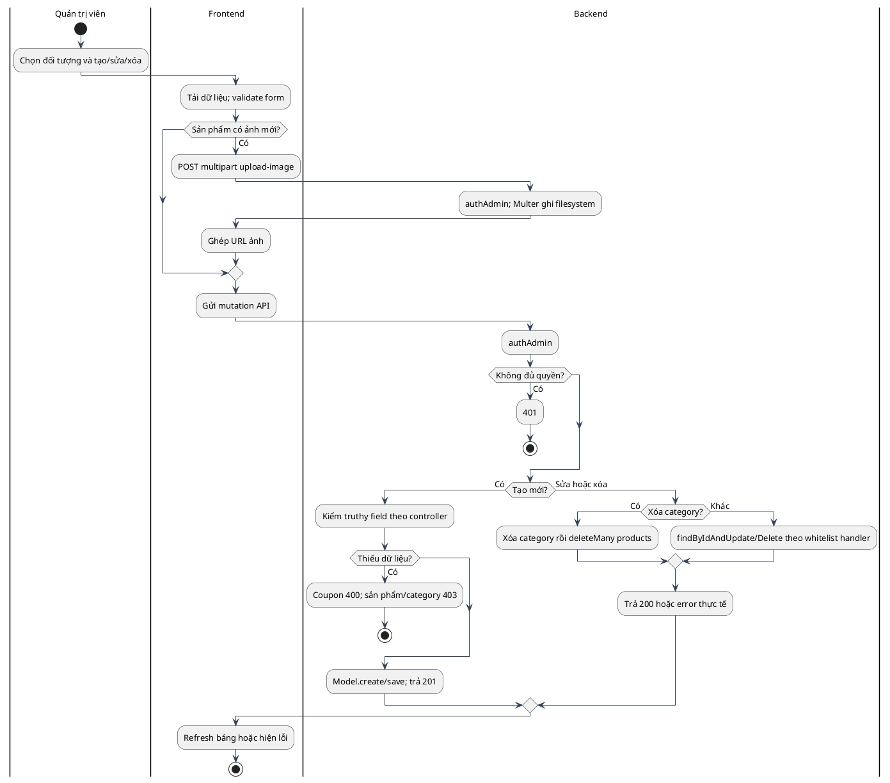

## Chat khách hàng và admin

**Phạm vi:** UC-29, UC-30.

**Mô tả:** Luồng điều khiển theo các handler/điều kiện trong code; các nhánh thành công, từ chối và lỗi được thể hiện ở các decision tương ứng.

**Nguồn:** `server/src/controllers/message.controller.js:15`; `client/src/Components/Messger/Messger.jsx:1`; `server/src/routes/message.routes.js:8`; `server/src/routes/message.routes.js:13`; `server/src/routes/message.routes.js:14`; `server/src/controllers/message.controller.js:42`; `client/src/Pages/Admin/Components/Messager/Messager.jsx:1`; `server/src/routes/message.routes.js:9`; `server/src/routes/message.routes.js:11`; `server/src/routes/message.routes.js:12`.

Nguồn sơ đồ: [uml/act-09.puml](uml/act-09.puml). Chưa kiểm tra cú pháp bằng công cụ.

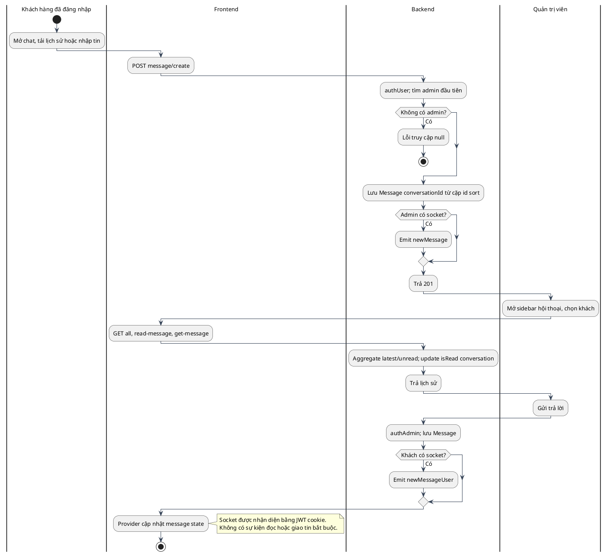

## Chatbot Gemini và nhánh lỗi

**Phạm vi:** UC-31.

**Mô tả:** Luồng điều khiển theo các handler/điều kiện trong code; các nhánh thành công, từ chối và lỗi được thể hiện ở các decision tương ứng.

**Nguồn:** `server/src/utils/chatbot.js:156`; `client/src/utils/Chatbot/Chatbot.jsx:1`; `server/src/server.js:64`.

Nguồn sơ đồ: [uml/act-10.puml](uml/act-10.puml). Chưa kiểm tra cú pháp bằng công cụ.

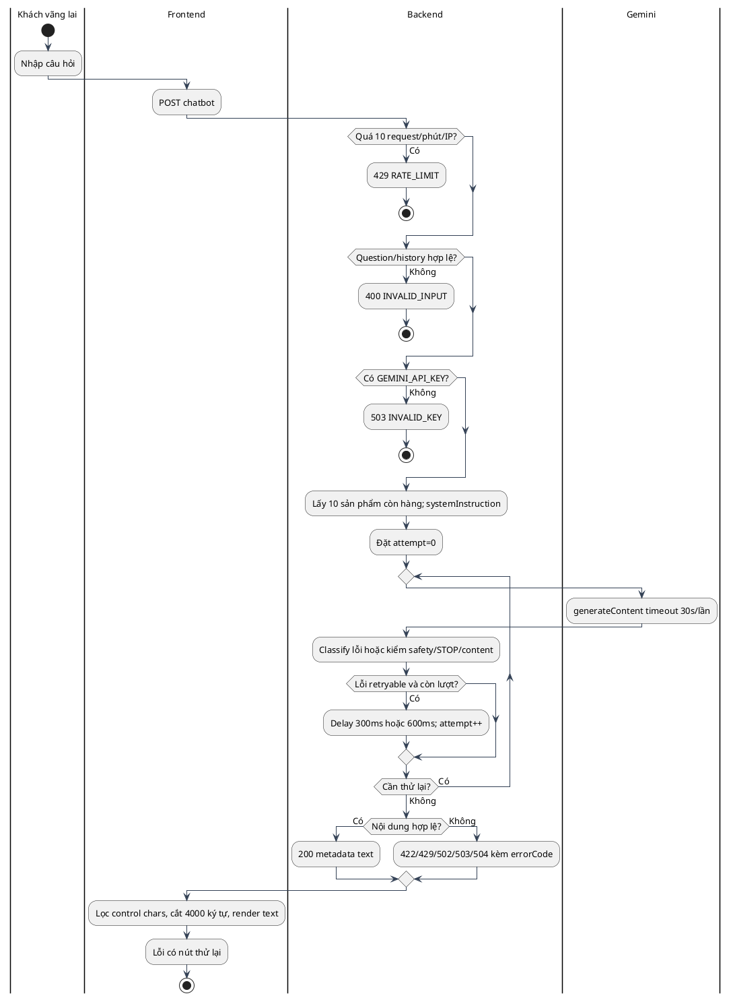

## Thống kê và phân quyền người dùng

**Phạm vi:** UC-36, UC-38.

**Mô tả:** Luồng điều khiển theo các handler/điều kiện trong code; các nhánh thành công, từ chối và lỗi được thể hiện ở các decision tương ứng.

**Nguồn:** `server/src/controllers/users.controller.js:401`; `client/src/Pages/Admin/Components/ManagerUser/ManagerUser.jsx:1`; `server/src/routes/users.routes.js:27`; `server/src/routes/users.routes.js:28`; `server/src/controllers/users.controller.js:225`; `client/src/Pages/Admin/Components/ManagerStatistical/ManagerStatistical.jsx:1`; `server/src/routes/users.routes.js:26`.

Nguồn sơ đồ: [uml/act-11.puml](uml/act-11.puml). Chưa kiểm tra cú pháp bằng công cụ.

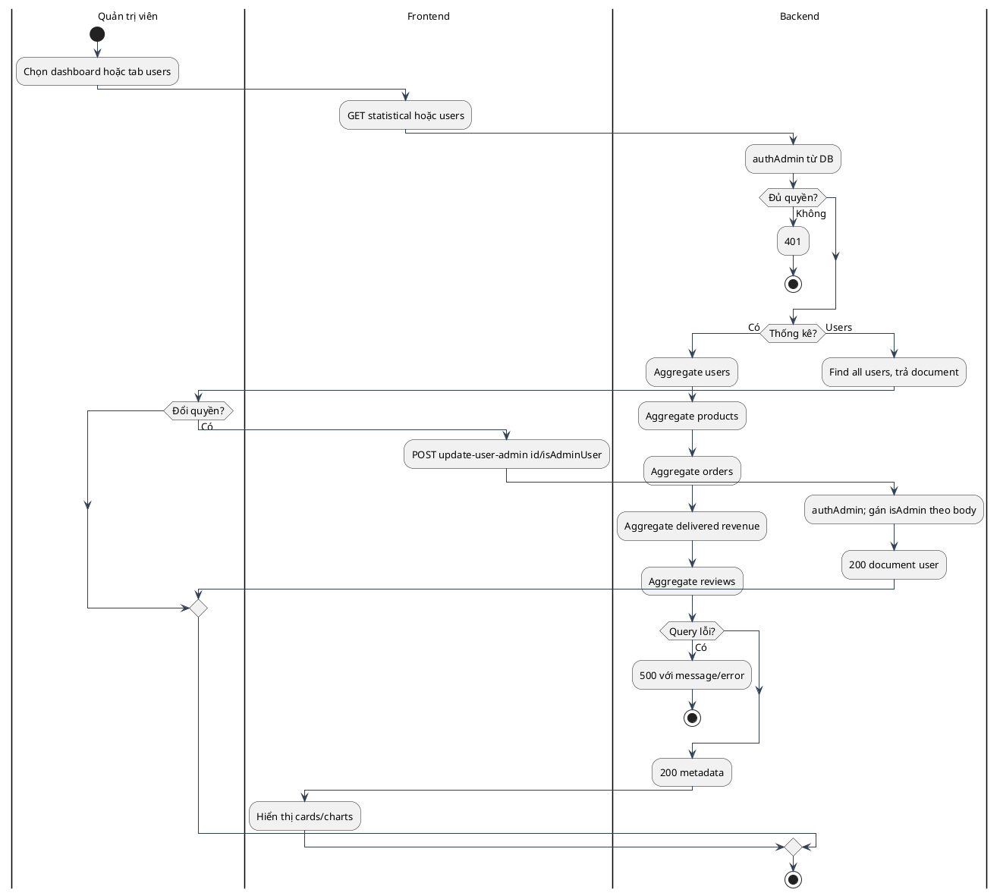

## Blog, upload và đọc nội dung

**Phạm vi:** UC-28, UC-35, UC-39.

**Mô tả:** Luồng điều khiển theo các handler/điều kiện trong code; các nhánh thành công, từ chối và lỗi được thể hiện ở các decision tương ứng.

**Nguồn:** `server/src/controllers/blog.controller.js:58`; `client/src/Pages/DetailBlog/DetailBlog.jsx:1`; `server/src/routes/blog.routes.js:24`; `server/src/routes/blog.routes.js:27`; `server/src/controllers/blog.controller.js:20`; `client/src/Pages/Admin/Components/ManagerBlog/BlogAdmin.jsx:1`; `server/src/routes/blog.routes.js:23`; `server/src/routes/blog.routes.js:25`; `server/src/routes/blog.routes.js:26`; `server/src/routes/index.js:1`; `client/src/Pages/Admin/Components/ManagerProduct/ManagerProduct.jsx:1`; `server/src/routes/blog.routes.js:22`; `server/src/routes/index.js:103`.

Nguồn sơ đồ: [uml/act-12.puml](uml/act-12.puml). Chưa kiểm tra cú pháp bằng công cụ.

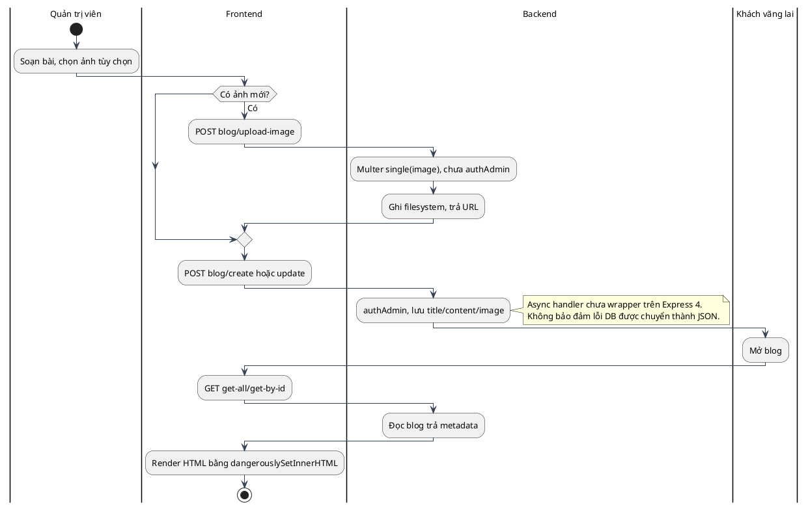

## MoMo legacy và callback

**Phạm vi:** UC-25.

**Mô tả:** Luồng điều khiển theo các handler/điều kiện trong code; các nhánh thành công, từ chối và lỗi được thể hiện ở các decision tương ứng.

**Nguồn:** `server/src/controllers/payments.controller.js:180`; `client/src/Pages/CheckOut/CheckOut.jsx:1`; `server/src/routes/payments.route.js:7`; `server/src/routes/payments.route.js:13`.

Nguồn sơ đồ: [uml/act-13.puml](uml/act-13.puml). Chưa kiểm tra cú pháp bằng công cụ.

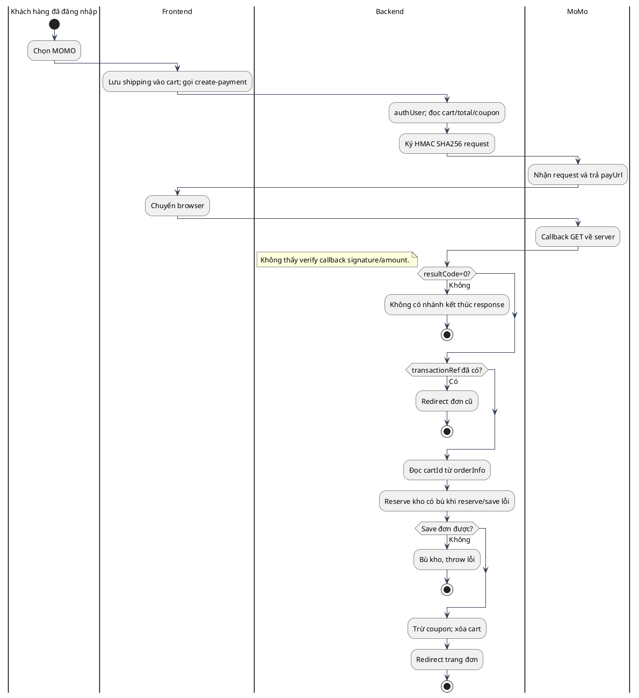

## State machine đơn hàng

Đây là transitions thực sự được khai báo trong vnpay.service; guard payment/ownership nằm trong changeStatus, không phải enum tự enforce chuyển trạng thái. Nguồn: `server/src/services/vnpay.service.js:transitions`, `changeStatus`; `client/src/Pages/Admin/Components/ManagerOrder/ManagerOrder.jsx:statusChoices`.

Nguồn sơ đồ: [uml/act-state-order.puml](uml/act-state-order.puml). Chưa kiểm tra cú pháp bằng công cụ.

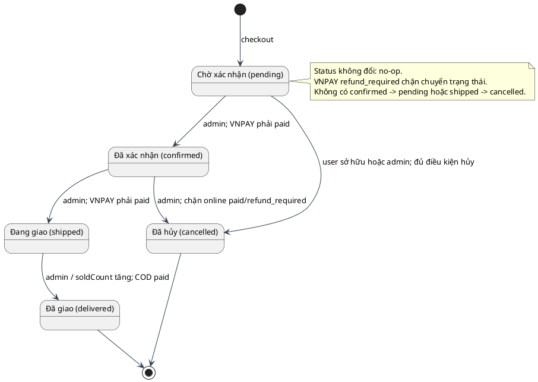

## State machine paymentStatus

Tách trạng thái thanh toán khỏi status giao hàng. Sơ đồ thể hiện các đường ghi trong checkout/settle/retry/expirePending/changeStatus, không suy diễn hệ thống hoàn tiền. Nguồn: `server/src/services/vnpay.service.js:checkout`, `settle`, `retry`, `expirePending`, `changeStatus`; `server/src/models/paymentAttempt.model.js:1`.

Nguồn sơ đồ: [uml/act-state-payment.puml](uml/act-state-payment.puml). Chưa kiểm tra cú pháp bằng công cụ.

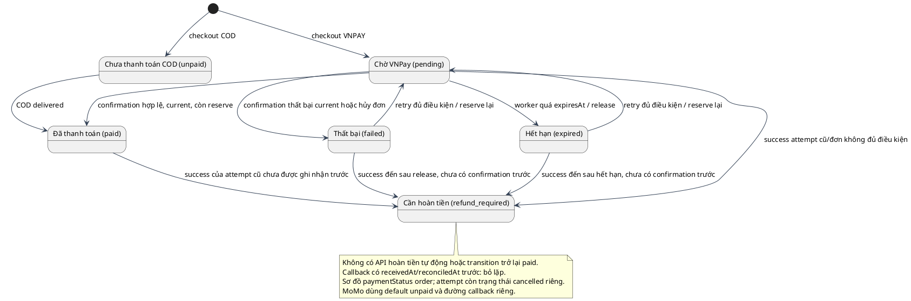

## Giả định và giới hạn

VNPay Return/IPN có thể tới theo bất kỳ thứ tự nào; code không bảo đảm cả hai sẽ đến. Hủy phía provider là confirmation không thành công; bỏ browser không tự phát callback, worker sẽ hết hạn. Đồng hồ/server/DB, IPN merchant setup và kết quả settlement thật đều cần xác minh bằng môi trường kiểm thử riêng. Không chạy thử trong nhiệm vụ.
